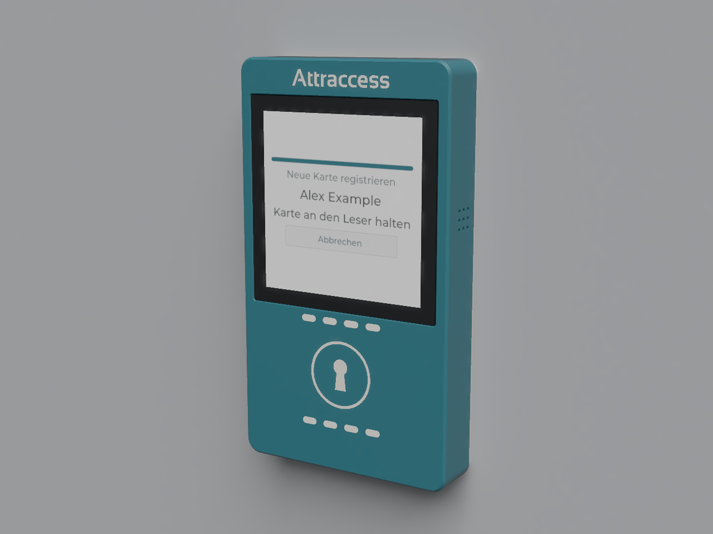
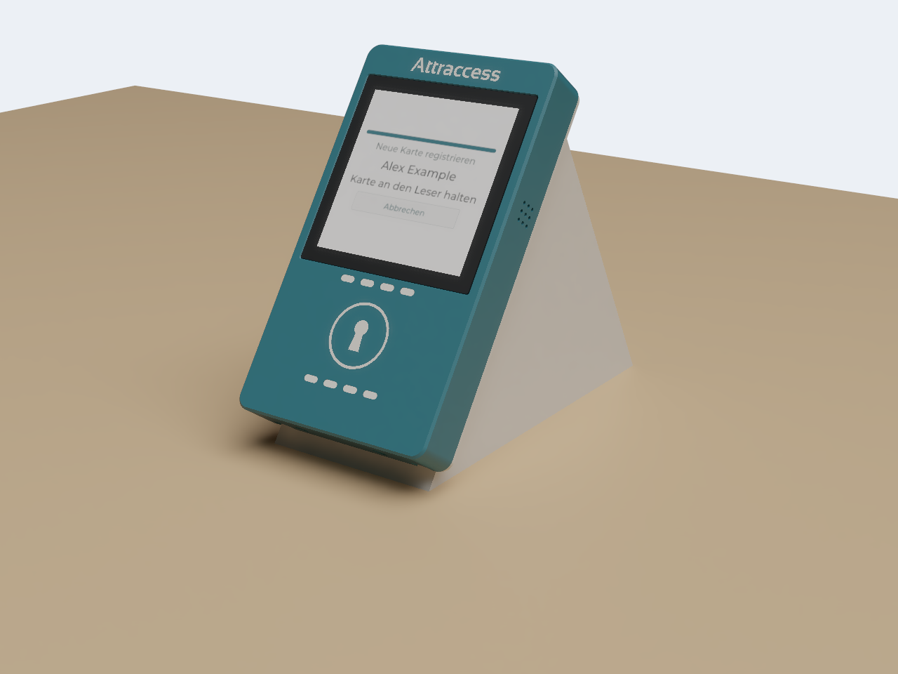
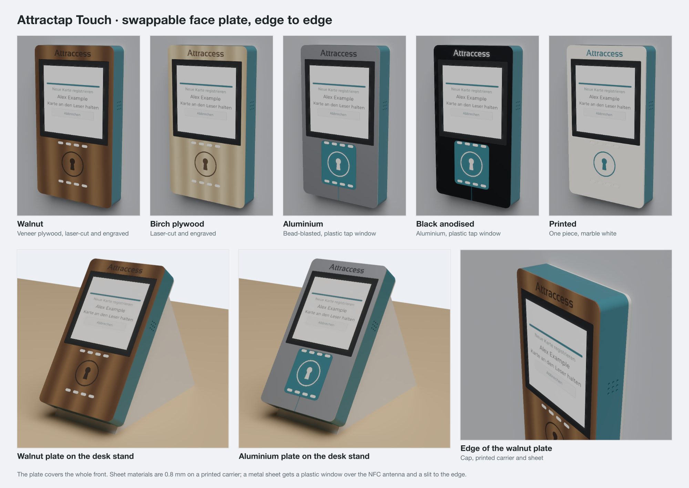

# Attractap Touch case

A 3D-printable case for the [Attractap Touch P4 board](../README.md), revision A (4-inch 480 × 480 touch display, NFC antenna on the board, Ethernet, DC jack, USB-C, buzzer, eight status LEDs). It hangs on a wall or stands on a desk, and the same reader fits both mounts.

| On the wall | On the desk stand |
| --- | --- |
|  |  |

> **Status: CAD only.** No part has been printed, sliced or test-fitted yet. Fits, screw lengths and the display dimensions are untested, and the display sits further from the board than the board's design notes allow; see [Not yet verified](#not-yet-verified).

## How it works

- **Cap**: the front shell. It carries the display, flush with the front, and the board. Eight light windows for the status LEDs, the Attraccess wordmark and a tap ring over the NFC antenna.
- **Dock**: the back plate. It is screwed to the wall (five holes; the lower pair matches the 60 mm spacing of a flush-mount box) or onto the stand.
- **Stand**: a hollow wedge for the desk. The reader leans back 35°.
- The cap hooks onto a 45° cleat at the top of the dock, swings shut and is locked by two M3 screws from below. Plugs and cables end up enclosed between cap and dock.
- A cable either disappears into the wall behind the dock or leaves through a notch at the bottom, where a cable tie on a saddle inside the cap takes the pull off the jack.
- Screws go into heat-set inserts. The reader comes off the wall with two screws, the board out of the cap with four more.

The [installation manual](manual/README.md) ([PDF](manual/attractap-installation-manual.pdf)) shows every step with figures: parts and hardware list, inserts, assembly, drilling template, cable routes, desk stand and service.

## What is in this folder

| Folder | Contents |
| --- | --- |
| [`cad/`](cad/) | The design (`attractap-touch-case.sc`, SolidCraft) and the files made from it: one 3MF and one STEP per part, the whole assembly as STEP, and a mock board and mock display for test fitting |
| [`cad/faceplate/`](cad/faceplate/) | A variant with a swappable face plate, see [below](#variant-swappable-face-plate) |
| [`board/`](board/) | STEP export of the board ([`../kicad/attractap-touch-p4.kicad_pcb`](../kicad/), revision A) that the case is built around. The design files embed the same model |
| [`logo/`](logo/) | The wordmark and keyhole outlines used for the logo inlays |
| [`manual/`](manual/) | The installation manual as Markdown and PDF, its figures, the SolidCraft file the figures are rendered from, and the scripts that make them |
| [`renders/`](renders/) | Renders of the case, a study of other materials (`finishes/`) and the face-plate variant (`faceplate/`) |

## Printing

The case is designed for ABS+ on a filament printer. Every part has one flat face to lie on and is meant to print without supports; none has been sliced yet, so that is unconfirmed. Each 3MF already lies on its print face.

| Part | File in `cad/` | Qty | Colour | Lies on |
| --- | --- | --- | --- | --- |
| Cap | `attractap-cap.3mf`, or `attractap-cap-multicolor.3mf` with the logo as separate objects for multi-colour printing | 1 | RAL 5021 | its front face |
| Dock | `attractap-dock.3mf` | 1 | Marble white | its back |
| Display frame | `attractap-display-frame.3mf` | 1 | Any | its board side |
| LED diffuser | `attractap-led-diffuser.3mf` | 2 | Natural or plain white | its board side |
| Stand (desk only) | `attractap-stand.3mf` | 1 | Marble white | its desk face |

`attractap-mock-pcb` and `attractap-mock-display` (3MF, STEP, STL) are stand-ins for the board and the display, to check the fit before the real parts are at hand. The mock display uses the assumed display dimensions listed below.

The hardware (heat-set inserts, screws, tape, cable ties) is listed in the [manual](manual/README.md#parts-hardware-and-tools).

## Variant: swappable face plate

`cad/faceplate/` holds a second design in which the whole front of the cap is a separate 2 mm plate, so the front can be printed, or made from a 0.8 mm sheet of wood or metal bonded to a printed carrier. The plate hooks in at the top and is pinned by two M2 × 12 screws from below. [How it clips in](renders/faceplate/how-it-clips-in.png) and [how a wood front is built up](renders/faceplate/wood-front-build-up.png) show the details.

- `attractap-touch-faceplate.sc` is built from the main design by the two step files in `cad/faceplate/tools/`.
- Print files: `attractap-fp-cap`, `attractap-fp-plate-printed` (one-piece printed plate), `attractap-fp-carrier` and `attractap-fp-tap-tile` (for sheet fronts).
- Cutting outlines for the sheet: `attractap-faceplate-sheet.svg`/`.dxf` for wood and other non-metals, `attractap-faceplate-sheet-metal.svg`/`.dxf` for metal. A metal sheet gets a window over the NFC antenna and a slit to the edge. The engraving for wordmark, tap ring and keyhole is not in these files yet.

The renders were made before the screw tabs moved to their current position; the outside is the same except for the two screw heads on the underside.

This variant is further from proven than the main case. The hooks are loaded across the print layers, their fit needs a test print, the display's flex cable has to reach 1.2 mm further, and reading cards through or beside a metal sheet is untested. A metal sheet also covers the Wi-Fi antenna in the strip above the display, which the board's design notes say to keep free of metal; expect it to need the Ethernet version or the external-antenna module.

## Other materials

`renders/finishes/` compares the same geometry rendered in aluminium, translucent resin and combinations ([comparison sheet](renders/finishes/finish-comparison.png)). These are looks only: no part was redesigned for milling or resin printing, and a metal cap would shield the NFC antenna and the radio module.

## Changing the design

The design files are SolidCraft documents (made with version 0.45.0).

- Coordinates: the origin is the centre of the display seen from the front, Z is 0 at the wall and the front face is at Z = `D`. A point (x, y) in the board's own coordinates, as used in its [design notes](../docs/design-notes.md#mechanics), is at case X = 43 − x and Y = 49.15 − y. In the coordinates of the KiCad file, where the board's corner is at (60, 30), that is X = 103 − x and Y = 79.15 − y.
- The depth stack is parametric (`plate_t`, `cav`, `pcb_t`, `disp_gap`, `disp_t`, `lens_t`, `tape_t`, `lens_recess`, `wall`). Positions in X and Y are plain numbers taken from the board.
- `manual/attractap-manual-scenes.sc` and `renders/finishes/attractap-finish-study.sc` are copies of the design with extra bodies for illustration. Print files are exported only from the designs in `cad/`.
- The 3MF files are saved lying on their print face. In SolidCraft 0.45.0 the option that lays parts on their marked print face had no effect, so each part is turned with a temporary move before the export.

The scripts are plain Python without dependencies; run them with `python3 -I`. They drive SolidCraft through its command-line tool (the path at the top of each script is the macOS one) or write step files for it, and use `rsvg-convert` for labels.

| Script | What it makes |
| --- | --- |
| `cad/faceplate/tools/plate_outline.py` | The sheet cutting outlines (SVG and DXF) |
| `renders/faceplate/tools/gen_faceplate.py` | Renders and print files of the face-plate variant |
| `renders/faceplate/tools/clip_figure.py` | The two explanatory figures of the face plate |
| `renders/finishes/tools/gen_finishes.py` | The material study renders |
| `renders/finishes/tools/sheet.py` | The two comparison sheets |
| `manual/tools/scenes.py`, `scenelib.py` | Scene and camera set-up and the labels of the manual's figures |
| `manual/tools/gen_hardware.py`, `gen_strain_relief.py`, `gen_wall_route.py` | Step files that add screws, inserts, cables and cable ties to the manual's scene file |
| `manual/tools/drill.py` | The drilling template |
| `manual/tools/build_pdf.py` | The manual PDF from `manual/README.md` (needs a Chromium-based browser) |

## Not yet verified

- **Nothing has been printed.** Printed fits, the swing-on motion and the strain relief are checked in CAD only.
- **Display dimensions.** Total thickness 3.8 mm, glass 1.3 mm and a corner radius of at least 1 mm are assumed, not measured. They decide whether the screen sits flush.
- **Display distance to the board, unresolved.** The board's [design notes](../docs/design-notes.md#display-mounting-and-flex) want the display at most about 1 mm in front of the board, so that its 25 mm flex can fold onto the connector, and give the flex about 1.5 mm of slack. This case holds the display 2 mm in front (3.2 mm in the face-plate variant), because solder joints stick out of the board behind the display: on the Ethernet version the jack J401 has 16 through-hole pins there, 11 of them behind the LCD's metal back, and the USB-C socket has its shell tabs under the edge of the glass. By estimate the 2 mm take about 1 mm of the flex's slack in the main case, and the face-plate variant takes more than there is. A smaller gap (parameter `disp_gap`) brings the metal back within reach of the jack's pins; a larger one needs a panel with a longer flex. Measure a real panel and how far the pins stick out before printing.
- **PoE module height.** Assumed 10 mm.
- **Outdoor use.** There are no seals, the buzzer holes and cable notches are open, and ABS+ ages in sunlight. Treat it as an indoor case.

The manual ends with the [full list](manual/README.md#not-yet-verified).
