# Den Attractap-Leser benutzen

Mit Ihrer RFID-Karte und dem Attractap-Touchdisplay können Sie die Nutzung einer Maschine starten oder beenden, eine Tür öffnen oder eine Aufsicht anfordern. Der Leser zeigt die ihm zugeordneten Maschinen und Türen sowie die für Sie verfügbaren Aktionen.

Sie benötigen eine RFID-Karte, die mit Ihrem Attraccess-Konto verknüpft ist. Wenn Sie noch keine haben, bitten Sie Ihre Administration, eine Karte für Sie zu registrieren.

## Mit der Karte anmelden

1. Halten Sie Ihre Karte an den Leser, bis Ihr Name oben auf dem Bildschirm erscheint.
2. Nehmen Sie die Karte weg. Sie bleiben angemeldet und können eine Maschine oder Tür aus der Liste auswählen.
3. Tippen Sie auf die Aktion **rechts**, um eine Ressource zu nutzen, oder auf ihren Namen **links**, um die Details zu öffnen.

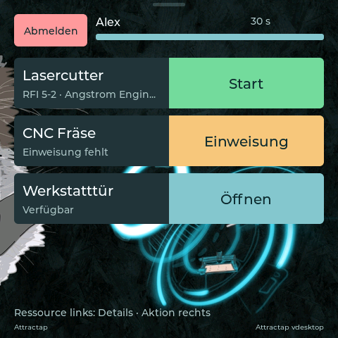

_Oben sehen Sie Ihren Namen und die verbleibende Zeit bis zur automatischen Abmeldung._

Sie können eine Ressource auch **vor der Anmeldung** auswählen. Tippen Sie auf ihren Namen und halten Sie Ihre Karte an den Leser, wenn Sie dazu aufgefordert werden. Nach der Anmeldung öffnen sich die Details. Mit dem Pfeil ganz links in der Kopfzeile gelangen Sie zurück zur Liste.

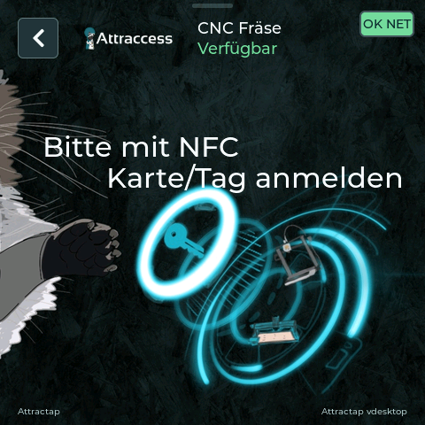

### Uhrzeit und Datum

Solange niemand angemeldet ist, dient der Leser auch als Uhr. Die Kartenaufforderung zeigt die aktuelle Uhrzeit und das Datum in großer Schrift, darunter **RFID-Karte auflegen**. Die Ressourcenliste zeigt beides oben an. Der Leser verwendet die Zeitzone Ihres Attraccess-Servers. Nach einem Neustart erscheint die Uhr, sobald der Leser mit dem Server verbunden ist; bis dahin zeigt er den gewohnten Anmeldetext. Bricht die Verbindung später ab, läuft die Uhr intern weiter. Das Display zeigt jedoch bis zur erneuten Verbindung den Initialisierungsbildschirm.

Während einer Unterbrechung läuft die UTC-Zeit mit dem zuletzt empfangenen Zeitzonenversatz des Servers weiter. Dieser Versatz bleibt unverändert: Sommerzeit- und Winterzeitwechsel oder eine Änderung der Serverzeitzone werden erst nach dem nächsten gültigen Zeitwert vom Server berücksichtigt.

Die Kartenaufforderung zeigt die Uhr auch dann, wenn die ausgewählte Ressource bereits verwendet wird und niemand am Leser angemeldet ist. Die Kopfzeile zeigt weiterhin den Namen der Person, die die Ressource verwendet. Nach der Anmeldung öffnen sich die gewohnten Ressourcendetails und Bedienelemente für die Sitzung.

## Eine Maschine starten oder eine Tür öffnen

Tippen Sie in der Ressourcenliste neben einer Maschine auf **Start** oder neben einer Tür auf **Öffnen**. Füllen Sie gegebenenfalls ein Formular aus oder lassen Sie die angeforderte Aufsicht bestätigen. Warten Sie anschließend auf das Ergebnis auf dem Display.

Während der Leser eine Aktion verarbeitet, sind die Bedienelemente kurzzeitig nicht verfügbar. Warten Sie, bis der Status der Ressource aktualisiert wurde, bevor Sie erneut tippen. Nach dem Start einer Maschine zeigt deren Zeile Ihren Namen und die Schaltfläche **Stop**.

### Ein Projekt auswählen

Um die Maschinennutzung einem Projekt zuzuordnen, öffnen Sie über den Namen der Maschine deren Details. Tippen Sie auf **Projekt wählen**, wählen Sie Ihr Projekt aus und starten Sie die Nutzung dort. Wenn Sie direkt aus der Liste starten, wird die Nutzung ohne Projekt erfasst.

### Ergebnisse, Meldungen und niedriges Guthaben

Der Leser zeigt Ergebnisse auf einem eigenen Vollbild und kehrt danach zu Ihrem Bildschirm zurück:

- Ein grüner Haken mit **Nutzung gestartet** oder **Nutzung beendet** und dem Ressourcennamen, oder **Aktion bestätigt** nach einer Tür- oder Ablauf-Schaltfläche. Tippen Sie irgendwo, um fortzufahren, oder warten Sie einen Moment.
- Der Bildschirm **Gesamtkosten dieser Sitzung** mit dem Betrag, wenn ein Stopp abgerechnet wird. Tippen Sie auf **OK** oder warten Sie.
- Ein rotes Kreuz mit **Anmeldung fehlgeschlagen**, wenn die Karte nicht akzeptiert wird. Tippen Sie auf **OK** oder halten Sie Ihre Karte erneut an den Leser.
- Eine Warnung mit Erklärung, zum Beispiel **Status nicht verfügbar**, wenn der Leser Sie abgemeldet hat, weil der Maschinenstatus nicht geladen wurde. Tippen Sie auf **OK**, warten Sie, oder halten Sie Ihre Karte an den Leser, um sich erneut anzumelden.

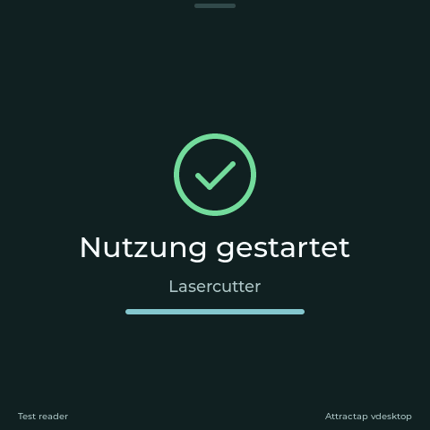

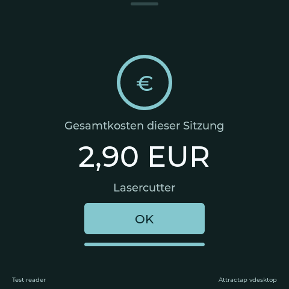

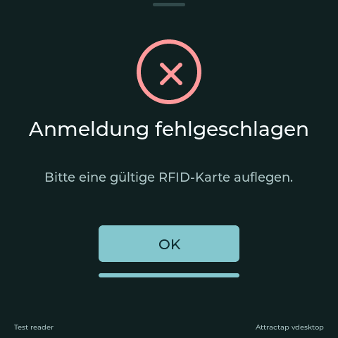

Schlägt die Aktion einer einzelnen Schaltfläche fehl, zum Beispiel **Start**, färbt sich die Schaltfläche selbst etwa vier Sekunden rot und zeigt **⚠ Fehlgeschlagen – erneut tippen** oder den Grund, zum Beispiel **⚠ Karte ist nicht aktiv**. Sie behält Größe und Platz, sonst bewegt sich nichts auf dem Bildschirm. Tippen Sie darauf, um es erneut zu versuchen. Lädt der Leser nach dem Fehler den Maschinenstatus neu, erscheint die Meldung erst, wenn der Status da ist. Bedeutet die Schaltfläche inzwischen etwas anderes, etwa weil jemand anderes die Maschine gestartet hat, entfällt die Meldung. Ist die Schaltfläche nicht mehr da, zeigt der Leser den Bildschirm **Etwas ist schiefgelaufen** mit dem Fehlercode und einer Schaltfläche **Zurück**.

Dasselbe gilt für Nutzungsformulare: Kann der Server eine Seite nicht annehmen, erscheint der Grund auf **Weiter** oder **Absenden**; lässt sich das Formular gar nicht laden, schließt es sich und der Grund erscheint auf der Schaltfläche, die es geöffnet hat.

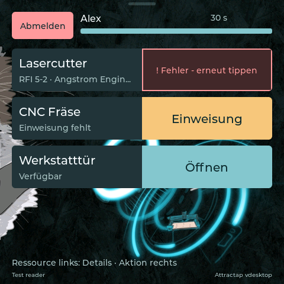

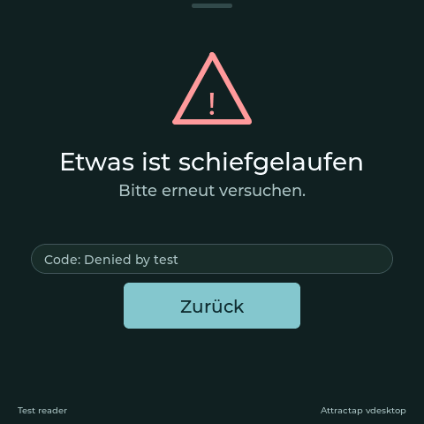

Schlägt eine Aktion wegen zu geringen Guthabens fehl und hat der Leser ein Zahlungsterminal, öffnet der Leser den Bildschirm **Unzureichendes Guthaben**. Geben Sie den Betrag in ganzen Euro auf dem Ziffernblock ein, tippen Sie auf **Aufladen** und fahren Sie am Zahlungsterminal fort, sobald **Aufladung gestartet** erscheint. Ein fehlender Betrag oder eine vom Server abgelehnte Aufladung erscheint wie bei einer fehlgeschlagenen Schaltfläche auf **Aufladen**; der eingegebene Betrag bleibt erhalten. **Abbrechen** bringt Sie zurück. Auch Nutzungsformulare und die Projektauswahl sind eigene Bildschirme. Meldet der Leser Sie währenddessen ab, wird der geöffnete Bildschirm wie jeder andere ersetzt.

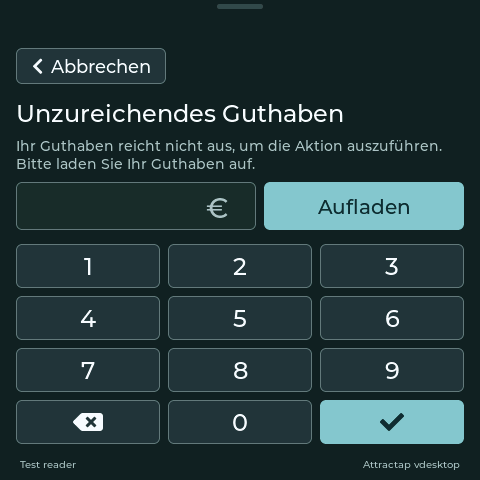

Der Neustart aus dem Wartungsmenü und das Ausschalten des Lesers (bei Geräten mit Ein/Aus-Taste) fragen auf einem eigenen Vollbild nach, mit **Abbrechen** und der Aktion nebeneinander.

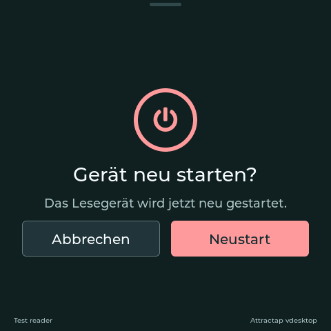

## Live-Statistiken ansehen

Tippen Sie nach der Anmeldung auf den Namen der Maschine, die Sie gerade nutzen. Die Details zeigen die Sitzungsdauer sowie **Aktuelle Nutzung** mit dem Energieverbrauch in **kWh**, der Betriebszeit und dem Status „Läuft“ oder „Leerlauf“. Die Messwerte werden alle 10 Sekunden aktualisiert, solange Sie die Details ansehen.

Energiewerte benötigen eine eingerichtete Verbrauchsmessung; die Betriebszeit benötigt die Erfassung des Betriebszustands. **Warte auf Messwert** bedeutet, dass kein aktueller Energiewert vorliegt. **Keine Daten** bedeutet, dass keine Betriebszeitdaten verfügbar sind. Fehlende Messwerte werden nicht als null gezählt. Die Statistiken verschwinden, sobald Sie die Nutzung beenden oder sich abmelden.

## Die Nutzung einer Maschine beenden

1. Falls Sie inzwischen abgemeldet wurden, halten Sie Ihre Karte erneut an den Leser.
2. Tippen Sie neben der von Ihnen genutzten Maschine auf **Stop**. Alternativ können Sie ihre Details öffnen und auf **Sitzung beenden** tippen.
3. Füllen Sie gegebenenfalls das Formular zum Nutzungsende aus und warten Sie, bis das Display das Ende der Nutzung bestätigt.

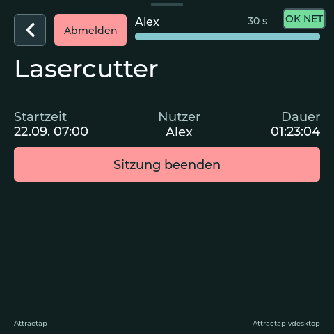

_Mit dem Zurück-Pfeil gelangen Sie wieder zur Ressourcenliste. Beim Wechsel zwischen Liste und Details bleiben Sie angemeldet._

> [!IMPORTANT]
> **Abmelden** beendet Ihre Anmeldung am Leser. Eine laufende Maschinennutzung wird dadurch **nicht** beendet. Nutzen Sie **Stop** oder **Sitzung beenden**, wenn Sie mit der Maschine fertig sind.

### Zusammenfassung zum Nutzungsende

Nach dem erfolgreichen Beenden Ihrer eigenen Maschinennutzung zeigt der Leser **Danke, {name}!** mit Ihrem Benutzernamen. **Dauer** ist die vergangene Sitzungszeit in Stunden, Minuten und Sekunden, nicht die Betriebszeit oder die abgerechneten Minuten. Die Stunden können 24 überschreiten. **Abgerechnet** zeigt den formatierten Endbetrag bei einer Gebühr ungleich null. Ohne Gebühr steht nur die Dauer mittig.

Die Zusammenfassung bleibt etwa **3,5 Sekunden** sichtbar und meldet Sie danach ab. Tippen Sie auf eine beliebige Stelle oder legen Sie erneut eine Karte auf, um sie früher zu schließen. Ein bereits gehaltener Finger oder eine bereits aufliegende Karte schließt sie nicht. Die Karte zum Schließen wird nicht zur Anmeldung verwendet; nehmen Sie sie weg und legen Sie sie zur Anmeldung erneut auf. Andere laufende Maschinennutzungen bleiben aktiv.

Das Beenden aus der Liste, aus den Details oder nach dem Absenden eines Pflichtformulars zeigt dieselbe Zusammenfassung. Bei einem fehlgeschlagenen Stop erscheint sie nicht. Wenn Sie als Administrator oder Einweiser die Sitzung einer anderen Person beenden, bleibt die bisherige Bestätigung erhalten und Sie bleiben angemeldet. Mit einem älteren Server ohne Zusammenfassungsdaten bleibt die bisherige Bestätigung erhalten.

Die Gerätebeschriftungen bleiben vorerst deutsch, einschließlich **Bis bald!**. Vorgesehene englische Entsprechungen: **Thanks, {name}!**, **Duration**, **Charged**, **See you soon!**.

## Ein erforderliches Formular ausfüllen

Ihre Organisation kann vor dem Start oder Ende einer Nutzung Angaben abfragen, zum Beispiel zum Zustand der Maschine oder zum verwendeten Material.

1. Tippen Sie auf das Feld, um eine Antwort einzugeben oder auszuwählen. Mit **\*** markierte Felder sind Pflichtfelder.
2. Tippen Sie auf **Weiter**, wenn es weitere Fragen gibt.
3. Tippen Sie bei der letzten Frage auf **Absenden** und warten Sie, bis die Aktion abgeschlossen ist.

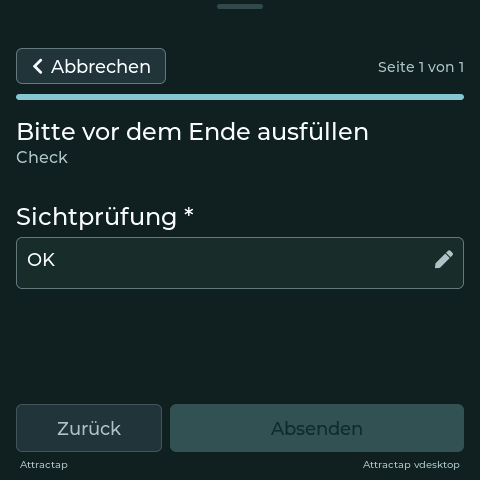

Zum Abbrechen tippen Sie auf das **×** oben rechts. Sie kehren zur Liste oder zu den Details zurück, von wo aus Sie die Aktion begonnen haben. Wenn Sie ein erforderliches Formular abbrechen, wird auch die Anfrage zum Starten oder Beenden der Nutzung abgebrochen.

## Eine Aufsicht anfordern

Steht auf der Schaltfläche **Aufsicht**, können Sie darüber eine beaufsichtigte Nutzung anfragen. Bitten Sie einen für diese Ressource berechtigten Einweiser, die Aufsicht zu übernehmen.

Die Aufsicht kann ihre Karte an den Leser halten oder die Anfrage in Attraccess auf dem Smartphone oder Computer bestätigen. Folgen Sie anschließend den weiteren Aufforderungen und warten Sie auf die Bestätigung, dass die Maschinennutzung gestartet wurde.

Tippen Sie auf **Abbrechen**, wenn Sie nicht fortfahren möchten. Sie bleiben angemeldet und können eine andere Ressource auswählen.

## Die weiteren Schaltflächen verstehen

Welche Aktion verfügbar ist, hängt von Ihren Berechtigungen und dem aktuellen Zustand der Ressource ab. Über den Ressourcennamen können Sie die Details auch dann öffnen, wenn Sie die Nutzung nicht starten können.

| Anzeige        | Was Sie tun können                                                                                                                                                       |
| -------------- | ------------------------------------------------------------------------------------------------------------------------------------------------------------------------ |
| **Einweisung** | Sie benötigen eine Einweisung, bevor Sie diese Ressource nutzen können. Öffnen Sie die Details für weitere Hinweise und wenden Sie sich an einen berechtigten Einweiser. |
| **Belegt**     | Eine andere Person nutzt die Maschine. Warten Sie, bis diese ihre Nutzung beendet hat.                                                                                   |
| **Übernehmen** | Die Übernahme der laufenden Nutzung ist erlaubt. Tippen Sie auf die Schaltfläche, um die Details zu öffnen, und wählen Sie dort die Übernahme aus.                       |
| **Gesperrt**   | Die Ressource ist wegen einer Wartung oder eines gemeldeten Problems für Sie nicht verfügbar. Wenden Sie sich an einen Wartenden oder Ressourcenverwalter für diese Ressource.                                      |
| **Laden ...**  | Der Leser prüft, welche Aktionen für Sie verfügbar sind. Warten Sie, bis sich die Schaltfläche aktualisiert.                                                             |

## Zum Schluss abmelden

Tippen Sie oben auf **Abmelden**. Der Leser meldet Sie auch nach **30 Sekunden ohne Bedienung** automatisch ab. Der Countdown und der Balken zeigen die verbleibende Zeit. Eine Berührung des Displays setzt den Countdown zurück. Während der Leser eine Aktion verarbeitet, pausiert er.

Nach der Abmeldung können Sie sich mit Ihrer Karte erneut anmelden. Eine laufende Maschinennutzung bleibt aktiv, auch wenn der Leser Sie automatisch abmeldet.

## Wenn etwas nicht funktioniert

| Was Sie sehen                              | Was Sie tun können                                                                                                                                                                                                |
| ------------------------------------------ | ----------------------------------------------------------------------------------------------------------------------------------------------------------------------------------------------------------------- |
| Die Anmeldung mit Ihrer Karte klappt nicht | Versuchen Sie es erneut und lassen Sie die Karte am Leser, bis die Anmeldung abgeschlossen ist. Falls es weiterhin nicht klappt, bitten Sie Ihre Administration zu prüfen, ob die Karte Ihrem Konto zugeordnet ist. |
| Start, Stop oder Türöffnung schlägt fehl   | Lesen Sie die Meldung und prüfen Sie vor einem erneuten Versuch den aktuellen Status der Ressource. Wenden Sie sich bei anhaltenden Problemen an einen Wartenden oder Ressourcenverwalter für diese Ressource.                                               |
| Der Leser verliert die Verbindung          | Warten Sie, bis die Verbindung wiederhergestellt ist, und melden Sie sich erneut an. Ein Verbindungsabbruch beendet keine laufende Maschinennutzung.                                                              |

## Weiterführende Anleitungen

- [Ressourcen nutzen](end-user/using-resources.md) – Maschinen und Werkzeuge über die Attraccess-App nutzen
- [RFID-Karten](attractap/rfid-cards.md) – Karten registrieren und verwalten
- [Einweisungen](resources/introductions.md) – Wie Sie Zugang zu einer Ressource erhalten
