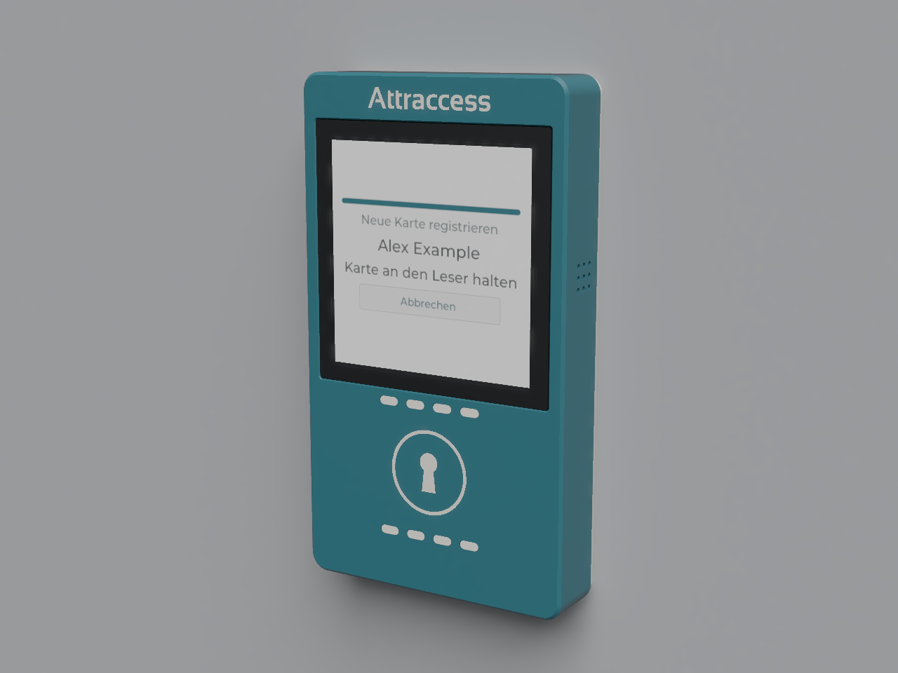
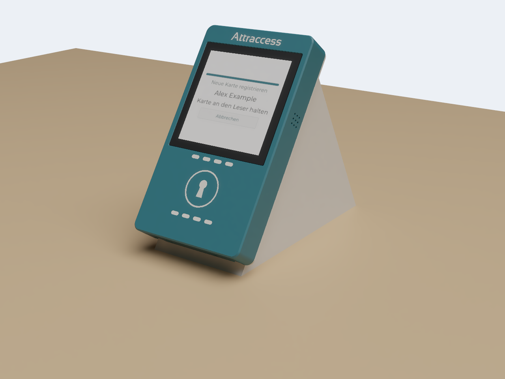

# Gehäuse
<!-- llms-description: Das 3D-druckbare Wand- und Tischgehäuse des Attractap-Touch-P4-Lesers: wie es funktioniert, alle Druck- und CAD-Dateien, wie man es druckt und ändert und was noch nicht geprüft ist. -->

Ein 3D-druckbares Gehäuse für die [Attractap-Touch-P4-Platine](hardware/touch-p4/overview.md), für alle,
die es drucken, zusammenbauen oder ändern. Es hängt an der Wand oder steht auf einem Tisch; derselbe Leser
passt in beide. Noch nichts wurde gedruckt oder anprobiert: siehe [Noch nicht geprüft](#noch-nicht-geprüft).

| An der Wand | Auf dem Tischständer |
| --- | --- |
|  |  |

## So funktioniert es

- **Kappe**: die vordere Schale. Sie trägt das Display und die Platine; ihre Front ist eine schlichte,
  1,4 mm dicke Wand.
- **Displayrahmen**: eine gedruckte Schale, 2,9 mm tief, zwischen der Platine und der Frontwand der Kappe. Das
  Display ist über die ganze Metallrückseite des LCD in sie geklebt, nicht am Glasrand.
  - **Boden.** 1,5 mm dick, auf der Platine. 0,2 mm doppelseitiges Klebeband darauf (`back_tape_t`) hält die
    Metallrückseite, sodass das Display auf dem Boden aufliegt, wenn auf den Bildschirm gedrückt wird. Die
    Vorderseite des Glases liegt bei Boden + Klebeband + `disp_t`, 0,1 mm unter der Vorderseite der Frontplatte.
  - **Öffnungen im Boden.** Eine breite für das gefaltete Flexkabel des Displays, am unteren Rand des Displays
    offen, damit die Faltung hineingleitet (die Fläche des Flexkabels plus 1 mm, Schlitz eingeschlossen); ein
    7 mm großes quadratisches Loch über jedem der vier Masse-Pads der Platine, damit die leitfähigen Dichtungen
    die Metallrückseite erreichen; Aussparungen über den Pins der Ethernet-Buchse und den Schirmlaschen der
    USB-C-Buchse, jeweils 1 mm größer als die Pads.
  - **Tasche.** Wände um das LCD-Modul, 0,4 mm pro Seite (wie beim alten Rahmen, der passte), richten es beim Einkleben aus. Die Tasche ist unten
    offen, wo sich das Flexkabel um die Kante faltet.
  - **Rand.** Er sitzt mit 0,1 mm pro Seite im Bildschirmfenster der Kappe und richtet den Rahmen seitlich aus.
    Er trägt kein Klebeband und bleibt 1,1 mm unter dem Glas (`rim_gap`); seine Öffnung von 77,3 mm lässt die
    Kanten des Touch-Sensors frei.
  - **Kein Spiel in der Tiefe.** Der Rahmen ist so tief wie der Raum zwischen Platine und Frontwand der Kappe:
    Die auf ihre Schraubdome geschraubte Platine klemmt ihn gegen die Wand.
- **Frontplatte**: eine 1 mm dicke Abdeckung über die ganze Front, von fünf Magneten an der Kappe gehalten,
  ohne Kleber oder Klebeband; das Displayglas liegt bündig mit ihr. Fünf Stahlscheiben auf ihrer Rückseite
  liegen über Magneten, die in der Frontwand der Kappe verborgen sind, so lassen sich Frontplatten von Hand
  tauschen (siehe [Frontplatten-Schnittstelle](#frontplatten-schnittstelle)). Standardmäßig ist sie schlicht, mit einem weißen Streifen von der Tap-Kachel bis zur
  Unterkante. Das Logo ist Sache der Frontplatte: Die gedruckte gibt es als zweite Datei mit eingelegtem
  Attraccess-Schriftzug, andere Frontplatten (Aluminium, Holz, das Logo eines Kunden) bringen ihr eigenes mit.
  Leser werden mit dem Attraccess-Schriftzug ausgeliefert, sofern ein Kunde nichts anderes wünscht.
- **Tap-Kachel**: das Kartenziel über der NFC-Antenne, 40,8 mm im Quadrat und 1,8 mm über der Frontplatte:
  eine schwarze Oberseite mit weißem Schlüsselloch auf einem weißen Körper. Ihr Flansch sitzt hinter der
  Frontwand der Kappe, so lässt sie sich von außen nicht abhebeln.
  - **Licht.** Die 16 LEDs der Platine bilden einen quadratischen Ring, auf jeder Seite 21,4 mm von der Mitte
    der Kachel, 10,7 mm voneinander entfernt. Der weiße Rand um die schwarze Oberseite ist 2 mm breit
    (21,4 ± 1 mm von der Mitte) und liegt genau über ihnen.
  - **Lichtkanal.** Die LEDs leuchten in einen Kanal in der Rückseite der Kachel, 2,3 mm breit und 2,5 mm tief,
    der um den ganzen Ring läuft. Seine weißen Wände leiten das Licht seitlich zwischen die LEDs, und zwischen
    Kanal und Rand liegen nur 2,8 mm weißer Kunststoff, etwa halb so viel wie bei einer massiven Kachel.
  - **Kern.** Innerhalb des Rings bleibt die Kachel weiß. In weißem Kunststoff wird Licht gestreut, nicht
    geführt: Ein weißer Kern wirft, was nach innen streut, zum Rand zurück, ein schwarzer würde es schlucken
    und den Rand dunkler machen. Die schwarze Oberseite verdeckt den Kern.
  - **Halt für die Platine.** Die Kachel ist zwischen der Frontwand der Kappe und der Platine eingeklemmt,
    ihre Rückseite liegt rund um die NFC-Schleife flach auf der Platine. So hält sie die Ecke der Platine, die
    keine Schraube hat (von vorn gesehen unten links). Von den beiden Platinenschrauben rechts der Kachel (von
    vorn gesehen) sitzt die obere in einer Kerbe im Flansch, die untere bleibt frei von seiner gerundeten Ecke.
- **Dock**: die Rückplatte, 13,9 mm von der Bestückungsseite der Platine entfernt. Sie wird an die Wand
  geschraubt (fünf Löcher; das untere Paar entspricht dem 60-mm-Abstand einer Unterputzdose) oder auf den
  Ständer. Unter der Ethernet-Buchse und dem PoE-Modul hat die Platte 0,8 mm tiefe Aussparungen und unter
  den beiden Schirmfedern der Buchse ein durchgehendes Fenster.
- **Dock-Erkennung**: Die Platine weiß, wann sie abgenommen wird. Ein Näherungssensor misst das
  Infrarotlicht, das die glatte Innenseite des Docks reflektiert, und ein Hall-Schalter erfasst einen
  Magneten von 10 x 3 mm, der in einem Ring auf dieser Fläche sitzt.
- **Ständer**: ein hohler Keil für den Tisch. Der Leser lehnt sich um 35° zurück.
- Die Kappe hakt an einer 45°-Leiste am oberen Rand des Docks ein, schwenkt zu und wird von unten mit
  zwei M3-Schrauben gesichert. Stecker und Kabel sind danach zwischen Kappe und Dock eingeschlossen.
- Ein Kabel verschwindet entweder in der Wand hinter dem Dock oder verlässt das Gerät durch eine Aussparung
  unten, wo ein Kabelbinder auf einem Sattel in der Kappe den Zug von der Buchse nimmt.
- Schrauben gehen in Einschmelzmuttern. Der Leser lässt sich mit zwei Schrauben von der Wand nehmen, die
  Platine mit vier weiteren aus der Kappe.

## Frontplatten-Schnittstelle

Was jede Frontplatte braucht, damit sie passt (gedruckt, Aluminium, Holz oder anderes). Positionen in mm
von der Mitte des Displays, von vorn gesehen: X nach rechts, Y nach oben. Logo und Motiv sind Sache der
Frontplatte.

| Merkmal | Maß und Lage |
| --- | --- |
| Umriss | 94,8 x 166,3 mm, Eckradius 6 mm, Mitte bei X 0, Y -26,1 (der Umriss der Kappe). Eine Fase von 0,4 mm an der vorderen Kante ist freigestellt |
| Dicke | 1,0 mm. Das Displayglas liegt 0,1 mm unter der Vorderseite einer 1 mm dicken Platte; bei einer dickeren Platte versinkt es |
| Displayfenster | 84,8 mm im Quadrat, Eckradius 1 mm, Mitte bei X 0, Y 0 |
| Öffnung für die Kachel | 45,2 mm im Quadrat, Eckradius 6,2 mm, Mitte bei X 0, Y -67,85. Die Tap-Kachel steht durch sie 1,8 mm über der Platte |
| Schlitz für den Streifen | 2 mm breit (X -1 bis 1), von der Öffnung für die Kachel nach unten durch die Unterkante. Bei einer Metallplatte nötig (siehe unten); eine gedruckte Platte füllt ihn mit ihrem weißen Streifen |
| Stahlscheiben | Fünf, mit der Mitte bei (-28,3, 48,8), (-39,5, -60), (39,5, -60), (-39,5, -88) und (39,5, -88). Von den Kanten der Platte: die obere 19,1 mm von der linken und 8,25 mm von der oberen Kante, die vier seitlichen 7,9 mm von der linken oder rechten Kante und 49,25 oder 21,25 mm von der Unterkante |
| Größe der Scheiben | Höchstens 9,4 mm Durchmesser (die Taschen der Kappe sind 9,6 mm weit und 0,7 mm tief). Eine Scheibe darf höchstens 0,6 mm über die Rückseite der Platte stehen, Kleber eingeschlossen; sonst darf nichts über die Rückseite stehen |
| Hebelkerbe | In der Unterseite der Kappe, X 6 bis 18, direkt hinter der Unterkante der Platte. Die Unterkante der Platte muss dort gerade und vollständig sein |

- **Scheiben.** Sie müssen aus magnetischem Stahl sein: verzinkt oder blank, nicht rostfrei (Edelstahl A2
  und A4 reagiert kaum auf einen Magneten). Die gedruckte Platte nimmt Unterlegscheiben DIN 125 / ISO 7089
  M4 (9 mm Durchmesser, 0,8 mm dick) in Vertiefungen von 9,4 mm Durchmesser und 0,4 mm Tiefe auf; vor
  ihnen bleiben 0,6 mm Platte. Eine Platte ohne Vertiefungen nimmt Scheiben ISO 7092 M4 (8 mm, 0,5 mm),
  flach aufgeklebt, oder M4-Scheiben in mindestens 0,3 mm tiefen Vertiefungen.
- **Scheiben aufkleben.** Sekundenkleber-Gel oder Zweikomponenten-Epoxid. Bei einer Platte ohne
  Vertiefungen die Scheiben in die Taschen der Kappe legen (die Magnete halten sie), auf jede einen kleinen
  Tropfen Kleber geben, die Platte bündig mit den Kanten der Kappe aufdrücken und aushärten lassen. Kein
  Kleber auf die Kappe.
- **Haltekraft.** Die Magnete sind Neodym-Scheiben 10 x 3 mm (N42), dieselben wie im Dock. Jeder sitzt hinter
  0,4 mm der Frontwand der Kappe, eine Scheibe in einer 0,4 mm tiefen Vertiefung ist also etwa 0,65 mm von
  ihm entfernt. Bei diesem Abstand zöge ein Magnet etwa 8 N an dickem Stahl (die 17,7 N des Herstellers bei
  Kontakt, mit einem Modell des Scheibenmagneten umgerechnet). Eine dünne Scheibe, kleiner als der Magnet,
  nimmt davon schätzungsweise 40 bis 60 %: etwa 3 bis 5 N pro Magnet, 16 bis 24 N für die Platte. Eine
  gedruckte Platte wiegt etwa 8 g, eine aus 1 mm Aluminium etwa 18 g; der Zug ist also mehr als 80-mal ihr
  Gewicht. Die Scheiben in ihren Taschen hindern die Platte außerdem am Verrutschen. An der Kerbe angehoben,
  löst sich die Platte paarweise von den Magneten, mit etwa 6 bis 10 N. Die Schätzung ist nicht gemessen.
- **Metallplatten.** Um die Öffnung für die Kachel ist eine Metallplatte ein geschlossener Ring direkt über
  der NFC-Schleife. Er wirkte als Kurzschlusswindung und nähme dem Leser sein Feld; deshalb ist auch das
  Kupfer der Platine um die Schleife an einer Stelle offen ([Designnotizen](hardware/touch-p4/design-notes.md#nfc)).
  Der Schlitz für den Streifen öffnet diesen Ring; lassen Sie ihn offen oder füllen Sie ihn mit etwas, das
  nicht leitet. Eine 1 mm dicke Aluminiumplatte über
  die ganze Front, nur mit Displayfenster und Kachelöffnung, braucht kein Fenster für die WLAN-Antenne: Im
  Vollwellenmodell (27. November 2026, Ersatzantenne, das Gehäuse in seiner jetzigen Form) kostet sie bei 2,4 GHz
  nichts und bei 5 GHz 0,1 bis 1,1 dB; ein Fenster über dem Display holt höchstens 0,3 dB zurück. Schneiden Sie
  keine zur Oberkante offene Kerbe über der Antenne aus: Sie verdirbt die Anpassung bei 2,4 GHz. Die 1,5 bis
  1,9 dB in den Notizen zur [Antenne](hardware/touch-p4/design-notes.md#antenne) gelten für eine ältere, kürzere
  Platte am alten Gehäuse. Prüfen Sie eine Metallplatte mit einem Reichweitentest an der echten Platine. Die Scheiben halten zu beidem Abstand: mindestens
  17 mm zum Kupfer der NFC-Schleife und 30 mm zur Antenne.
- **Wo die Magnete sitzen.** Sie meiden die NFC-Schleife (35 x 37 mm um die Mitte der Kachel), die
  WLAN-Antenne (oben rechts hinter dem Streifen über dem Display), den Buzzer (X 36,6, Y -2,85) und den
  Hall-Schalter U703 (X 30,5, Y 10,95), der den Magneten im Dock erkennt. Alle fünf zusammen ergeben am
  Schalter höchstens etwa 0,24 mT (Dipol-Schätzung, jeder Magnet in der ungünstigsten Richtung). Der Schalter
  (DRV5032FA) schaltet bei 1,5 bis 4,8 mT ein und frühestens unter 0,5 mT wieder aus; die Magnete der
  Frontplatte können ihn also weder auslösen noch eingeschaltet halten, wenn der Leser das Dock verlässt.
  Die obere rechte Ecke hat keinen Magneten: Antenne und eine Platinenschraube lassen dort keinen Platz.

Die [Installationsanleitung](hardware/touch-p4/installation-manual.md) ([PDF](_media/hardware/touch-p4/attractap-installation-manual-de.pdf ':ignore'))
zeigt jeden Schritt mit Abbildungen: Teile- und Hardwareliste, Einschmelzmuttern, Montage, Bohrschablone,
Kabelwege, Tischständer und Wartung.

## Dateien

Alle Dateien liegen in [`apps/attractap/hardware/touch-p4/case/`](https://github.com/Attraccess/Attraccess/tree/main/apps/attractap/hardware/touch-p4/case). Sie stehen unter der
[nichtkommerziellen Hardware-Lizenz](https://github.com/Attraccess/Attraccess/blob/main/apps/attractap/hardware/LICENSE.md): Das Design und gedruckte Gehäuse dürfen nicht verkauft werden (siehe [Lizenz](hardware/touch-p4/overview.md#lizenz)).

### Druckdateien

Jede 3MF-Datei liegt bereits auf ihrer Druckfläche. Drucken Sie sie in ABS+ (siehe [Drucken](#drucken)).

| Teil | Druckdatei | CAD | Anz. | Farbe | Liegt auf |
| --- | --- | --- | --- | --- | --- |
| Kappe | [`attractap-cap.3mf`](https://github.com/Attraccess/Attraccess/blob/main/apps/attractap/hardware/touch-p4/case/cad/attractap-cap.3mf) | [STEP](https://github.com/Attraccess/Attraccess/blob/main/apps/attractap/hardware/touch-p4/case/cad/attractap-cap.step) | 1 | RAL 5021 | ihrer Vorderseite |
| Frontplatte | [`attractap-faceplate.3mf`](https://github.com/Attraccess/Attraccess/blob/main/apps/attractap/hardware/touch-p4/case/cad/attractap-faceplate.3mf), mit Schriftzug [`attractap-faceplate-logo.3mf`](https://github.com/Attraccess/Attraccess/blob/main/apps/attractap/hardware/touch-p4/case/cad/attractap-faceplate-logo.3mf) | [STEP](https://github.com/Attraccess/Attraccess/blob/main/apps/attractap/hardware/touch-p4/case/cad/attractap-faceplate.step), [STEP](https://github.com/Attraccess/Attraccess/blob/main/apps/attractap/hardware/touch-p4/case/cad/attractap-faceplate-logo.step) | 1 | RAL 5021, Streifen und Schriftzug weiß | ihrer Vorderseite |
| Tap-Kachel | [`attractap-tile.3mf`](https://github.com/Attraccess/Attraccess/blob/main/apps/attractap/hardware/touch-p4/case/cad/attractap-tile.3mf) | [STEP](https://github.com/Attraccess/Attraccess/blob/main/apps/attractap/hardware/touch-p4/case/cad/attractap-tile.step) | 1 | Oberseite und Schlüsselloch schwarz, Körper reines Weiß (er führt das Licht der LEDs) | ihrer Rückseite |
| Dock | [`attractap-dock.3mf`](https://github.com/Attraccess/Attraccess/blob/main/apps/attractap/hardware/touch-p4/case/cad/attractap-dock.3mf) | [STEP](https://github.com/Attraccess/Attraccess/blob/main/apps/attractap/hardware/touch-p4/case/cad/attractap-dock.step) | 1 | Marmorweiß | seiner Rückseite |
| Displayrahmen | [`attractap-display-frame.3mf`](https://github.com/Attraccess/Attraccess/blob/main/apps/attractap/hardware/touch-p4/case/cad/attractap-display-frame.3mf) | [STEP](https://github.com/Attraccess/Attraccess/blob/main/apps/attractap/hardware/touch-p4/case/cad/attractap-display-frame.step) | 1 | Beliebig | seiner Platinenseite |
| Ständer (nur Tisch) | [`attractap-stand.3mf`](https://github.com/Attraccess/Attraccess/blob/main/apps/attractap/hardware/touch-p4/case/cad/attractap-stand.3mf) | [STEP](https://github.com/Attraccess/Attraccess/blob/main/apps/attractap/hardware/touch-p4/case/cad/attractap-stand.step) | 1 | Marmorweiß | seiner Tischseite |

Die Hardware (Einschmelzmuttern, Schrauben, Klebeband, Kabelbinder) ist in der
[Installationsanleitung](hardware/touch-p4/installation-manual.md) aufgelistet.

### Konstruktions- und Referenzdateien

| Datei | Was sie ist |
| --- | --- |
| [`cad/attractap-touch-case.sc`](https://github.com/Attraccess/Attraccess/blob/main/apps/attractap/hardware/touch-p4/case/cad/attractap-touch-case.sc) | Die Konstruktion, ein SolidCraft-Dokument (gespeichert mit Version 0.51.2). Jede Druckdatei wird daraus exportiert. |
| [`cad/attractap-assembly.step`](https://github.com/Attraccess/Attraccess/blob/main/apps/attractap/hardware/touch-p4/case/cad/attractap-assembly.step) | Der ganze Leser zusammengebaut, für andere CAD-Programme. |
| Platinen-Attrappe: [3MF](https://github.com/Attraccess/Attraccess/blob/main/apps/attractap/hardware/touch-p4/case/cad/attractap-mock-pcb.3mf), [STEP](https://github.com/Attraccess/Attraccess/blob/main/apps/attractap/hardware/touch-p4/case/cad/attractap-mock-pcb.step), [STL](https://github.com/Attraccess/Attraccess/blob/main/apps/attractap/hardware/touch-p4/case/cad/attractap-mock-pcb.stl) | Druckbarer Platzhalter für die Platine, mit den Körpern aller Bauteile, um die Passung mit Auge und Hand zu prüfen, bevor die echte Platine vorliegt. Es ist die Ethernet- und PoE-Ausführung (`lan`), in der jedes Bauteil bestückt ist; die WLAN-Ausführung lässt nur Bauteile weg. Drucken Sie sie in voller Größe auf der Rückseite (der Displayseite), Bauteile oben, mit Stützen von der Druckplatte: das Ende des WLAN-Moduls über dem Antennenausschnitt und die USB-C-Buchse in ihrer Aussparung ragen über die Platine. Die Öffnungen der RJ45-Buchse und der Hohlstecker-Buchse werden als Brücken gedruckt. Die 3MF- und STL-Dateien haben die Formen der Bauteilmodelle, mit an der Rückseite abgeschnittenen Pins und ausgefülltem Raum unter dem PoE-Modul; die STEP-Datei hat stattdessen um jedes Bauteil einen Quader, damit sie klein bleibt. Erzeugt aus der KiCad-Platine von `cad/tools/mock_board.py`. |
| Display-Attrappe: [3MF](https://github.com/Attraccess/Attraccess/blob/main/apps/attractap/hardware/touch-p4/case/cad/attractap-mock-display.3mf), [STEP](https://github.com/Attraccess/Attraccess/blob/main/apps/attractap/hardware/touch-p4/case/cad/attractap-mock-display.step), [STL](https://github.com/Attraccess/Attraccess/blob/main/apps/attractap/hardware/touch-p4/case/cad/attractap-mock-display.stl) | Platzhalter für das Display, mit den angenommenen Displaymaßen (siehe [Noch nicht geprüft](#noch-nicht-geprüft)). |
| [`board/attractap-touch-p4.step`](https://github.com/Attraccess/Attraccess/blob/main/apps/attractap/hardware/touch-p4/case/board/attractap-touch-p4.step) | Die Platine allein (ohne Bauteile), aus dem aktuellen Layout exportiert. Die Konstruktion enthält diese Datei, am 27. November 2026 für den LED-Ring und die verschobenen Befestigungslöcher neu importiert; importieren Sie sie nach einer Änderung der Platinenkontur oder der Löcher erneut. |
| [`logo/attraccess-wordmark.svg`](https://github.com/Attraccess/Attraccess/blob/main/apps/attractap/hardware/touch-p4/case/logo/attraccess-wordmark.svg), [`attraccess-keyhole.svg`](https://github.com/Attraccess/Attraccess/blob/main/apps/attractap/hardware/touch-p4/case/logo/attraccess-keyhole.svg), [`attraccess-logo-mono.svg`](https://github.com/Attraccess/Attraccess/blob/main/apps/attractap/hardware/touch-p4/case/logo/attraccess-logo-mono.svg) | Logo-Umrisse für die Einlagen der Frontplatte und der Tap-Kachel; das Logo im Bestückungsdruck der Platine wird aus demselben Ordner gezeichnet. |
| [`manual/`](https://github.com/Attraccess/Attraccess/tree/main/apps/attractap/hardware/touch-p4/case/manual) | Die Szenendatei, aus der die Abbildungen der Anleitung gerendert werden, und die Skripte, die Abbildungen und PDF erzeugen (siehe [Das Design ändern](#das-design-ändern)). |

## Drucken

- Material: ABS+ auf einem Filamentdrucker. Für einen Leser, der verkauft wird, braucht das Filament ein
  Datenblatt, das seine Brennbarkeitsklasse nennt; ob einfaches ABS+ genügt, steht in der
  [Konformitäts-Checkliste](hardware/touch-p4/compliance.md).
- Jedes Teil hat eine ebene Fläche zum Aufliegen und soll ohne Stützstrukturen druckbar sein. Keines wurde
  bisher geslict, das ist also unbestätigt.

## Das Design ändern

- **Koordinaten**: Der Ursprung ist die Mitte des Displays von vorn gesehen; Z ist 0 an der Wand, und die
  Vorderseite liegt bei Z = `D`. Ein Platinenpunkt (x, y) in den eigenen Koordinaten der Platine liegt im
  Gehäuse bei X = 43 − x, Y = 49,15 − y; in KiCad-Koordinaten (Platinenecke bei (60, 30)) bei X = 103 − x,
  Y = 79,15 − y.
- **Parameter**: Der Tiefenaufbau ist parametrisch (`plate_t`, `cav`, `pcb_t`, `disp_gap`, `disp_t`,
  `back_tape_t`, `lens_t`, `rim_gap`, `lens_recess`, `wall`, `pcb_ins_depth`). Positionen in X und Y sind einfache Zahlen,
  die der Platine entnommen sind. Was jeder Parameter ist, sagt sein Kommentar im Design. Für das Display:
  - `disp_gap`: Platine bis zur Metallrückseite des LCD, gefüllt vom Boden des Displayrahmens (`disp_gap` −
    `back_tape_t`) und dem Klebeband darauf.
  - `disp_t`: das Display von der Vorderseite des Glases bis zur Metallrückseite, gemessen.
  - `back_tape_t`: das Klebeband zwischen dem Boden des Rahmens und der Metallrückseite.
  - `lens_t`: die Deckscheibe allein. Sie legt nur die Referenzkörper und den Rand des Rahmens fest.
  - `rim_gap`: wie weit der Rand des Rahmens unter der Rückseite des Glases bleibt; mindestens 0,3 mm.
- **Export**: Führen Sie nach einer Änderung `cad/tools/export_parts.py` aus. Es schreibt Kappe,
  Frontplatte (schlicht und mit Schriftzug), Tap-Kachel, Dock, Displayrahmen, Display-Attrappe und die Baugruppe; Ständer und
  Platinen-Attrappe exportiert es nicht. Die Platinen-Attrappe entsteht aus der KiCad-Platine:
  `bash tools/pcb.sh export-3d <Ordner>` dort, wo KiCad 10 ist (oder im Container `kicad10-np`), dann
  `uv run case/cad/tools/mock_board.py <Ordner>`, beides aus `apps/attractap/hardware/touch-p4`. In SolidCraft 0.45.0 bleibt die Option, die Teile auf ihre
  Druckfläche legt, ohne Wirkung; deshalb dreht das Skript jedes Teil vor dem Export mit einer
  vorübergehenden Verschiebung.
- **Szenen der Anleitung**: `manual/attractap-manual-scenes.sc` ist eine Kopie des Designs mit zusätzlichen
  Körpern zur Illustration; Druckdateien kommen nie daraus. Sie, die Renderings auf dieser Seite und die
  Abbildungen der Anleitung zeigen noch den Displayrahmen ohne seinen Boden (vor dem 28. November 2026) und einen früheren Tiefenaufbau: eine um 0,64 mm tiefere Kappe, mit dem
  Display 2 mm von der Platine entfernt, und den früheren Weg des Display-Flexkabels durch die Platine unterhalb des
  Displays. Außerdem zeigen sie noch die alte Front mit Lichtfenstern, LED-Diffusoren und Einlagen in der Kappe,
  von vor der Frontplatte und der Tap-Kachel (27. November 2026).

Die Skripte sind reines Python ohne Abhängigkeiten; führen Sie sie mit `python3 -I` aus. Die Ausnahme ist
`cad/tools/mock_board.py`, das numpy, scipy und manifold3d braucht; `uv run` holt sie. Sie steuern
SolidCraft über sein Kommandozeilenwerkzeug (der Pfad am Anfang jedes Skripts ist der für macOS) oder
schreiben Step-Dateien dafür und nutzen `rsvg-convert` für Beschriftungen.

| Skript | Was es erzeugt |
| --- | --- |
| `cad/tools/export_parts.py` | STEP-, 3MF- und STL-Dateien von Kappe, Frontplatte, Tap-Kachel, Dock, Displayrahmen, Display-Attrappe und Baugruppe |
| `cad/tools/mock_board.py` | STEP-, 3MF- und STL-Dateien der Platinen-Attrappe, aus der Platine mit ihren Bauteilmodellen |
| `manual/tools/scenes.py`, `scenelib.py` | Szenen, Kameras und Beschriftungen der Abbildungen der Anleitung |
| `manual/tools/gen_hardware.py`, `gen_strain_relief.py`, `gen_wall_route.py` | Step-Dateien, die der Szenendatei der Anleitung Schrauben, Einschmelzmuttern, Kabel und Kabelbinder hinzufügen |
| `manual/tools/drill.py` | Die Bohrschablone |
| `manual/tools/build_pdf.py` | Die PDFs der Anleitung (`docs/_media/hardware/touch-p4/attractap-installation-manual-en.pdf` und `-de.pdf`) aus der englischen und der deutschen Seite der Anleitung; braucht einen Chromium-basierten Browser |

## Noch nicht geprüft

- **Nichts wurde gedruckt.** Passungen, die Schwenkbewegung beim Einhängen und die Zugentlastung sind nur in CAD geprüft.
- **Displaymaße.** Gemessen an einem Muster-Panel (26. November 2026): Glas 84,23 x 84,25 mm, 3,5 mm von der
  Vorderseite des Glases bis zur Metallrückseite (`disp_t`; die Zeichnung auf der Produktseite des Displays,
  AliExpress-Artikel 1005005675144653, sagt 3,14 mm). Der nach dem LCD-Umriss der Zeichnung gedruckte Displayrahmen
  passt auf das Muster. Nicht gemessen: die Deckscheibe allein (`lens_t`, 0,55 mm laut Zeichnung) und der Eckenradius
  (angenommen mindestens 1 mm). Vermessen Sie das Panel, das Sie kaufen; weicht es ab, setzen Sie `disp_t`
  und exportieren Sie die Teile erneut.
  - Die Höhe des Glases ergibt sich aus `disp_t` und dem Klebeband unter der Metallrückseite (`back_tape_t`,
    0,2 mm), nicht mehr aus `lens_t` oder einem Klebeband unter dem Glasrand. Ein Band anderer Dicke hebt
    oder senkt das Glas um den Unterschied: Setzen Sie `back_tape_t` darauf.
  - Der Touch-Sensor hinter der Deckscheibe misst 76,5 x 76,7 mm. Die Öffnung des Rands, 77,3 mm, lässt
    ihn auf jeder Seite frei, wenn der Sensor mittig auf der Deckscheibe sitzt (angenommen, nicht gemessen).
  - Der Rand der Deckscheibe des Musters trägt ein eigenes Klebeband (3M, mit Schutzfolie; laut Zeichnung
    3M 9495 mit 0,175 mm, nicht gemessen). Der Rahmen nutzt es nicht; sein Rand bleibt 1,1 mm unter dem
    Glas, geschätzt frei von diesem Band samt Schutzfolie.
  - Bis zum 28. November 2026 hielt der Rahmen das Display nur mit 0,3-mm-Klebeband unter dem Glasrand. Beim
    ersten Druck (27. November 2026) stand das Glas etwa 0,7 mm vor, wahrscheinlich weil der Rand auf den
    Sensor drückte, der breiter ist als die alte Öffnung von 75,6 mm. Außerdem gab das Display beim Drücken
    auf den Bildschirm in den Spalt dahinter nach, und der Rahmen hatte Spiel in der Kappe. Daher der Boden,
    die weitere Öffnung im Rand und der in der Tiefe geklemmte Rahmen.
  - Der neue Rahmen ist nur im CAD geprüft: keine Überschneidung mit Kappe, Display, Kachel oder Platine,
    die Oberseite des Bodens 0,2 mm unter der Metallrückseite. Wie gut das Klebeband hält und ob die
    0,4 mm der Tasche zu einem echten Druck passen, ist offen.
- **Abstand des Displays zur Platine.** Das Gehäuse hält das Display 1,7 mm von der Platine entfernt
  (`disp_gap`): der 1,5 mm dicke Boden des Displayrahmens und 0,2 mm Klebeband. Einzelheiten in den [Designnotizen](hardware/touch-p4/design-notes.md#displaymontage-und-flexkabel).
  - Das Flexkabel des Displays faltet sich flach auf die Metallrückseite des LCD und geht durch einen Schlitz
    hinter dem Display. Der Touch-Controller darauf zeigt zur Platine, 1,3 mm hoch; die Platine erlaubt 1,5 bis
    2,0 mm, und 1,7 mm lassen Raum für Drucktoleranzen. Der Boden des Rahmens ist über dem ganzen Flexkabel und am
    unteren Rand des Displays offen, wo die Faltung liegt.
  - Bei der LAN-Version hat die Ethernet-Buchse J401 ihre Lötpins hinter dem Display: 16 Pins, zwei
    Schirmlaschen und zwei Kunststoffzapfen, 11 davon hinter der Metallrückseite des LCD, die mindestens
    1,45 mm aus der Platine herausstehen. Sie werden auf 1 mm gekürzt, und diese Ecke des LCD bekommt
    Polyimidband (die Anleitung enthält beide Schritte). Die USB-C-Buchse hat ihre Schirmlaschen unter dem
    Rand des Glases.
  - Die beiden 48-V-Pins der Buchse treten 0,5 mm neben der Metallkante des LCD aus, innerhalb der Aussparung
    des Rahmens für die Pins. Der Rahmen kann dort keine Wand setzen (das Pad des näheren Pins endet 0,1 mm
    von der Kante des LCD); das Band auf dem LCD ist die Isolierung.
  - Die Buchse andersherum zu drehen geht nicht ohne ein längeres Gehäuse: Unter dem Display schrumpft ihr
    Steckerraum von 51 auf 32 mm, und ein Kabel aus der Wand bräuchte einen Stecker, der 12 mm unter der
    Buchse endet.
- **Tap-Kachel und LED-Ring.** Am 27. November 2026 für den Ring aus 16 LEDs der Platine geändert und nur im CAD
  geprüft.
  - Wie gleichmäßig und wie hell der Rand leuchtet. Der Lichtkanal und die 2,8 mm Weiß darüber sind ein erster
    Ansatz; Lichtflecken auf dem Rand sprächen für einen tieferen Kanal oder kleine schwarze Masken über den
    LEDs, ein zu dunkler Rand für eine dünnere Decke.
  - Ob die Rückseite der Kachel die untere linke Ecke der Platine (von vorn gesehen) ohne Spiel hält. Sie liegt
    im CAD ohne Spalt auf der Platine. Sitzt die Platine dann nicht auf allen vier Schraubdomen, schleifen Sie
    die Rückseite der Kachel ab.
  - Nach hinten (zur Wand) stützt diese Ecke nur die Platine selbst: Das Dock hat dahinter seine Kabelöffnung.
    Eine auf die Kachel gedrückte Karte biegt sie elastisch zurück, geschätzt um 0,1 mm bei 5 N auf die Mitte
    der Kachel.
- **Magnete der Frontplatte.** Fünf Magnete, in Domen hinter der Frontwand der Kappe eingeklebt, mit 0,4 mm
  Wand vor ihnen, und fünf Scheiben auf der Frontplatte. Die Rückseiten der Magnete haben 0,2 mm Abstand zur
  Displayseite der Platine; ein Magnet, der über seinen Dom steht, drückt auf die Platine. Prüfen Sie die
  Haltekraft, ob sich die Platte an der Kerbe abheben lässt und ob der Hall-Schalter mit dem Leser abseits
  des Docks weiterhin „ab“ meldet. Die Brücke über jeder vorderen Tasche ist die erste Schicht
  über ihr (die Kappe wird mit der Front nach unten gedruckt): Prüfen Sie, dass sie sich schließt.
- **Einschmelzmuttern nahe der Frontfläche.** Nur 2,9 mm liegen zwischen Platine und Frontwand. Die Löcher
  für die Einschmelzmuttern der vier Platinen-Schraubdome sind 3,2 mm tief (`pcb_ins_depth`), reichen also
  0,3 mm in die 1,4 mm dicke Frontwand der Kappe (2,4 mm, bevor die Frontplatte ihren äußeren Millimeter
  übernahm) und lassen 1,1 mm stehen. Prüfen Sie beim ersten Druck, dass das Einpressen der Einschmelzmuttern
  die Front nicht markiert und die Frontplatte nicht anhebt.
- **Dock-Magnet.** Der Ring liegt bei X 30,5, Y 10,95 (Platinenpunkt 12,5, 38,2); die Fläche des Magneten
  ist 10,3 mm vom Hall-Schalter entfernt, was rechnerisch 22 mT ergibt, das Vierfache dessen, was der
  Schalter braucht. Prüfen Sie an der ersten Platine, dass der Schalter bei eingehängtem Leser „am Dock“ und
  nach dem Abheben „ab“ meldet. Die Tasche ist 10,2 mm breit für einen Tropfen Kleber; passen Sie sie an die
  Magnete an, die Sie kaufen.
- **Dock-Platte vor dem Näherungssensor.** Der Sensor beleuchtet eine Stelle der Dock-Innenseite um
  X 21,4, Y -2,1 (Platinenpunkt 21,6, 51,25), von vorn gesehen 9 mm links und 13 mm unter dem Ring des
  Magneten. Halten Sie die Platte dort auf 9 mm ringsum eben und frei von Rippen, Löchern, Kabelclips und
  Etiketten; ein Test prüft, dass die Öffnungen des Docks diese Stelle freilassen. Der Messwert hängt von der
  Farbe der Platte ab: Ein Leser muss seine Referenz auf einem Dock anderer Farbe erneut speichern, und ein
  schwarzes Dock reflektiert womöglich zu wenig (nicht gemessen).
- **Ethernet-Buchse und PoE-Modul gegen das Dock.** Nur gegen die 3D-Modelle der Platine geprüft, bei den
  Maximalhöhen der Hersteller: Der Körper der Buchse behält 0,70 mm zu seiner Aussparung, ihre Schirmfedern
  (15,21 ± 0,5 mm hoch) 1,14 mm zur Wand hinter dem Fenster und 1,0 mm zu den Seiten des Fensters, das
  PoE-Modul (13,35 ± 0,5 mm, Zeichnung von SDAPO) 0,80 mm, die DC-Klemme J103 0,70 mm zur Platte.
  Prüfen Sie beim ersten Druck.
- **Betrieb im Freien.** Es gibt keine Dichtungen, die Buzzerlöcher und Kabelaussparungen sind offen, und
  ABS+ altert im Sonnenlicht: ein Gehäuse für Innenräume. Auch das 5-GHz-WLAN der Platine ist auf den
  Betrieb in Innenräumen beschränkt ([Konformitäts-Checkliste](hardware/touch-p4/compliance.md)).

Die Installationsanleitung endet mit der [vollständigen Liste](hardware/touch-p4/installation-manual.md)
dessen, was noch nicht geprüft ist.
