# Installationsanleitung Attractap Touch P4
<!-- llms-description: Wie Sie den Attractap-Touch-P4-Leser in seinem gedruckten Gehäuse zusammenbauen und an einer Wand oder auf einem Tischständer montieren. -->

## Auf einen Blick

Der Leser besteht aus zwei Baugruppen. Die **Kappe** ist die blaue vordere Schale, die das Display und die Platine trägt. Das **Dock** ist die weiße Rückplatte, die an die Wand oder auf den Tischständer geschraubt wird.

Die Kappe hakt an einer 45°-Leiste am oberen Rand des Docks ein, schwenkt zu und wird von unten mit zwei M3-Schrauben gesichert. Stecker und Kabel sind danach zwischen beiden eingeschlossen.

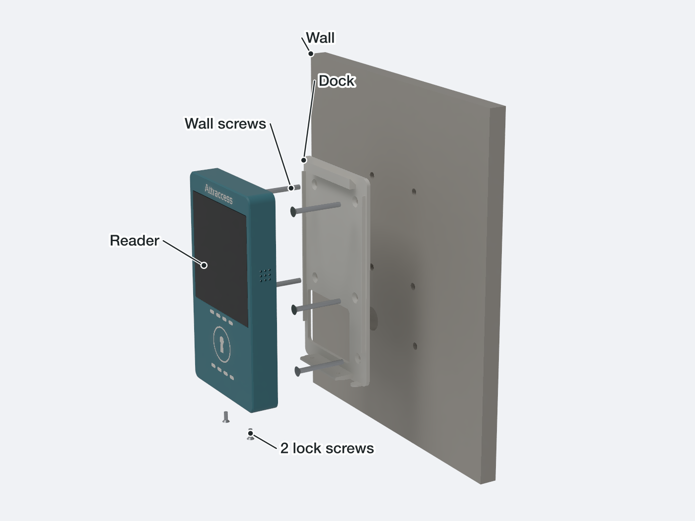

Von hinten nach vorn: die Wand, das Dock mit seinen Wandschrauben, der Leser und die beiden Sicherungsschrauben, die von unten eingedreht werden.

Diese Anleitung beschreibt die CAD-Konstruktion, Revision 2. Bisher wurde kein Teil gedruckt oder anprobiert; Passungen und Schraubenlängen sind daher ungetestet, bis die Liste am Ende abgearbeitet ist.

## Teile, Hardware und Werkzeuge

Ein Leser braucht fünf gedruckte Teile für die Wand und sechs für den Tisch. Die Druckdateien liegen in [`case/cad/`](https://github.com/Attraccess/Attraccess/tree/main/apps/attractap/hardware/touch-p4/case/cad); jede 3MF-Datei liegt bereits auf ihrer Druckfläche.

| Gedrucktes Teil | Datei | Anz. | Farbe | Wird liegend gedruckt auf |
| --- | --- | --- | --- | --- |
| Kappe (vordere Schale) | `attractap-cap.3mf` | 1 | RAL 5021 | ihrer Vorderseite |
| Frontplatte (Abdeckung der Front) | `attractap-faceplate.3mf`, oder `attractap-faceplate-logo.3mf` mit Schriftzug | 1 | RAL 5021, Streifen und Schriftzug weiß | ihrer Vorderseite |
| Tap-Kachel | `attractap-tile.3mf` | 1 | Oberseite und Schlüsselloch schwarz, Körper reines Weiß | ihrer Oberseite |
| Dock (Rückplatte) | `attractap-dock.3mf` | 1 | Marmorweiß | ihrer Rückseite |
| Displayrahmen | `attractap-display-frame.3mf` | 1 | Beliebig | seiner Platinenseite |
| Ständer (nur Tisch) | `attractap-stand.3mf` | 1 | Marmorweiß | seiner Tischseite |

| Hardware | Anz. | Wohin sie gehört |
| --- | --- | --- |
| M3-Einschmelzmutter, kurz (3 mm lang) | 4 | Platinen-Schraubdome in der Kappe |
| M3-Einschmelzmutter, Standard (5,7 mm lang) | 2 | Sicherungsleiste in der Kappe |
| M3 × 4 Linsenkopfschraube | 4 | Platine an Kappe |
| M3 × 8 Senkkopfschraube, idealerweise Torx mit Stift | 2 | Sicherungsschrauben, von unten |
| Doppelseitiges Klebeband, 0,3 mm dick | 3 Streifen | Displayglas an Rahmen |
| Dünnes doppelseitiges Klebeband, höchstens 0,15 mm | etwa 4 Streifen | Frontplatte an Kappe. Dickeres Band lässt das Glas hinter der Frontplatte versinken |
| Polyimidband (Kapton), 25 mm breit | 30 mm, plus 80 mm | Rückseite des Displays, über den Lötpins der Ethernet-Buchse (Ethernet-Version); über dem Flexkabel des Displays dort, wo es das Display verlässt |
| Leitfähige Dichtung, Gewebe über Schaumstoff, 5 × 5 mm, etwa 2 mm dick, selbstklebend | 2 bis 4 | Auf den blanken quadratischen Masse-Pads auf der Displayseite der Platine, gegen die Metallrückseite des Displays. Sie legt die Metallrückseite auf Masse, was der Leser braucht, um den Test auf elektrostatische Entladung zu bestehen |
| Neodym-Scheibenmagnet, 10 mm Durchmesser, 3 mm dick | 1 | Ring auf der Innenseite des Docks. Der Leser erfasst ihn und weiß so, wann er vom Dock genommen wird |
| Senkkopf-Wandschraube, 4 mm Schaft, Kopf bis 8,6 mm, mit Dübeln | 3 bis 5 | Dock an Wand |
| Kabelbinder, 2,5 mm breit, etwa 100 mm lang | 1 pro Kabel | Zugentlastung, nur für ein Kabel, das durch die untere Aussparung oder am Tischständer austritt |
| M3-Einschmelzmutter, Standard (5,7 mm lang) | 4 | Ständer (nur Tisch) |
| M3 × 8 Senkkopfschraube | 4 | Dock an Ständer (nur Tisch) |

Werkzeuge: Lötkolben mit einer Spitze, die schmaler als 6 mm und mindestens 10 mm lang ist, ein Schraubendreher für die M3-Schrauben, Seitenschneider, Elektronik-Seitenschneider (Flush Cutter) für die Pins der Buchse (Ethernet-Version) und eine Bohrmaschine für die Wand.

Die Platinenschrauben sind M3 × 4. Frühere Stücklisten nannten M3 × 6, aber seit das Display bündig sitzt, sind die Löcher für die Einschmelzmuttern in den Schraubdomen nur 3,2 mm tief, und eine 6-mm-Schraube stößt auf, bevor sie die Platine klemmt.

## Die gedruckten Teile vorbereiten

Sechs Einschmelzmuttern kommen in die Kappe, der Magnet ins Dock, dann die Tap-Kachel in die Kappe. Erledigen Sie alle Arbeiten mit Hitze, bevor Elektronik auf dem Tisch liegt.

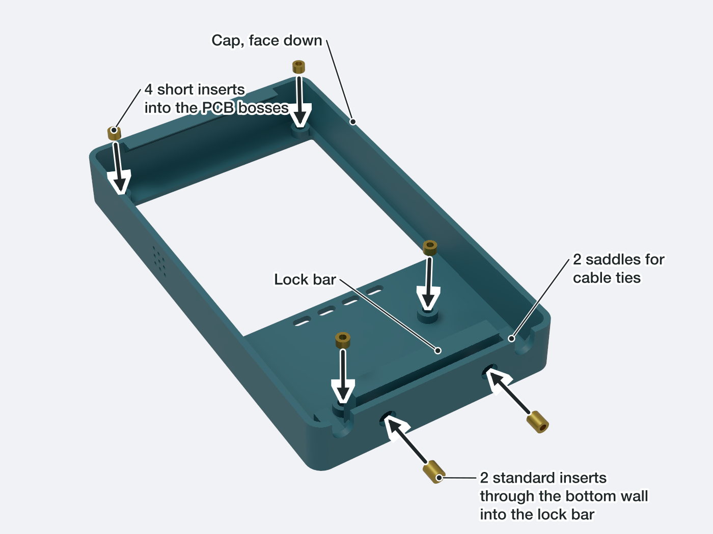

Die kurzen Einschmelzmuttern gehen direkt von oben in die Schraubdome. Die beiden Standard-Einschmelzmuttern gehen durch die Löcher in der unteren Wand. Die beiden Sättel neben den unteren Aussparungen nehmen keine Einschmelzmutter auf; sie halten später einen Kabelbinder.

1. Legen Sie die Kappe mit der Vorderseite nach unten auf ein weiches Tuch, die Innenseite zeigt nach oben.
2. Heizen Sie den Lötkolben auf etwa 250 °C auf.
3. Drücken Sie in jeden der vier Platinen-Schraubdome eine kurze Einschmelzmutter, bündig mit der Oberseite des Schraubdoms oder 0,2 mm darunter. Eine überstehende Einschmelzmutter hebt die Platine an und lockert das Display dahinter. Diese Löcher enden 1,1 mm hinter der Front der Kappe: Nehmen Sie den Kolben weg, sobald die Einschmelzmutter bündig sitzt, sonst kann sich die Front wölben und die Frontplatte anheben.
4. Stellen Sie die Kappe auf ihre Oberkante, die untere Wand zeigt nach oben. Setzen Sie eine Standard-Einschmelzmutter auf die Lötkolbenspitze, führen Sie sie durch eines der beiden runden Löcher in der unteren Wand und über den Schlitz hinweg und drücken Sie sie in die Sicherungsleiste, bis sie bündig sitzt. Wiederholen Sie das für das zweite Loch.
5. Prüfen Sie, dass nichts in den Schlitz zwischen unterer Wand und Sicherungsleiste hineinragt. Die Zunge des Docks muss dort hineingleiten.
6. Lassen Sie alles abkühlen und drehen Sie dann einmal eine M3-Schraube durch jede Einschmelzmutter.
7. Geben Sie einen Tropfen Sekundenkleber in den Ring auf der Innenseite des Docks und drücken Sie den Magneten hinein, mit beliebiger Seite nach oben. Er darf nicht über den Ring hinausstehen.
8. Schieben Sie die Tap-Kachel von hinten in die Kappe, die schwarze Oberseite voran, durch die quadratische Öffnung unter dem Displayfenster. Ihr Flansch schlägt innen an der Frontwand an. Die Kerbe im Flansch geht um den Platinen-Schraubdom daneben. Die Kachel bleibt lose, bis die Platine sie hält.

## Den Leser zusammenbauen

Alles wird von hinten in die Kappe mit der Vorderseite nach unten gelegt, in dieser Reihenfolge: Display auf seinem Rahmen, Platine, vier Schrauben. Bei der Ethernet-Version brauchen Platine und Display vorher je einen Vorbereitungsschritt.

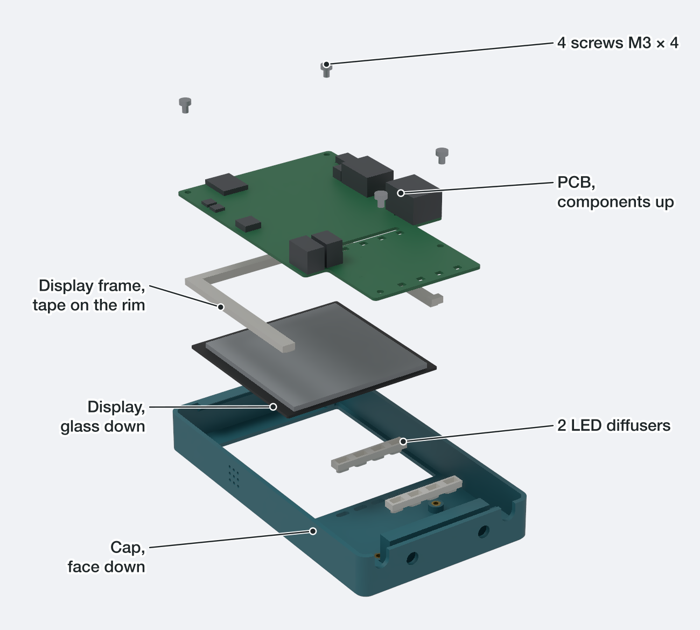

Alles ist in der Reihenfolge, in der es eingesetzt wird, aus der Kappe herausgehoben dargestellt, das unterste zuerst.

1. Nur Ethernet-Version: Drehen Sie die Platine so, dass die Seite ohne Bauteile zu Ihnen zeigt. Die Lötpins der Ethernet-Buchse stehen in einer Ecke heraus: 16 Pins, zwei breitere Schirmlaschen und zwei Kunststoffzapfen. Kürzen Sie jeden davon mit Elektronik-Seitenschneidern auf 1 mm. Schneiden Sie oberhalb des Lötkegels, nicht durch ihn hindurch.
2. Nur Ethernet-Version: Legen Sie das Display mit dem Glas nach unten hin, das Flexkabel zeigt zu Ihnen. Kleben Sie ein Stück Polyimidband von 25 × 30 mm auf die Metallrückseite in die Ecke unten rechts, bündig mit der Unterkante, und falten Sie 2 mm davon um die rechte Seitenkante des Metalls. Das ist die Ecke, die über den gekürzten Pins liegen wird; zwei davon führen 48 V.
3. Kleben Sie 0,3 mm dickes doppelseitiges Klebeband auf den erhöhten Rand des Displayrahmens: je einen Streifen links, rechts und oben. Die vierte Seite bleibt für das Flexkabel des Displays offen.
4. Legen Sie das Display mit dem Glas nach unten auf ein sauberes Tuch. Setzen Sie den Rahmen mit dem Rand nach unten auf die Rückseite des Glases, die offene Seite über dem Flexkabel. Richten Sie den Rahmen an den Glaskanten aus und drücken Sie entlang der drei Streifen an.
5. Falten Sie das Flexkabel über den unteren Rand des Displays auf die Metallrückseite, sodass es flach darauf liegt und der kleine Chip vom Display weg zeigt. Falten Sie um die Kante, ohne zu knicken. Legen Sie dann einen Streifen Polyimidband quer über die Faltung, über die offene Seite des Rahmens, und falten Sie seine Enden auf den Rahmen. Es deckt die Leiterbahnen des Flexkabels hinter dem Spalt um das Glas ab, auf die sonst eine elektrostatische Entladung an der Glaskante treffen würde.
6. Senken Sie Display und Rahmen so in die Kappe, dass das Glas in das Fenster fällt. Drehen Sie die Kappe einmal um und prüfen Sie, dass das Glas bündig und mit einem gleichmäßigen Spalt ringsum sitzt.
7. Kleben Sie eine leitfähige Dichtung auf mindestens zwei der vier blanken quadratischen Pads auf der Seite der Platine ohne Bauteile (die goldenen Quadrate hinter der Stelle, an der das Display liegen wird), zwei weit voneinander entfernt. Die Dichtungen drücken gegen die Metallrückseite des Displays, wenn die Platine eingesetzt wird.
8. Heben Sie das Ende des Flexkabels, den schmalen Streifen mit den Kontakten, von der Metallrückseite ab. Halten Sie die Platine mit den Bauteilen zu Ihnen und der Ethernet-Buchse zum unteren Ende der Kappe. Fädeln Sie das Ende des Flexkabels von der Seite ohne Bauteile durch den Schlitz in der Mitte der Platine und senken Sie die Platine dann auf die vier Schraubdome. Der Teil mit dem Chip bleibt flach auf der Rückseite des Displays; nur der schmale Streifen biegt sich durch den Schlitz.
9. Stecken Sie das Flexkabel in seinen Anschluss auf der Platine und schließen Sie den Verriegelungsbügel.
10. Befestigen Sie die Platine mit den vier M3 × 4 Schrauben. Handfest genügt; die Einschmelzmuttern sitzen in Kunststoff.
11. Versorgen Sie die Platine über USB-C und prüfen Sie Display, Touch, LEDs und Buzzer, bevor der Leser an die Wand kommt. USB-C, Reset und Boot sind nur erreichbar, solange der Leser nicht am Dock hängt.
12. Drehen Sie den Leser mit der Front nach oben. Kleben Sie dünnes doppelseitiges Klebeband auf die Front der Kappe nahe den Kanten und zwischen Displayfenster und Kachel, setzen Sie dann die Frontplatte über Kachel und Glas und drücken Sie sie rundum an. Ihre Kante schließt mit den Seiten der Kappe ab.

## Das Dock an einer Wand montieren

Das Dock nimmt drei bis fünf Senkkopfschrauben auf, und der Leser verdeckt später jeden Schraubenkopf. Legen Sie den Kabelweg fest, bevor Sie bohren.

Nur für Innenräume. Das Gehäuse ist nicht abgedichtet, und in der EU darf das WLAN des Lesers seine 5-GHz-Kanäle 36 bis 64 nur innerhalb von Gebäuden nutzen. Die WLAN-Antenne sitzt hinter der oberen linken Ecke des Lesers: Halten Sie Metallgegenstände davon fern. Eine Metallwand hinter dem Leser schwächt das WLAN etwas (geschätzt 1 bis 2 dB bei 2,4 GHz).

- **Kabel durch die Wand:** Bohren Sie ein Loch von 20 mm 32 mm links von der Mittellinie des Docks, auf Höhe des einzelnen unteren Schraubenlochs. Das ist die untere linke Ecke der Öffnung des Docks, direkt unter dem Ethernet-Stecker, und das Dock verdeckt sie. Lassen Sie beide Abbrechlaschen stehen. Der Weg ist unten unter „Wo die Kabel hinter dem Leser verlaufen“ dargestellt.
- **Kabel von unten an der Wand entlang:** Knipsen Sie mit dem Seitenschneider eine Lasche von der Unterkante des Docks ab. Die linke Lasche ist für Ethernet, die rechte für ein Stromkabel. Jede gibt eine 8 mm breite Aussparung frei. Dieses Kabel wird im Leser festgebunden, bevor der Leser eingehängt wird; siehe den nächsten Abschnitt.

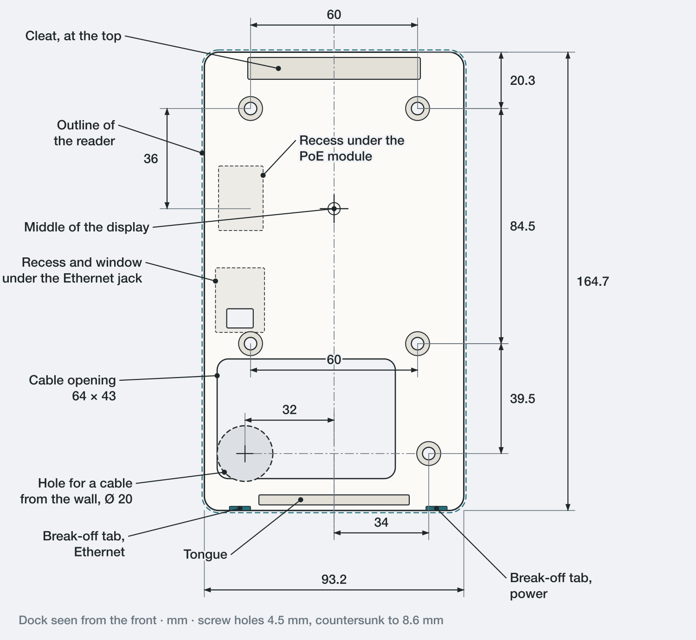

Die Zeichnung ist am Bildschirm nicht maßstabsgetreu. Verwenden Sie das gedruckte Dock selbst als Bohrschablone. Der gestrichelte Kreis ist das Loch für ein Kabel, das aus der Wand kommt.

1. Halten Sie das Dock mit der abgewinkelten Leiste oben an die Wand und richten Sie es waagerecht aus. Die Mitte des Displays liegt später 36 mm unter dem oberen Lochpaar.
2. Markieren Sie die Löcher. Nutzen Sie beide oberen Löcher und mindestens ein unteres Loch.
3. Bohren Sie und setzen Sie die Dübel. Bei einer Unterputzdose passt das untere Paar zum Schraubenabstand der Dose von 60 mm; lesen Sie vorher den Hinweis zu Dosen unter „Wo die Kabel hinter dem Leser verlaufen“.
4. Schrauben Sie das Dock an. Jeder Schraubenkopf muss bündig mit der Platte oder darunter sitzen. Halten Sie die beiden flachen Aussparungen links auf der Platte frei, ebenso das kleine Fenster in der unteren: Die Ethernet-Buchse und das PoE-Modul stehen darüber, und die beiden Schirmfedern der Buchse reichen in das Fenster.

## Den Leser anschließen, einhängen und sichern

Der Leser wird in einer Bewegung angebracht: einstecken, oben über die Leiste haken, unten zuschwenken. Zwei Schrauben von unten sichern ihn dann.

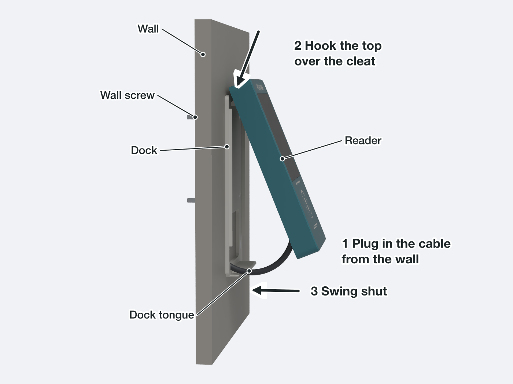

Von links gesehen. Der Leser ist weiter herausgekippt gezeichnet, als es nötig ist.

1. Halten Sie den Leser vor das Dock, mit seiner Unterkante zu Ihnen gekippt. Drücken Sie den Ethernet-Stecker von unten in die Buchse, bis die Verriegelung einrastet. Schließen Sie die Stromversorgung auf dieselbe Weise an, wenn Sie sie nutzen.
2. Nur wenn das Kabel durch die untere Aussparung austritt: Binden Sie es jetzt auf seinem Sattel fest, wie unten unter „Das Kabel am unteren Austritt festbinden“ beschrieben. Ein Kabel, das hinter dem Dock aus der Wand kommt, braucht keinen Kabelbinder.
3. Setzen Sie die Oberkante des Lesers etwa 6 mm über seiner Endposition an das Dock und lassen Sie ihn nach unten gleiten. Sein Haken fällt hinter die 45°-Leiste des Docks.
4. Schwenken Sie die Unterseite zur Wand. Schieben Sie die Kabelreserve zurück in die Wand oder legen Sie das Kabel in die untere Aussparung. Die Zunge des Docks gleitet in den Schlitz zwischen der unteren Wand des Lesers und seiner Sicherungsleiste.
5. Drehen Sie von unten die beiden M3 × 8 Sicherungsschrauben durch die runden Löcher in der unteren Wand, bis sie fest sitzen. Sie klemmen die Sicherungsleiste auf die Zunge, und ihre Köpfe enden versenkt in der Wand.
6. Rütteln Sie am Leser. Er darf sich nicht heben, kippen oder klappern.

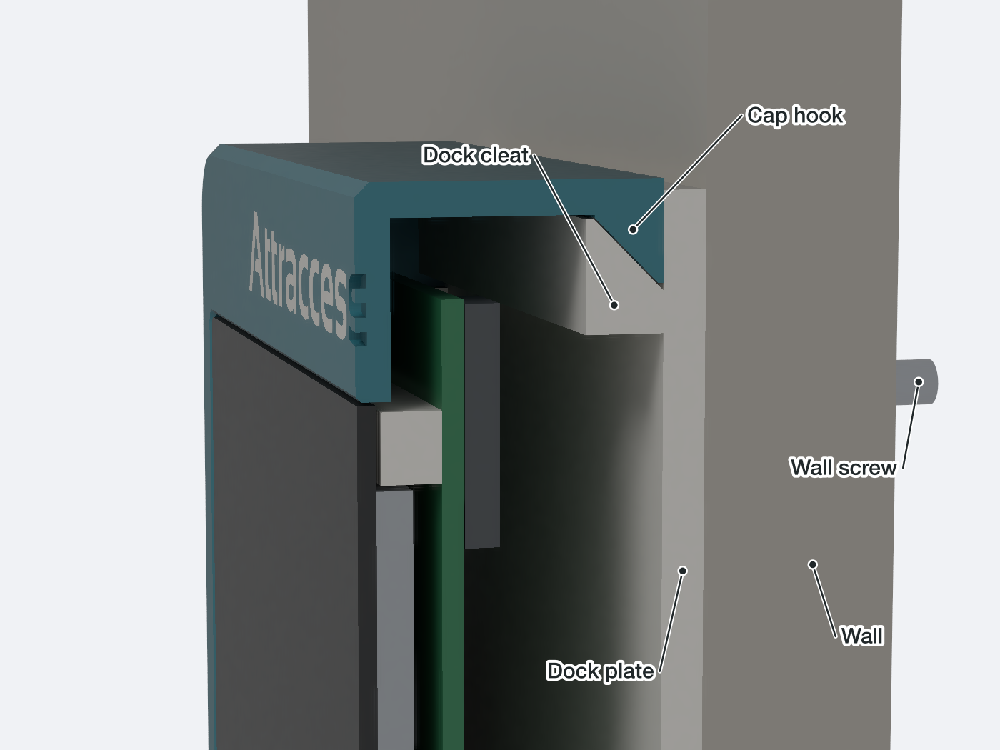

Schnitt durch die Oberkante. Der Haken der Kappe sitzt hinter der Leiste des Docks, sodass sich der Leser nicht gerade von der Wand ziehen lässt.

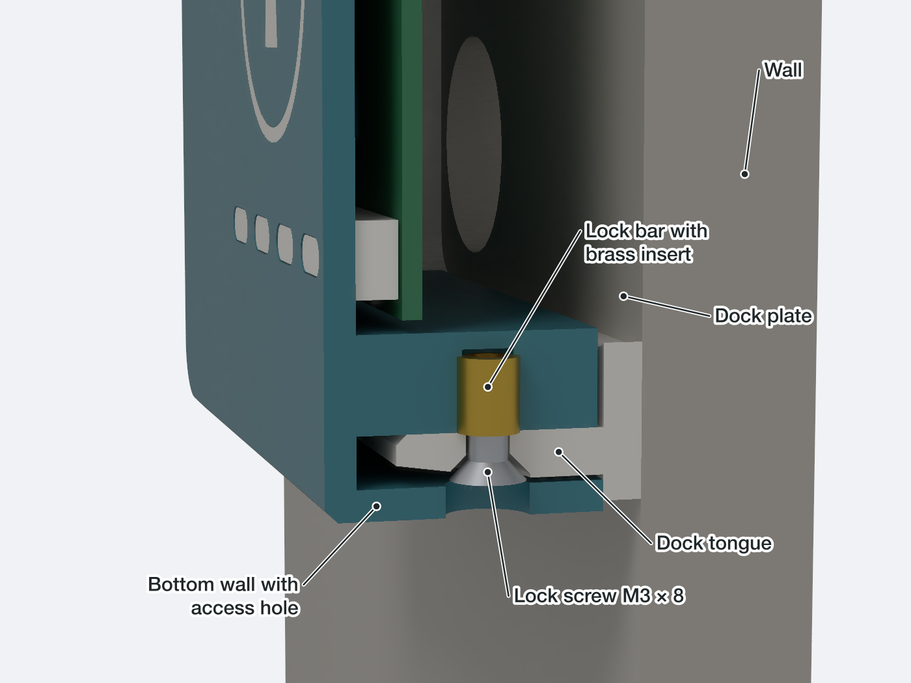

Schnitt durch eine Sicherungsschraube. Sie geht durch die untere Wand und die Zunge des Docks in die Einschmelzmutter in der Sicherungsleiste.

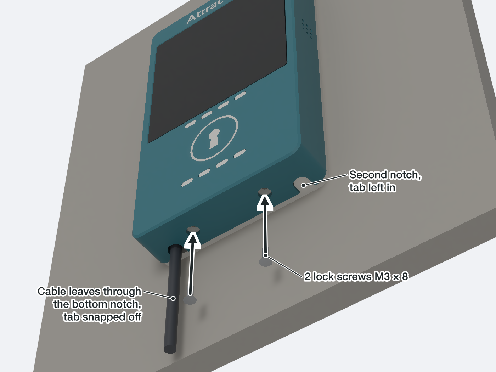

Die Ansicht von unten, mit den Sicherungsschrauben aus ihren Löchern herausgezogen gezeichnet und einem Kabel, das durch die untere Aussparung austritt.

Nach dem Sichern sind Stecker und Buchsen eingeschlossen. Ein Kabel, das hinter dem Dock aus der Wand kommt, ist von außen nicht erreichbar und braucht nichts weiter.

### Wo die Kabel hinter dem Leser verlaufen

Beide Buchsen zeigen nach unten und sitzen etwa 10 mm vor der Wand. Ein Kabel aus der Wand tritt deshalb unterhalb seines Steckers aus der Wand und biegt nach oben in ihn ab. Ein Teil dieser Biegung findet innerhalb der Wand statt, weshalb das Loch 20 mm breit ist.

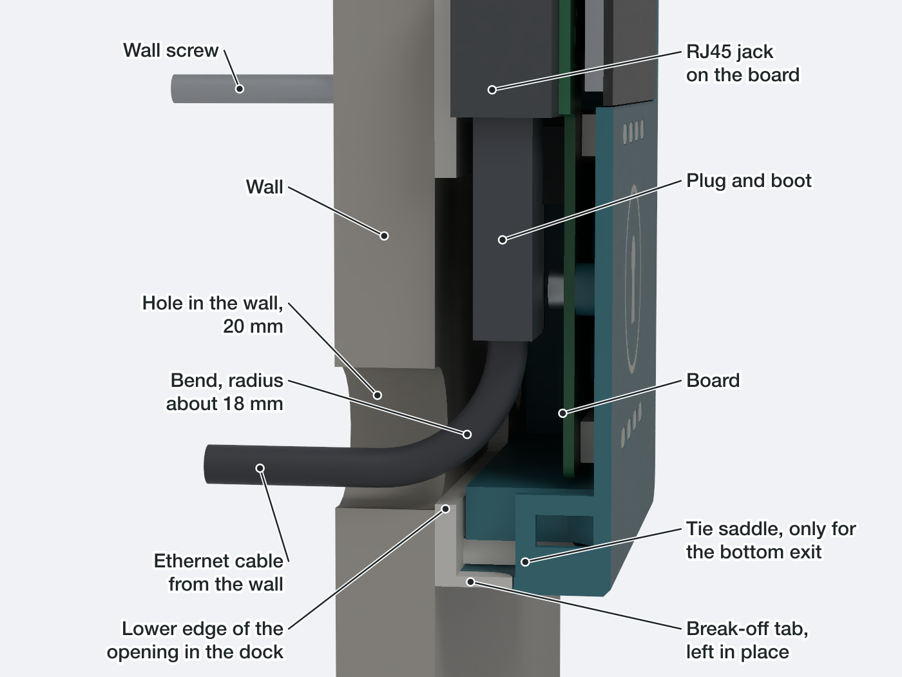

Schnitt durch die Ethernet-Buchse, von links gesehen, die Wand links. Das Kabel kommt aus dem Loch, biegt nach oben und tritt von unten in den Stecker ein. Die Abbrechlasche und der Kabelbinder-Sattel bleiben ungenutzt.

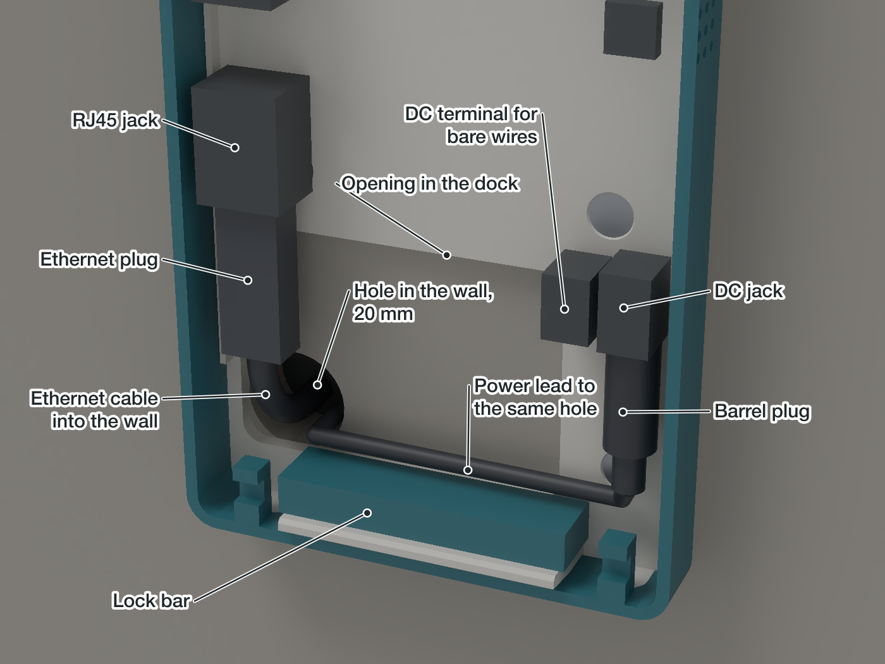

Der Leser an der Wand, ohne Front, Display und Platine. Ethernet ist links. Rechts steckt ein Hohlstecker in der DC-Buchse, und seine Leitung läuft über der Sicherungsleiste zum selben Loch.

- **Biegung.** Das Ethernet-Kabel macht eine Vierteldrehung mit einem Radius von etwa 18 bis 20 mm. Nehmen Sie ein flexibles Patchkabel; steifes Installationskabel macht diese Biegung nicht mit.
- **Steckerlänge.** Die Zeichnung geht davon aus, dass Stecker und Knickschutz 30 mm unter der Buchse enden. Ein längerer Knickschutz drückt die Biegung nach unten und macht sie enger. Gängige angespritzte Patchkabel enden 24 bis 31 mm unter der Buchse. Ein schlankes Patchkabel (28 AWG, unter 4 mm dick) biegt enger und lässt den meisten Platz.
- **Reserve.** Lassen Sie etwa 10 cm Kabel außerhalb der Wand zum Einstecken. Bis auf etwa 2 cm davon gleitet es beim Zuschwenken des Lesers zurück in das Loch, hinter dem Loch muss also freier Raum sein: ein Leerrohr, ein Hohlraum oder eine Dose.
- **Strom.** Wird die Platine über PoE versorgt, ist das Ethernet-Kabel das einzige Kabel. Andernfalls führen Sie zwei Adern aus demselben Loch zur DC-Klemme neben der DC-Buchse oder nutzen einen Hohlstecker wie abgebildet. Eine Leitung von 3,5 mm passt neben dem Ethernet-Kabel durch das Loch.
- **Freie Platte.** Halten Sie Kabel, Aderreserven und Etiketten von der Platte des Docks unmittelbar unter und links vom Ring des Magneten fern, von vorn gesehen. Der Leser misst das Licht, das diese Stelle reflektiert, um zu erkennen, dass er am Dock sitzt. Ein Draht, der dort liegt, verändert den Messwert, und ein Draht, der sich dort bewegt, sieht aus, als nähme jemand den Leser ab.
- **Unterputzdose.** Eine Dose sitzt höher als dieses Loch, auf Höhe des Steckers statt darunter. Ein Kabel aus der Dose muss neben dem Stecker nach unten laufen und im Leser eine U-Kehre mit höchstens 19 mm Radius machen. Das schafft nur ein dünnes, sehr flexibles Patchkabel, und dieser Weg ist nicht modelliert.

### Das Kabel am unteren Austritt festbinden

Ein Kabel, das durch die untere Aussparung austritt, kann von außen gepackt werden und bekommt deshalb im Leser einen Kabelbinder. Ohne den Kabelbinder geht ein Zug direkt in die Buchse: Ein Hohlstecker rutscht heraus, und ein Ethernet-Stecker hängt an seiner Verriegelung und den Lötstellen der Buchse. Mit dem Kabelbinder geht der Zug durch Kappe und Dock in die Wandschrauben.

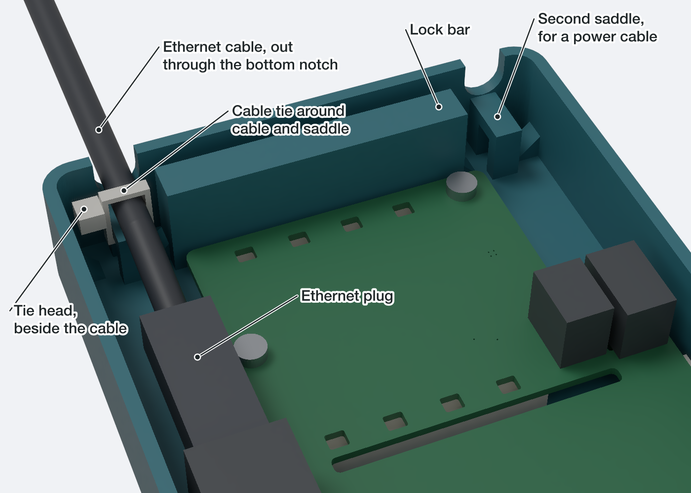

Leser mit der Vorderseite nach unten, von seinem oberen Ende gesehen. Neben jeder unteren Aussparung liegt ein Sattel: eine kleine Brücke mit einer Öffnung darunter. Hier ist das Ethernet-Kabel an seinen Sattel gebunden.

1. Legen Sie das eingesteckte Kabel über den Sattel und in die Aussparung. Ethernet nutzt den Sattel auf der Seite der Ethernet-Buchse, Strom den anderen.
2. Biegen Sie die Spitze des Kabelbinders zu einem Haken und drücken Sie sie zwischen Sattel und Seitenwand nach unten. Eine Rampe unten lenkt sie durch die Öffnung unter dem Sattel, und eine zweite Rampe dreht sie auf der Seite der Sicherungsleiste wieder nach oben. Eine Pinzette hilft beim Fangen.
3. Schließen Sie den Kabelbinder um das Kabel, mit seinem Kopf auf der Seite der Seitenwand, neben dem Kabel. Ein Kopf auf dem Kabel würde gegen das Dock stoßen.
4. Ziehen Sie den Kabelbinder so fest, dass das Kabel nicht rutschen kann, ohne es zu quetschen, und schneiden Sie das Ende bündig ab.
5. Ziehen Sie am Kabel. Der Stecker darf sich nicht bewegen.

Der Sattel nimmt Kabel bis etwa 7 mm Dicke auf. Für Wartungsarbeiten schneiden Sie den Kabelbinder durch, sobald der Leser vom Dock abgenommen ist.

## Tischständer statt Wand

Auf einem Tisch wird dasselbe Dock statt an eine Wand auf die schräge Fläche des Ständers geschraubt. Der Leser lehnt sich dann um 35° zurück.

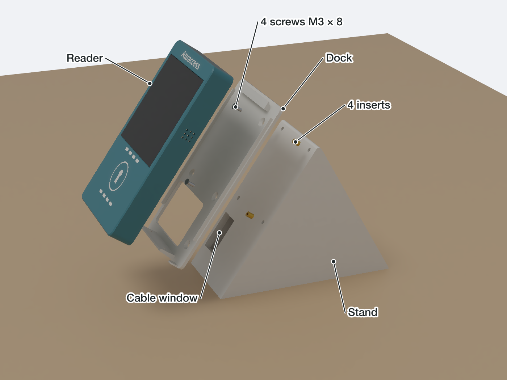

1. Drücken Sie vier Standard-Einschmelzmuttern in die vier Löcher in der schrägen Fläche des Ständers, bündig mit der Oberfläche.
2. Legen Sie das Dock mit der Leiste oben auf die schräge Fläche und befestigen Sie es mit vier M3 × 8 Senkkopfschrauben durch seine beiden Lochpaare. Das einzelne fünfte Loch bleibt leer.
3. Führen Sie das Kabel durch die Aussparung an der hinteren Unterkante des Ständers hinein und durch das Fenster hinter der Öffnung des Docks nach oben.
4. Stecken Sie ein, haken Sie ein und schwenken Sie zu wie an der Wand.
5. Heben Sie den Ständer vom Tisch, um die beiden Sicherungsschrauben einzudrehen. Steht der Ständer auf dem Tisch, blockiert der Tisch den Schraubendreher, was die Schrauben auch im Alltag unerreichbar hält.
6. Binden Sie das Kabel, solange der Ständer angehoben ist, an eine der beiden Rippen neben der Aussparung. Führen Sie einen Kabelbinder durch beide Schlitze der Rippe und um das Kabel, wobei das Kabel auf der Aussparungsseite der Rippe liegt, und schneiden Sie das Ende ab. Lassen Sie das Kabel im Ständer etwas durchhängen. Jede Rippe hält ein Kabel.

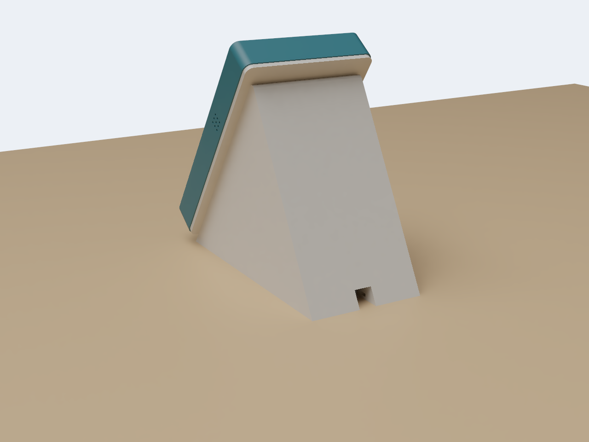

Die Aussparung an der hinteren Unterkante ist die Stelle, an der das Kabel den Ständer verlässt. Sie ist 12 mm breit, 11 mm hoch und zum Tisch hin offen, das Kabel wird also von unten eingelegt.

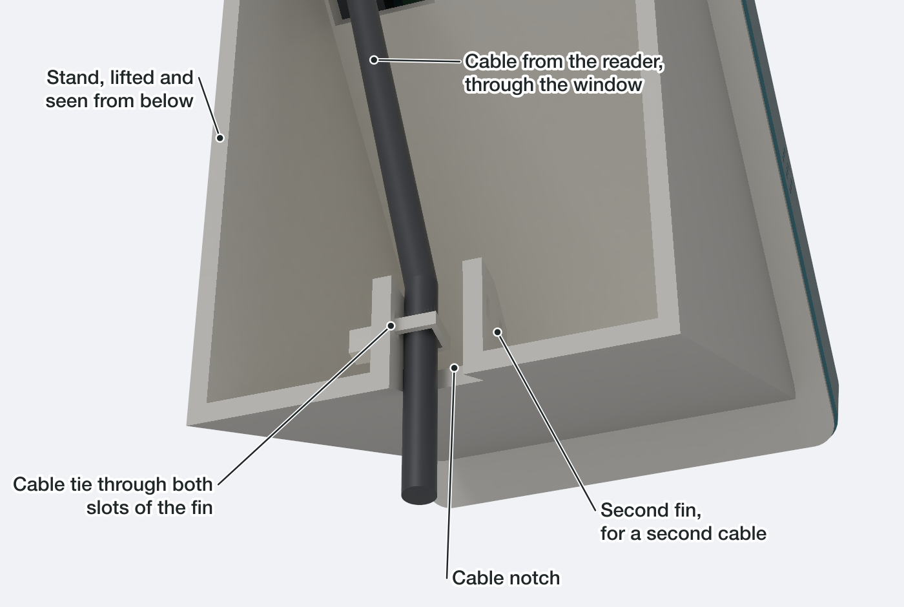

Der umgedrehte Ständer. Das Kabel vom Leser ist an eine Rippe gebunden und tritt durch die Aussparung aus, sodass ein Zug daran am Ständer endet und nicht am Stecker.

## Zur Wartung wieder öffnen

Zwei Schrauben lösen den Leser; vier weitere lösen die Platine. USB-C, die Reset- und Boot-Taster und die Testpunkte sind nur für die Wartung gedacht und nicht so gegen elektrostatische Entladung geschützt wie die Außenseite des Lesers: Berühren Sie ein geerdetes Metallteil (oder tragen Sie ein Erdungsarmband), bevor Sie USB-C einstecken oder einen Taster drücken, und halten Sie die Platine an den Rändern.

1. Entfernen Sie die beiden Sicherungsschrauben von unten.
2. Schwenken Sie die Unterseite des Lesers etwa 20 mm von der Wand weg und heben Sie den Leser dann 6 mm von der Leiste.
3. Schneiden Sie den Kabelbinder durch, falls ein Kabel festgebunden ist. Drücken Sie die Verriegelung des Ethernet-Steckers und ziehen Sie die Kabel ab. USB-C, Reset und Boot sind jetzt zum Flashen erreichbar.
4. Um die Platine herauszunehmen, entfernen Sie die vier M3 × 4 Schrauben, öffnen Sie den Verriegelungsbügel des Flexanschlusses und heben Sie die Platine heraus.
5. Das Display kommt zusammen mit seinem Rahmen heraus. Um das Display selbst zu ersetzen, ziehen Sie das Glas vom Klebeband ab und kleben Sie das neue wieder auf.

## Noch nicht geprüft

Nichts davon wurde an echten Teilen geprüft. Jeder Punkt kann einen Schritt oder ein Teil ändern.

- [ ] **Gedruckte Passungen.** Glas in seinem Fenster (0,25 mm Spalt pro Seite), Zunge in ihrem Schlitz (0,4 mm), Haken an der Leiste (0,1 mm). Stimmen Sie beim ersten Druck ab.
- [ ] **Displaymaße.** Die Gesamtdicke von 3,5 mm ist an einem Muster-Panel gemessen; die Deckscheibe (0,55 mm) stammt aus der Zeichnung auf der Produktseite des Displays, ein Eckenradius von mindestens 1 mm wird angenommen. Sie entscheiden, ob der Bildschirm bündig sitzt. Vermessen Sie das Panel vor dem Drucken.
- [ ] **Einschmelzmuttern in den Platinen-Schraubdomen.** Ihre Löcher reichen in die Frontwand und lassen 2,1 mm davon stehen. Prüfen Sie beim ersten Druck, dass die Front nach dem Einpressen der Einschmelzmuttern keine Spuren zeigt.
- [ ] **Abstand und Flexkabel des Displays.** Der Rahmen hält das Display 1,7 mm von der Platine entfernt; das gefaltete Flexkabel mit seinem Chip liegt in diesem Spalt (siehe das [Gehäuse](hardware/touch-p4/case.md#noch-nicht-geprüft)). Prüfen Sie mit dem echten Panel, dass der Teil mit dem Chip flach auf der Rückseite des Displays liegt und dass das Flexkabel seinen Anschluss durch den Schlitz erreicht.
- [ ] **Dock-Magnet.** Mit am Dock hängendem Leser muss die Platine „am Dock“ melden und „ab“, sobald er weggehoben wird. Die Abbildungen zeigen den Ring des Magneten noch nicht.
- [ ] **Dock-Platte und Näherungssensor.** Die Platine misst auch das Infrarotlicht, das die Platte des Docks reflektiert. Was sie am Dock liest, mit jeder verwendeten Dock-Farbe, und ob Licht auf dem Gehäuse den Wert verändert, ist noch nicht gemessen (siehe die Inbetriebnahmenotizen der Platine).
- [ ] **Abbildungen.** Die Abbildungen zeigen das Gehäuse vor der Änderung seiner Tiefe: Die Kappe war 1,2 mm tiefer. Die Schritte sind dieselben.
- [ ] **Buchsenpins hinter dem Display.** Auf 1 mm gekürzt sollten sie 0,5 mm oder mehr Abstand zur Metallrückseite des Displays halten. Messen Sie, wie weit die Pins einer eingelöteten Buchse herausstehen, und prüfen Sie den Abstand bei eingebautem Display.
- [ ] **Höhe des PoE-Moduls.** Angenommen 10 mm.
- [ ] **Schwenkbewegung beim Einhängen.** In CAD kollisionsfrei bei fünf Winkeln zwischen 7° und geschlossen, nachdem die Zunge des Docks am 19. Nov. 2026 angeschrägt wurde. Docks, die vorher geslict wurden, müssen neu geslict werden.
- [ ] **Zugentlastung.** Die Kabelbinder-Sättel in der Kappe und die Kabelbinder-Rippen im Ständer wurden am 19. Nov. 2026 hinzugefügt und sind nur in CAD geprüft. Fädeln Sie beim ersten Druck einen Kabelbinder ein und ziehen Sie am Kabel. Die Kabelaussparung des Ständers wurde in derselben Änderung auf 11 mm erhöht; vorher war sie für ein Ethernet-Kabel zu niedrig. Kappen und Ständer, die vorher geslict wurden, müssen neu geslict werden.
- [ ] **Kabelweg in die Wand.** Am 19. Nov. 2026 modelliert, mit einem 5,5-mm-Ethernet-Kabel bei 18 mm Biegeradius und einer 3,5-mm-Stromleitung; in CAD kollidiert nichts. Mit echten Kabeln nicht erprobt. Der Weg aus einer Unterputzdose ist nicht modelliert.
- [ ] **Frontplatte und Tap-Kachel.** Neu am 27. Nov. 2026 und nur im CAD geprüft: wie gleichmäßig der Rand der Kachel leuchtet (die LEDs liegen nur unter der oberen und unteren Kante), ob die Kachel ohne Spiel sitzt und wie gut dünnes Klebeband die Frontplatte hält. Die Abbildungen zeigen beide Teile noch nicht.
- [ ] **Passung der Einschmelzmuttern.** Die gedruckten Löcher sind 4,0 mm für gängige M3-Einschmelzmuttern. Prüfen Sie sie gegen die Einschmelzmuttern, die Sie kaufen.
- [ ] **Betrieb im Freien.** Es gibt keine Dichtungen; die Buzzerlöcher und Kabelaussparungen sind offen, und ABS+ altert im Sonnenlicht. Behandeln Sie es als nur für Innenräume: Eine abgedichtete Variante bräuchte außerdem ein auf die im Freien erlaubten Kanäle beschränktes WLAN.
