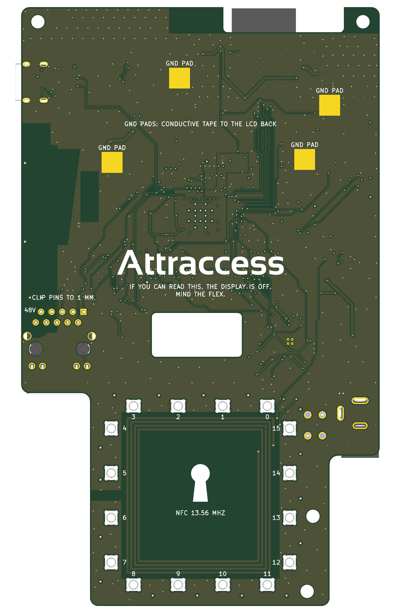
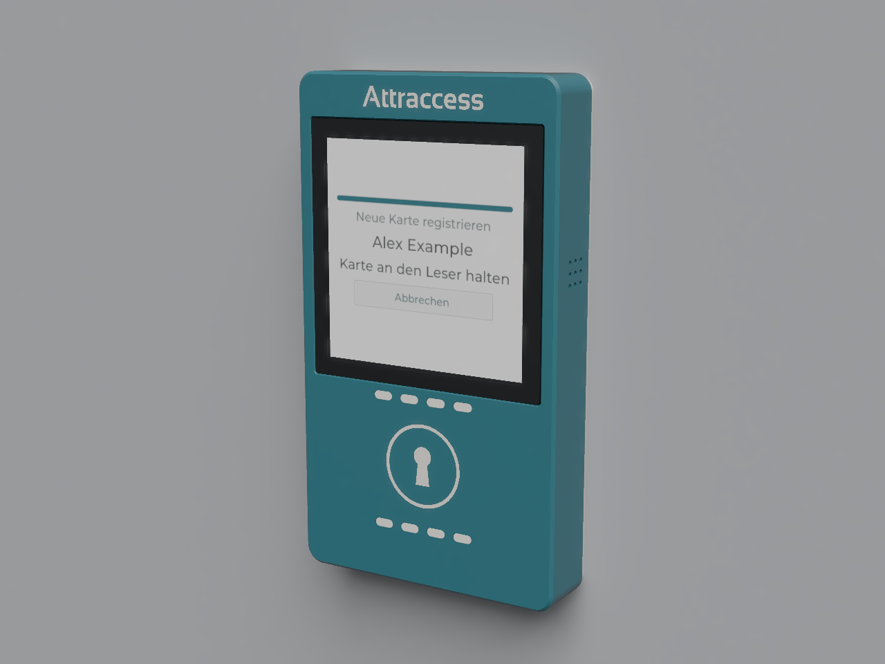

# Attractap Touch P4
<!-- llms-description: Die Leserplatine Attractap Touch P4: was auf ihr sitzt, ihre zwei Versionen, ihr Stand, Renderings und Zeichnungen, ihr Gehäuse und wo der Rest ihrer Dokumentation steht. -->

Eine eigene Platine für den Attractap-Touch-Leser, Revision A. Sie ersetzt die Waveshare-Entwicklungsplatine
samt PN532-Modul der heutigen Leser durch eine einzige Platine. Diese Seite ist der Einstieg für alle;
die Liste [Dokumentation](#dokumentation) am Ende führt zu den Einzelheiten.

> **Status: Revision A, noch nicht gebaut.** Niemand hat diese Platine bestückt oder vermessen. Sie
> wurde auf dem Papier geprüft (Datenblätter, die Fertigungsgrenzen und die Bauteilbibliothek von
> JLCPCB, Layout-Regeln), und ihr Spannungseingang, die NFC-Antenne und die schnellen Signale wurden
> aus dem verlegten Kupfer simuliert. Rechnen Sie mit einer Inbetriebnahmerunde
> ([Inbetriebnahmeplan](hardware/touch-p4/bring-up.md)); die Ziele, die sie nicht vollständig
> erfüllt, stehen unter [Bekannte Einschränkungen](hardware/touch-p4/limitations.md). Die
> CE-Kennzeichnung braucht Labortests am fertigen Produkt ([Konformitäts-Checkliste](hardware/touch-p4/compliance.md)).

## Was auf der Platine sitzt

| Funktion | Bauteil | Hinweise |
|---|---|---|
| MCU | ESP32-P4NRW32X | 400 MHz, zwei Kerne, 32 MB PSRAM im Gehäuse, 16 MB Flash |
| Wi-Fi 6 (2,4 und 5 GHz), Bluetooth LE | Modul ESP32-C5-MINI-1 | Funk-Coprozessor über SDIO (esp-hosted); EU-Baumusterprüfbescheinigung; eigene Platinenantenne in der oberen linken Ecke der Platine |
| Display | 4,0"-Panel 480 x 480, ST7701S + GT911 | derselbe Paneltyp wie heute, 40-poliges Flexkabel, RGB565 |
| NFC | PN532 + Platinen-Schleifenantenne | derselbe Chip und dasselbe I2C-Protokoll wie heute |
| Ethernet (LAN-Version) | PHY IP101GRI + Buchse HY931147C | 10/100, RMII |
| PoE (LAN-Version) | isoliertes Modul DP9900M-5V | IEEE 802.3af |
| Stromversorgung | DC 12 bis 24 V (Hohlstecker oder WAGO-Klemme), PoE oder USB-C 5 V | beliebige Kombinationen dürfen angeschlossen sein; USB-C ist der Serviceport zum Flashen und Debuggen |
| Rückmeldung | 8 RGB-LEDs (SK6812MINI-E), Summer | die LEDs leuchten rund um den NFC-Bereich durch die Platine |
| Manipulationserkennung | Beschleunigungssensor LIS2DH12, Näherungssensor VCNL4040, Hall-Schalter DRV5032 | Klopfen, Kippen und der Leser, der sein Dock verlässt; die Firmware liest sie noch nicht aus |

Werte, Bereiche und Grenzen stehen in der [Spezifikation](hardware/touch-p4/spec.md); die
Gründe für jedes Bauteil in den [Designnotizen](hardware/touch-p4/design-notes.md).

## Die zwei Versionen

Beide Versionen werden aus derselben Platine bestückt:

| Version | Enthält |
|---|---|
| **wifi** | alles außer den Bauteilen, deren Feld `Variant` den Wert `lan` hat (Ethernet und PoE) |
| **lan** | alle Bauteile: Ethernet, PoE und WLAN |

Auf 5 GHz ist der Leser nur für den Betrieb in Innenräumen gedacht, und seine Firmware hält die Kanal-
und Leistungsregeln der EU ein ([Firmware-Portierung](hardware/touch-p4/firmware-port.md), [Konformität](hardware/touch-p4/compliance.md)).

## Renderings und Zeichnungen

| Bestückungsseite (zur Wand) | Displayseite |
| --- | --- |
|  |  |

- [Schaltplan](_media/hardware/touch-p4/schematic.pdf ':ignore') (PDF, alle Blätter)
- Kupfer und Bestückungsdruck im Maßstab 1:1: [Bestückungsseite](_media/hardware/touch-p4/board-front.pdf ':ignore'),
  [Displayseite](_media/hardware/touch-p4/board-back.pdf ':ignore') (PDF, für die Papierprüfung im
  [Inbetriebnahmeplan](hardware/touch-p4/bring-up.md))
- [Fertigungszeichnung](https://github.com/Attraccess/Attraccess/blob/main/apps/attractap/hardware/touch-p4/fab/jlcpcb/attractap-touch-p4-fab.pdf)
  und [Bestückungszeichnung](https://github.com/Attraccess/Attraccess/blob/main/apps/attractap/hardware/touch-p4/fab/jlcpcb/attractap-touch-p4-assembly.pdf)
  (PDF, Teil des Bestellpakets)

Die Renderings und PDFs werden von den Targets `build` und `render` aus der Platine geschrieben
([Arbeiten an der Platine](hardware/touch-p4/development.md)).

## Das Gehäuse

Ein 3D-druckbares Gehäuse hängt den Leser an eine Wand oder stellt ihn auf einen Tisch; derselbe Leser
passt in beide. Die vordere Schale trägt das Display und die Platine und hakt an einem Dock ein, das an die
Wand oder auf den Ständer geschraubt ist. Druckdateien, CAD-Dateien und offene Prüfungen stehen auf der
Seite [Gehäuse](hardware/touch-p4/case.md); Montage und Befestigung in der [Installationsanleitung](hardware/touch-p4/installation-manual.md)
([PDF](_media/hardware/touch-p4/attractap-installation-manual-de.pdf ':ignore')).

## Lizenz

Die Hardware-Designs (Platine, Generator, Gehäuse, Fertigungsdaten und diese Dokumentation) stehen unter einer
[nichtkommerziellen Hardware-Lizenz](https://github.com/Attraccess/Attraccess/blob/main/apps/attractap/hardware/LICENSE.md).
Privatpersonen und gemeinnützige Organisationen dürfen sie für nichtkommerzielle Zwecke nutzen, ändern und bauen.
Niemand darf das Design oder daraus gebaute Geräte verkaufen. Kommerzielle Nutzer brauchen eine eigene Lizenz
oder können Leser beim Projekt kaufen: contact@attraccess.org.

## Dokumentation

Für den Einsatz:

- [Spezifikation](hardware/touch-p4/spec.md): Funktion, Versorgung, Umgebung, Schnittstellen, EMV-Ziele.
- [Installationsanleitung](hardware/touch-p4/installation-manual.md): den Leser drucken, zusammenbauen, montieren und warten.
- [Gehäuse](hardware/touch-p4/case.md): das druckbare Gehäuse, seine Druck- und CAD-Dateien, was noch nicht geprüft ist.

Für die Entwicklung:

- [Arbeiten an der Platine](hardware/touch-p4/development.md): Projektordner, Generator, Nx-Targets, Bestellen und Freigeben.
- [Designnotizen](hardware/touch-p4/design-notes.md): das aktuelle Design und seine Begründung, Block für Block.
- [Bekannte Einschränkungen](hardware/touch-p4/limitations.md): akzeptierte Abweichungen und Punkte, die sich auf dem Papier nicht klären lassen.
- [Designstandards und Review-Kriterien](hardware/touch-p4/review.md): wogegen das Design geprüft wird.
- [Bauteile und Beschaffung](hardware/touch-p4/parts.md): Lebenszyklus, Alternativen, Kosten, Beschaffungsrisiken.
- [Pinbelegung und Firmware-Portierung](hardware/touch-p4/firmware-port.md): GPIO-Belegung und was die Firmware ändern muss.
- [Simulationen](hardware/touch-p4/simulations.md): was aus der verlegten Platine simuliert wird, und die Ergebnisse.
- [Inbetriebnahmeplan](hardware/touch-p4/bring-up.md): Prüfungen vor der Bestellung und an den ersten Platinen.
- [CE- und Marktcheckliste](hardware/touch-p4/compliance.md): die Richtlinien, Normen und Prüfungen, mit Quellen.
