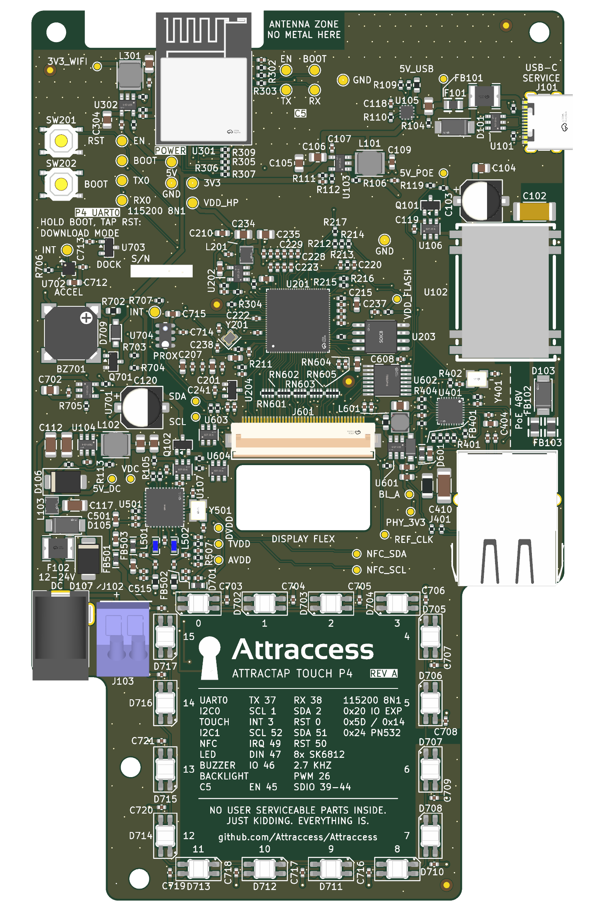

# Attractap Touch P4
<!-- llms-description: Die Leserplatine Attractap Touch P4 (Revision A, in Entwicklung): was auf ihr sitzt, Zeichnungen und Renderings, wie das KiCad-Projekt erzeugt und geprüft wird und wie man sie bestellt. -->

Eigene Platine für den Attractap-Touch-Leser, Revision A. Sie ersetzt die Waveshare-Entwicklungsplatine
samt PN532-Modul der heutigen Leser durch eine einzige Platine.

> **Status: Entwurf der Revision A, noch nicht gebaut.** Niemand hat diese Platine
> bestückt oder vermessen. Sie wurde gegen die Datenblätter ihrer Bauteile, gegen
> die Fertigungsgrenzen von JLCPCB und gegen JLCPCBs Bauteilbibliothek sowie gegen einen Satz von
> Layout-Regeln geprüft, und ihr Spannungseingang, die NFC-Antenne und die schnellen Signale wurden
> aus dem verlegten Kupfer simuliert. Was diese Prüfungen fanden und änderten und was sie nicht
> klären konnten, steht in den
> [Designnotizen](hardware/touch-p4/design-notes.md#design-review). Die Review-Ziele,
> die sie nicht vollständig erfüllt, jeweils mit Begründung, stehen unter
> [Akzeptierte Abweichungen](hardware/touch-p4/design-notes.md#akzeptierte-abweichungen). Rechnen Sie mit einer Inbetriebnahmerunde (siehe [Inbetriebnahmeplan](hardware/touch-p4/bring-up.md)). Die CE-Kennzeichnung braucht Labortests
> am fertigen Produkt (siehe [Konformitäts-Checkliste](hardware/touch-p4/compliance.md)).

## Was auf der Platine sitzt

| Funktion | Bauteil | Hinweise |
|---|---|---|
| MCU | ESP32-P4NRW32X (Chip, QFN-104) | 400 MHz, zwei Kerne, 32 MB PSRAM im Gehäuse, 16 MB Flash |
| Wi-Fi 6 (2,4 und 5 GHz) / Bluetooth LE | Modul ESP32-C5-MINI-1-N4-V1.2 | Funk-Coprozessor, esp-hosted über SDIO; das Modul hat eine EU-Baumusterprüfbescheinigung. Eigene Platinenantenne für beide Bänder, in der oberen linken Ecke der Platine über einem Ausschnitt in der Oberkante; eigener 3,3-V-Wandler (TLV62569) |
| Display | 4,0"-Panel 480x480, ST7701S + GT911 | derselbe Paneltyp wie heute, 40-poliges Flexkabel, RGB565 |
| NFC | PN532 + Platinen-Schleifenantenne | derselbe Chip und dasselbe I2C-Protokoll wie heute |
| Ethernet (LAN-Version) | PHY IP101GRI + Buchse HY931147C | 10/100, RMII |
| PoE (LAN-Version) | isoliertes Modul DP9900M-5V | 802.3af; das Footprint nimmt auch ein Silvertel Ag9905M auf |
| Stromversorgung | DC 12 bis 24 V (Hohlstecker oder WAGO-Drucktasten-Klemme), PoE oder USB-C 5 V | jede Quelle speist die 5-V-Schiene über einen Schalter, der Rückstrom sperrt: eine eFuse (TPS259470A) für USB, ideale Dioden (LM74700-Q1 mit einem MOSFET) für DC und PoE. 3,3-V-Abwärtswandler TLV62569; ein Supervisor (TLV803S) hält den MCU im Reset, bis 3,3 V anliegen. Der DC-Eingang hat eine TVS-Diode am Anschluss, ein gedämpftes Filter zum Netzteilkabel hin und hält höchstens 28 V aus. USB-C ist der Serviceport zum Flashen und Debuggen |
| Rückmeldung | 8 RGB-LEDs (SK6812MINI-E), Summer | die LEDs leuchten oberhalb und unterhalb des NFC-Bereichs durch die Platine |
| Manipulationserkennung | Beschleunigungssensor LIS2DH12, Näherungssensor VCNL4040, Hall-Schalter DRV5032 | Klopfen, Kippen und der Leser, der sein Dock verlässt: Der Näherungssensor misst das Infrarotlicht, das die Platte des Docks im geschlossenen Gehäuse reflektiert, der Hall-Schalter erfasst einen Magneten im Dock. Bisher nur Hardware; die Firmware liest sie noch nicht aus |

Aus derselben Platine entstehen zwei Bestückungsvarianten:

- **wifi**: alles außer den Bauteilen, deren Feld `Variant` den Wert `lan` hat.
- **lan**: alle Bauteile (Ethernet, PoE und WLAN).

Das WLAN-Modul (ESP32-C5-MINI-1) bringt seine eigene Antenne mit, es muss also keine Antenne gekauft
oder platziert werden. Es sitzt in der oberen linken Ecke der Platine und nicht in der Mitte der Oberkante,
wo Espressifs Leitfaden es vorsieht. Das Vollwellenmodell hält es in jedem Kanal innerhalb von 3 dB von
diesem Platz. Siehe „WLAN-Antenne“ in den
[Designnotizen](hardware/touch-p4/design-notes.md#wlan-antenne) und die zugehörige akzeptierte Abweichung. Auf 5 GHz
ist der Leser nur für den Betrieb in Innenräumen gedacht, und seine Firmware muss die Kanal- und Leistungsregeln
der EU einhalten ([firmware-port.md](hardware/touch-p4/firmware-port.md), [compliance.md](hardware/touch-p4/compliance.md)).

## Zeichnungen und Renderings

Aus der Platine geschrieben von den Targets `build` und `render` (siehe [Arbeiten am Design](#arbeiten-am-design)):

| Bestückungsseite (zur Wand) | Displayseite |
| --- | --- |
|  |  |

- [Schaltplan](_media/hardware/touch-p4/schematic.pdf ':ignore') (PDF, alle Blätter)
- [Kupfer und Bestückungsdruck der Bestückungsseite](_media/hardware/touch-p4/board-front.pdf ':ignore') und [der Displayseite](_media/hardware/touch-p4/board-back.pdf ':ignore') (PDF, 1:1, für die Papierprüfung im [Inbetriebnahmeplan](hardware/touch-p4/bring-up.md#vor-der-bestellung))
- [Fertigungszeichnung](https://github.com/Attraccess/Attraccess/blob/main/apps/attractap/hardware/touch-p4/fab/jlcpcb/attractap-touch-p4-fab.pdf) und [Bestückungszeichnung](https://github.com/Attraccess/Attraccess/blob/main/apps/attractap/hardware/touch-p4/fab/jlcpcb/attractap-touch-p4-assembly.pdf) (PDF, Teil des Bestellpakets, siehe [Bestellen bei JLCPCB](#bestellen-bei-jlcpcb))
- [Installationsanleitung](hardware/touch-p4/installation-manual.md) des Gehäuses, auch als [PDF](_media/hardware/touch-p4/attractap-installation-manual-de.pdf ':ignore')

## Projektordner

Das Design liegt in [`apps/attractap/hardware/touch-p4/`](https://github.com/Attraccess/Attraccess/tree/main/apps/attractap/hardware/touch-p4/); diese Dokumentation und ihre Bilder in `docs/en/hardware/touch-p4/` und `docs/_media/hardware/touch-p4/`.

```
kicad/                      KiCad 10 project, written by the generator: look, do not edit
  attractap-touch-p4.kicad_pro / .kicad_sch / .kicad_pcb
  attractap-touch-p4-<sheet>.kicad_sch    one sheet per function block
  lib/attractap.kicad_sym, lib/attractap.pretty/   project symbols and footprints
  sym-lib-table, fp-lib-table             register the project library
scripts/bootstrap/          the generator, the master of the schematic and the board (see below)
scripts/export_fab.py       Gerbers, drill, BOM and placement files for JLCPCB, drawings
sim/                        field and circuit simulations of the routed board
case/                       3D-printable case: design, print files, sources of the manual's figures
fab/jlcpcb/                 the JLCPCB upload package (in git)
```

### Aufbau des Schaltplans

Das Stammblatt ist ein Blockdiagramm. Jeder Block ist ein Blatt:

| Blatt | Inhalt |
|---|---|
| Power | USB-C-Eingang mit seiner eFuse, DC-Eingang (Buchse und Klemme) mit seinem 5-V-Wandler, PoE-Eingang, ideale Dioden auf die 5-V-Schiene, 3,3-V-Abwärtswandler |
| MCU | GPIO und Systemeinheiten des ESP32-P4, Flash, Quarz, Reset-Supervisor und Taster, Boot, USB |
| MCU_Power | Versorgungseinheit des ESP32-P4, Abblockung, 1,1-V-Kernwandler |
| WiFi | ESP32-C5-Modul, sein 3,3-V-Wandler, SDIO-Pull-ups, Reset und Testpunkte |
| Ethernet | PHY, Quarz, Strap-Beschaltung, Buchse (nur LAN-Version) |
| NFC | PN532, Versorgung, Anpassnetzwerk, Antenne |
| Display | Panel-Anschluss, RGB-Serienwiderstände, Hintergrundbeleuchtung, IO-Expander |
| UI | LEDs, Pegelwandler, Summer |
| Mechanical | Befestigungslöcher, Passmarken |

Innerhalb eines Blatts sitzen die Bauteile in umrahmten, betitelten Blöcken, einer je Funktion, gezeichnet
als Schaltung: Leitungen innerhalb eines Blocks, von links nach rechts gelesen, Versorgung oben und
Masse unten. Labels verbinden die Blöcke und tragen Busse. Netze, die Blätter überqueren,
verwenden hierarchische Labels und erscheinen als Pins auf dem Stammblatt. `GND`, `+3V3` und
`+5V` sind Power-Symbole. Kondensatoren zeigen ihre Spannung und ihr Dielektrikum,
Widerstände ihre Toleranz, wo sie wichtig ist. Jedes Blatt hat das kleinste Papierformat,
das es fasst (A4 oder A3), und trägt Datum und Revision in seinem Schriftfeld. Das
Stammblatt hat die Revisionshistorie. Wie die Blätter gezeichnet werden:
[Platinengenerator](hardware/touch-p4/board-generator.md#schaltplanzeichnung).

## Arbeiten am Design

Die Schaltungsbeschreibung und der Generator in `scripts/bootstrap/` sind die Vorlage;
die KiCad-Dateien sind ihre Ausgabe ([Freigabe](hardware/touch-p4/release.md), "Source of
truth"). Machen Sie jede Änderung dort und erzeugen Sie neu: `generate-library`, wenn sich ein Symbol
oder Footprint ändert, `generate-schematic`, dann `place` und `route-finish`, dann
`check`. Öffnen Sie `kicad/attractap-touch-p4.kicad_pro` in KiCad 10, um das Ergebnis anzusehen
oder etwas auszuprobieren, aber committen Sie keine in KiCad gemachte Änderung: `check-source`
schlägt fehl, wenn sich eine KiCad-Datei von dem unterscheidet, was der Generator schrieb, oder wenn sich der
Generator nach dem Schreiben der Dateien geändert hat.

Die Platine ist das Nx-Projekt `attractap-touch-p4-pcb`. Jede Operation ist ein Target:

| Befehl | Was er tut |
|---|---|
| `pnpm nx run attractap-touch-p4-pcb:setup-toolchain` | Prüft KiCad 10 und sein Python, lädt den Autorouter nach `.tools/kicad`. Einmal ausführen. |
| `pnpm nx run attractap-touch-p4-pcb:check` | Alle folgenden Prüfungen außer `check-footprints`, und dass `fab/jlcpcb/` zur Platine passt. Vor dem Bestellen ausführen. |
| `pnpm nx run attractap-touch-p4-pcb:check-footprints` | Jedes Footprint gegen das Bibliotheks-Footprint von JLCPCB für seine Bauteilnummer: Passen die Pads, und stimmt der Winkel in der Bestückungsdatei. Braucht das Internet. Ausführen, wenn sich eine Bauteilnummer oder ein Footprint geändert hat. |
| `pnpm nx run attractap-touch-p4-pcb:route-finish` | Baut das Routing aus dem committeten Autorouter-Ergebnis neu auf (nach `place`): schließt offene Verbindungen, verbreitert Versorgungsleiterbahnen, setzt Rückstrom- und Stitching-Vias, füllt die Kupferflächen und führt die Entwurfsregelprüfung aus. Etwa fünf Minuten; zwei Läufe ergeben dieselbe Platine. |
| `pnpm nx run attractap-touch-p4-pcb:test` | Prüfungen der Schaltungsbeschreibung und der I2C-Adressprüfung. Braucht kein KiCad. |
| `pnpm nx run attractap-touch-p4-pcb:check-source` | Die KiCad-Dateien sind das, was der Generator schrieb, und der Generator hat sich seitdem nicht geändert (`scripts/check_source.py`; jeder Generatorschritt hält einen Stempel in `kicad/generated-from.json` fest). Braucht kein KiCad. `python3 scripts/check_source.py --full` erzeugt alles in einer Kopie neu und vergleicht (etwa 45 Minuten, KiCad nötig; vor einer Bestellung). |
| `pnpm nx run attractap-touch-p4-pcb:erc` | Elektrische Regelprüfung des Schaltplans. |
| `pnpm nx run attractap-touch-p4-pcb:check-netlist` | Schaltplan gegen die Schaltungsbeschreibung; Geräte und Adressen an jedem I2C-Bus. |
| `pnpm nx run attractap-touch-p4-pcb:drc` | Entwurfsregelprüfung der Platine, einschließlich Abgleich mit dem Schaltplan. |
| `pnpm nx run attractap-touch-p4-pcb:simulate` | Simuliert die verlegte Platine und vergleicht die Ergebnisse mit den Grenzen der Bauteile: NFC-Schleife, Anpassung und Feld, Hot-Plug am DC-Eingang, Hochfahren, Reflexionen und Timing auf den schnellen Leitungen, Spannungsabfall auf den Versorgungsleiterbahnen, PoE-Isolationsabstände, Wärme im geschlossenen Gehäuse, der Dock-Magnet. Braucht ngspice. Siehe [Simulationen](hardware/touch-p4/simulations.md). |
| `pnpm nx run attractap-touch-p4-pcb:simulate-antenna` | Vollwellenmodell der Dualband-Platinenantenne des WLAN-Moduls (ein Ersatz gleicher Größe und Art) an ihrem Platz auf der Platine und zum Vergleich an Espressifs Position, mit dem Display, im Gehäuse und mit einer Metallwand hinter dem Leser. Braucht openEMS; nicht Teil von `check`. |
| `pnpm nx run attractap-touch-p4-pcb:build` | Das JLCPCB-Upload-Paket nach `fab/jlcpcb/` sowie den Schaltplan und die beiden Platinenplots (PDF) nach `docs/_media/hardware/touch-p4/`. Führt zuerst `erc` und `drc` aus. |
| `pnpm nx run attractap-touch-p4-pcb:render` | Die beiden 3D-Renderings oben, `docs/_media/hardware/touch-p4/board-top.png` und `board-bottom.png`. |

Berichte landen in `fab/reports/`. Die Targets finden KiCad im PATH, im macOS-App-Bundle oder, unter
NixOS, in nixpkgs; setzen Sie `KICAD_CLI` und `KICAD_PYTHON`, um eine andere Installation zu verwenden. `simulate` nimmt
ngspice aus dem PATH oder aus nixpkgs (`NGSPICE` benennt ein anderes). Sie führen KiCad
mit einer eigenen Konfiguration unter `.tools/kicad` aus und hängen daher nicht von Ihren KiCad-Einstellungen ab.
Die Targets `generate-library`, `generate-schematic`, `place`, `route` und `route-finish` bauen das
Projekt aus der Schaltungsbeschreibung neu auf und überschreiben die KiCad-Dateien; siehe
[Platinengenerator](hardware/touch-p4/board-generator.md). Das Ergebnis des Autorouters
(`kicad/attractap-touch-p4.ses`) ist committet, sodass `place` gefolgt von `route-finish` wieder die
committete Platine ergibt.

### Bestellen bei JLCPCB

`build` schreibt das Upload-Paket nach `fab/jlcpcb/`. Dieser Ordner liegt in Git, damit die Dateien einer Bestellung
wiedergefunden werden können; `check` schlägt fehl, wenn er nicht zur Platine passt.

| Datei | Verwendung |
|---|---|
| `attractap-touch-p4-gerbers.zip` | Die Platinenbestellung: Gerber- und Bohrdateien. |
| `attractap-touch-p4-fab.pdf` | Fertigungszeichnung: Umriss und Ausschnitte mit Maßen, Lagenaufbau, Bohrtabelle, kleinste Strukturen, Fertigungshinweise (Oberfläche, IPC-Klasse, Via-Füllung). An die Bestellung anhängen. |
| `attractap-touch-p4-assembly.pdf` | Bestückungszeichnung: jedes Bauteil der Bestückungsseite mit Umriss, Pads, Bezeichner und Wert, Pin 1 und Polarität markiert; eine Übersicht und Detailblätter von MCU, PHY, NFC-Chip und Leistungsteil. Für Bestückungsfragen, Prüfung und Reparatur. |
| `attractap-touch-p4.ipc` | IPC-D-356-Netzliste, für den elektrischen Test der Fertigung gegen das Design. |
| `bom-lan.csv`, `cpl-lan.csv` | Bestückung der Ethernet/PoE-Version: Stückliste und Positionen. Die Stückliste hat Hersteller, Bauteilnummer, Beschreibung, eine freigegebene Alternative und den Lebenszyklus jeder Zeile. |
| `bom-wifi.csv`, `cpl-wifi.csv` | Bestückung der WLAN-Version. |
| `parts-list-lan.csv`, `parts-list-wifi.csv` | Alles, was für einen Leser zu kaufen ist: die Bestückungsstückliste plus die Teile, die JLCPCB nicht bestückt (Displaypanel). |

Der Bestückungsdruck trägt einen Bezeichner, wo immer einer neben sein Bauteil passt (etwa die Hälfte); die
Bestückungszeichnung hat alle. Was der Bestückungsdruck sonst noch trägt, steht in den
[Designnotizen](hardware/touch-p4/design-notes.md#verwendete-layout-regeln). Einfache Plots der Kupfer- und Bestückungsdrucklagen stehen unter
[Zeichnungen und Renderings](#zeichnungen-und-renderings).

Was die Platine für das Bestellformular braucht:

| | |
|---|---|
| Platine | 6 Lagen, 86 x 143,5 mm, 1,6 mm FR-4 |
| Lagenaufbau | JLC06161H-3313: "Specify Stackup" im Bestellformular auf "Yes" setzen und ihn wählen (kostenlos). Die Platinendatei trägt die Dicken, die das Bestellformular dafür zeigt: Prepreg 0,0994, Kern 0,55, Prepreg 0,1088, Kern 0,55, Prepreg 0,0994 mm |
| Kleinste Leiterbahn und Abstand | 0,11 mm und 0,127 mm (JLCPCBs Grenze für Platinen mit Innenlagen: je 0,09 mm). Zwei Leiterbahnsegmente sind 0,112 mm breit, alle anderen 0,126 mm oder mehr. Pads zweier Netze stehen mindestens 0,15 mm auseinander (die Pins des MCU), JLCPCBs Wert; jeder Spielraum steht in den [Designnotizen](hardware/touch-p4/design-notes.md#reserven-zu-den-grenzen-von-jlcpcb) |
| Kleinste Via | 0,45 mm Pad mit 0,2 mm Bohrung (etwa jede fünfte Via; die meisten haben ein 0,5-mm-Pad). Ohne Aufpreis: Nach dem Hinweis des Bestellformulars zu "Min via hole size/diameter" ist eine 0,2-mm-Bohrung bei Platinen mit Innenlagen kostenlos, wenn die Via 0,45 mm oder breiter ist. Lassen Sie diese Option auf "0.3mm/(0.4/0.45mm)"; die kleineren Auswahlmöglichkeiten sind für kleinere Pads und kosten 39 USD und mehr |
| Vias | "Epoxy Filled & Capped", die Wahl des Bestellformulars für sechs Lagen, ohne Aufpreis. Das Formular bietet für Platinen mit Innenlagen keine Lötstopplack-Abdeckung ("Tented") an. Nötig, nicht nur kostenlos: Vier Kondensator-Pads am MCU (C208, C223, C226) haben eine Via im Pad, und die Ränder der zwölf Masse-Vias zwischen den Masse-Pads des WLAN-Moduls berühren die Pads (Espressifs Land Pattern); die Füllung und die Kupferkappe verhindern, dass sie das Lot einsaugen. Keine andere Via liegt unter Lotpaste |
| Lötstopplack | grün. Die Lötstopplackstege zwischen den Pins des MCU sind 0,1 mm breit, JLCPCBs Grenze für Grün; andere Farben brauchen breitere Stege |
| Gefräste Öffnungen | Flexschlitz 3 mm breit, acht LED-Fenster 3,4 x 3,0 mm mit freigestellten Ecken, ein Ausschnitt 28,9 x 6,0 mm in der Oberkante unter der Antenne des WLAN-Moduls, zwei abgeschnittene Ecken, durchkontaktierte Langlöcher an der DC-Buchse und an USB-C |
| Umrisstoleranz | die übliche +/-0,2 mm genügt |
| Oberfläche | ENIG (18 USD für 5 Platinen, 45 USD für 100). Nicht das kostenlose OSP, das das Formular für sechs Lagen wählt: Es ist ebenso eben, aber JLCPCB schließt es für Kontaktflächen aus, und die vier Masse-Pads für die Metallrückseite des Displays und die 30 Testpunkte blieben blankes Kupfer ([mehr](hardware/touch-p4/design-notes.md#kosten)) |
| Impedanzkontrolle | "Yes", +-10 % (der Hinweis der Fertigungszeichnung): USB-Paar 90 Ohm differenziell (0,14-mm-Leitungen, 0,15 mm Abstand, Rückseitenlage über In4), Ethernet-Leitungen 50 Ohm (0,155 mm, Bestückungsseite über In1). Breiten aus JLCPCBs Rechner für diesen Lagenaufbau ([Designnotizen](hardware/touch-p4/design-notes.md#impedanz)); die Fertigung darf sie anpassen |
| Bestückung | nur Oberseite: 221 Bauteile in 85 Zeilen (WLAN-Version), 258 Bauteile in 96 Zeilen (Ethernet/PoE-Version) |
| Durchsteckbauteile | DC-Buchse J102, DC-Klemme J103 (zwei Pins in einem Footprint mit vier Löchern, siehe unten) und bei der Ethernet/PoE-Version die Buchse J401 |
| Nicht von JLCPCB bestückt | das Displaypanel (aufgeklebt, Flexkabel in J601 gesteckt) |
| Seriennummer auf der Platine | Option "Mark on PCB": nur Nummer, Position festgelegt. JLCPCB druckt dann eine auf jeder Platine andere Nummer in das weiße Feld neben `S/N` auf der Bestückungsseite: ein vollflächiges Bestückungsdruck-Rechteck von 10 x 2 mm, wonach es sucht. Ohne die Option bleibt das Feld weiß, zum Beschriften. (JLCPCB druckt keine Bestellnummer mehr; der Text `JLCJLCJLCJLC`, der früher ihren Platz markierte, ist von der Platine verschwunden.) |

Was die Bauteile kosten, was JLCPCB einmal je Bestellung berechnet und welche günstigeren Bauteile erwogen wurden:
[Designnotizen](hardware/touch-p4/design-notes.md#kosten). Lebenszyklus, freigegebene Alternativen und wie man die
Bauteile beschafft, die JLCPCB nicht führt: [Bauteile](hardware/touch-p4/parts.md).

Vor dem Bezahlen prüfen:

- Lagerbestand. JLCPCBs Bauteilliste zeigt, was nicht vorrätig ist. Am 22. November 2026 hatte es keinen ESP32-P4
  (U201); er muss vor der Bestückungsbestellung über JLCPCBs Bauteilbeschaffung bestellt werden. Vom
  PoE-Modul (U102, Ethernet-Version) waren 38 vorrätig, zehn weniger als zwei Tage zuvor. Der 3,3-V-Wandler U103
  ist jetzt der TLV62569 des Kernwandlers (490416 vorrätig am 25. November 2026);
  der zuvor bestückte AP63203WU-7 war ausverkauft. Siehe die Beschaffungsrisiken in den
  [Designnotizen](hardware/touch-p4/design-notes.md).
- DC-Klemme J103. Die WAGO 250-202 hat zwei Pins und das Footprint vier Löcher (es nimmt auch die
  WAGO-Hebelklemme 2601-3102 auf). Schreiben Sie in die Bestellbemerkung: Pins im oberen linken und im unteren
  rechten Loch, Kabeleinführung zum Platinenrand mit den beiden abgeschnittenen Ecken. Die Fertigungszeichnung
  zeigt den Umriss des Körpers.
- Rotation. Die Bestückungsdateien tragen bereits JLCPCBs Winkel für die vier Bauteile, bei denen er
  von KiCads abweicht (der PN532 U501, der Pegelwandler U701, der Transistor Q701 und die Widerstandsarrays);
  `check-footprints` vergleicht jedes Bauteil mit JLCPCBs Bibliothek, außer der Induktivität L102, für deren
  Bauteilnummer die Bibliothek kein Footprint hat (zwei Pads, keine Polarität). Prüfen Sie dennoch jedes gepolte Bauteil
  in JLCPCBs Bestückungsvorschau, besonders das PoE-Modul U102 (seine Pads sind gleich, wenn es
  um 180 Grad gedreht ist), die Dioden D101, D103, D105 und D106 (D106, die TVS-Diode am DC-Wandler,
  hat ihre Kathode links, zum Platinenrand hin; D107 ist bidirektional), die Elektrolytkondensatoren
  C103 und C120, die MOSFETs Q101 und Q102, die LEDs und die ICs.

### Bauteile und Bibliothek

Jedes bestückte Bauteil trägt seine LCSC-Nummer im Feld `LCSC`, seinen Hersteller in
`Manufacturer`, seine Bauteilnummer in `MPN`, und `BOM description`, `Alternate` und (für
ICs und Module) `Lifecycle` aus `scripts/bootstrap/parts_info.py`; Passive übernehmen
ihre aus der Tabelle in `design.py`. Projektsymbole und Footprints für die größeren
Bauteile wurden aus LCSC/EasyEDA mit
[easyeda2kicad](https://github.com/uPesy/easyeda2kicad.py) konvertiert; Passive verwenden die
Standard-KiCad-Bibliotheken. Jedes Footprint mit einem Körper hat ein 3D-Modell in
`kicad/lib/attractap.3dshapes/` (gzip-komprimiertes STEP, von KiCad direkt gelesen): aus
der offiziellen JLCEDA/EasyEDA-Bibliothek (easyeda.com, lceda.cn) für die konvertierten
Footprints, aus KiCads packages3D für die Standard-Footprints. Ihre Platzierung steht in
`scripts/bootstrap/lib_models.py`, das `scripts/bootstrap/collect_models.py` schreibt
(siehe den [Platinengenerator](hardware/touch-p4/board-generator.md)). Das ESP32-C5-Footprint trägt den MINI-1-Körper, das
PN532-Footprint den Körper des NXP-Bauteils; die NFC-Antenne ist nur Kupfer.

Um ein Bauteil von LCSC hinzuzufügen, tragen Sie es in die Schaltungsbeschreibung ein, holen Sie die
Konvertierungen aller LCSC-Bauteile der Platine in einen Ordner und bauen Sie die Bibliothek
daraus neu auf (der [Platinengenerator](hardware/touch-p4/board-generator.md#schritte), „Schritte“):

```bash
easyeda2kicad --lcsc_id C54540373 C5736265 ... C12345 --full --output /tmp/lcsc/lcsc
pnpm nx run attractap-touch-p4-pcb:generate-library -- /tmp/lcsc
```

erzeugen Sie dann den Schaltplan und die Platine neu.

### Der Generator

Die Skripte in `scripts/bootstrap/` bauen das ganze Projekt aus einer Schaltungsbeschreibung
(`design.py`): Sie schreiben die Bibliothek und die Schaltplanblätter, platzieren
die Bauteile, fügen die festen Routen hinzu, importieren das committete Ergebnis des Autorouters, schließen
die übrigen Verbindungen mit einem kleinen Raster-Router und prüfen das Ergebnis. Sie sind
die Vorlage: **Ihr Ausführen überschreibt die KiCad-Dateien**, so wird jede Änderung
gemacht. Siehe [Platinengenerator](hardware/touch-p4/board-generator.md).

## Platinendaten

- 86 x 143,5 mm, 6 Lagen, 1,6 mm, alle Bauteile auf einer Seite (KiCad front = die Seite,
  die zur Wand zeigt). Das Display ist auf die andere Seite geklebt; die NFC-Schleife liegt
  ebenfalls auf dieser Seite.
- Lagenbelegung: F.Cu Signale und Bauteile, In1 Massefläche, In2 Signale mit dazwischen
  gefüllter Masse, In3 3,3-V-Fläche, In4 Massefläche, B.Cu Signale, Kernschiene
  und Antenne. Jede Signallage liegt neben einer Fläche, die keine Leiterbahn durchtrennt.
  Leiterbahnen verlaufen nur auf F.Cu, In2 und B.Cu.
- Das erste Layout hatte vier Lagen, wobei sich die 3,3-V-Fläche In2 mit den
  Signalleiterbahnen teilte. `COPPER_LAYERS` in `scripts/bootstrap/geometry.py` baut diese
  Platine aus demselben Routing neu auf; sie kostet 8 bis 45 USD weniger je Bestellung und hat die
  Schwächen beim Rückstrompfad, die in den [Designnotizen](hardware/touch-p4/design-notes.md#review-gegen-layout-regeln) aufgeführt sind.
- Bestellen Sie mit JLCPCBs Lagenaufbau JLC06161H-3313, Oberfläche ENIG (QFN mit 0,35 mm Raster)
  und Standard PCBA.
- Die Ethernet-Buchse sitzt hinter der unteren rechten Ecke des Displays, damit
  ihr Stecker und der Knick des Kabels ins Gehäuse passen. Ihre Pins ragen dort aus der
  Displayseite der Platine. Kürzen Sie sie auf 1 mm und montieren Sie das Display
  1,5 mm von der Platine entfernt (höchstens 2 mm), siehe die
  [Designnotizen](hardware/touch-p4/design-notes.md#displaymontage-und-flexkabel).

Weiterführend: [Designnotizen](hardware/touch-p4/design-notes.md),
[Design-Review: Noten, Kriterien und Entscheidungen](hardware/touch-p4/review.md),
[Pin-Belegung und Firmware-Portierung](hardware/touch-p4/firmware-port.md),
[Inbetriebnahmeplan](hardware/touch-p4/bring-up.md), [Konformitäts-Checkliste](hardware/touch-p4/compliance.md),
[Gehäuse und Installationsanleitung](hardware/touch-p4/case.md).
