# Waveshare ESP32-S3-Touch-LCD-4
<!-- llms-description: Referenzschaltpläne der Waveshare-Platine ESP32-S3-Touch-LCD-4, V3.0 und V4.0, auf der die Attractap-Touch-V1- und V2-Leser aufbauen. -->

Die im Einsatz befindlichen Attractap-Touch-Leser basieren auf Waveshares Platine ESP32-S3-Touch-LCD-4: der Touch V1 auf ihrer V3.0, der Touch V2 auf ihrer V4.0 (Firmware-Varianten `attractap-touch` und `attractap-touch-v2`). Hier stehen ihre Schaltpläne, wie Waveshare sie veröffentlicht, für die Pin- und IO-Expander-Zuordnungen der Firmware. Die Platine [Attractap Touch P4](hardware/touch-p4/overview.md) ersetzt sie durch eine eigene Platine.

## V4.0 (Touch V2)

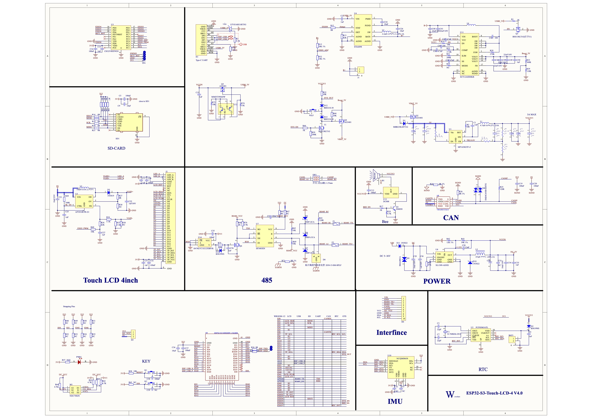

Seine Blöcke, aus dem Blatt ausgeschnitten:

### ESP32-S3-Modul

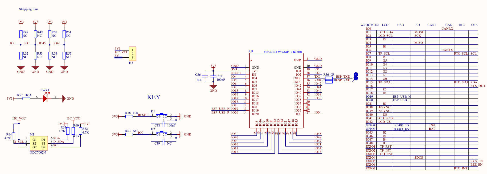

### Stromversorgung

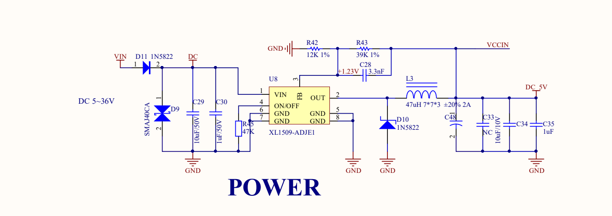

### USB

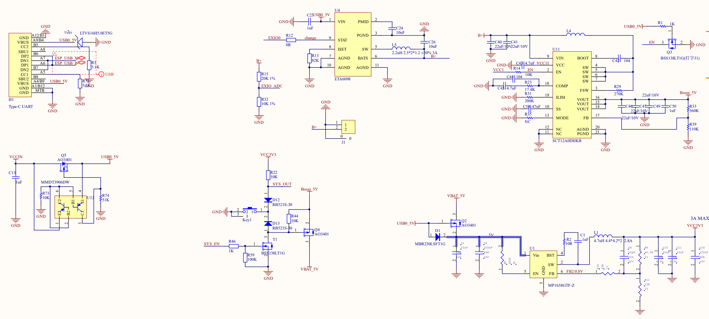

### IO-Expander

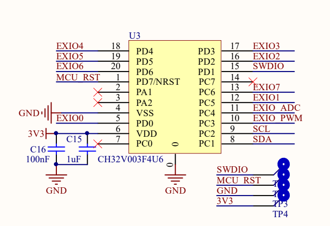

### Display- und Touch-Anschluss

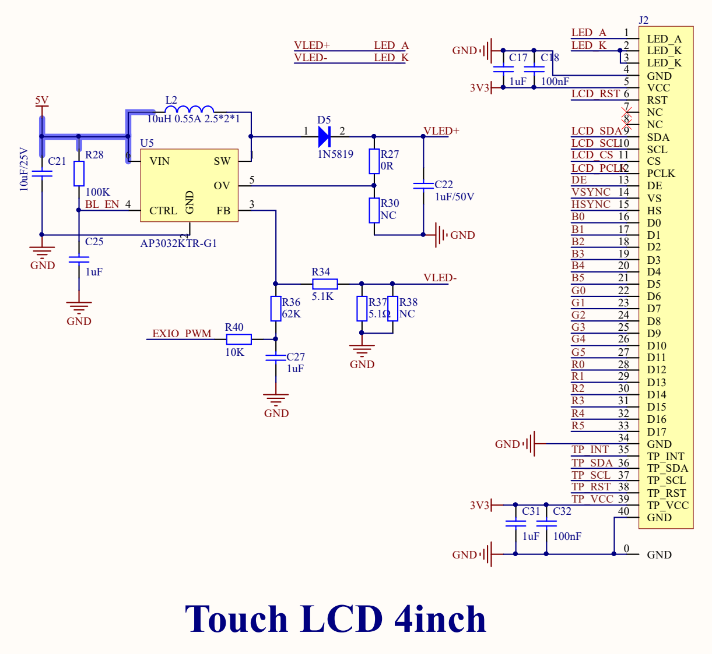

### Schnittstellenleiste

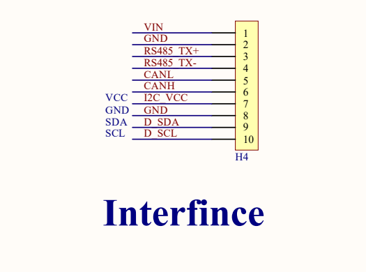

### RS-485

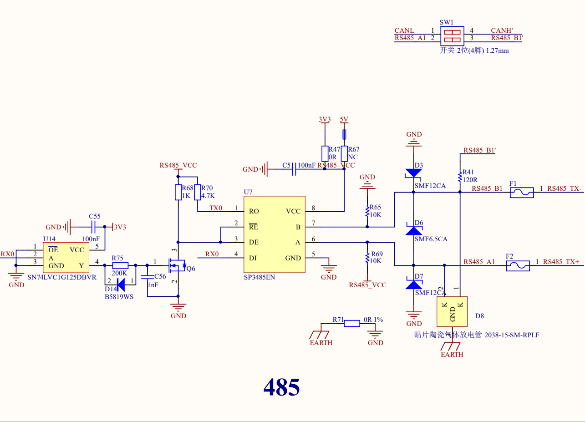

### CAN

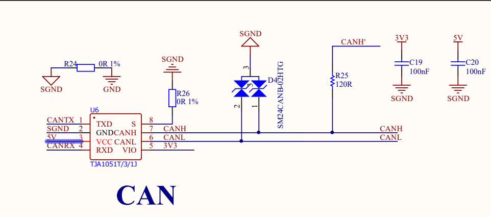

### Echtzeituhr

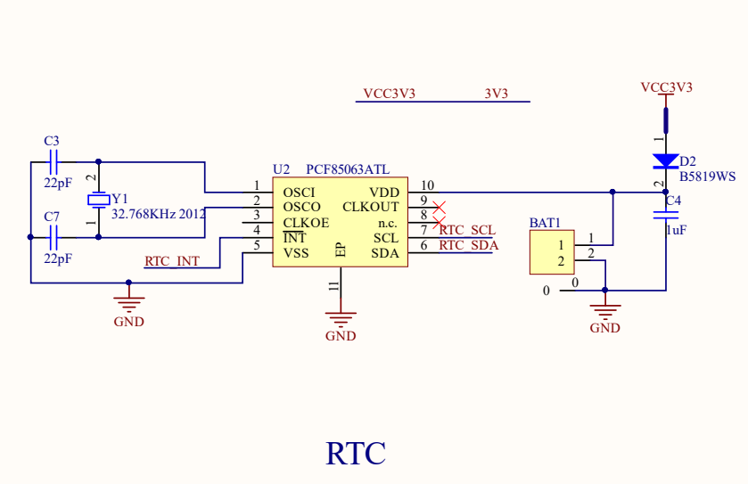

### IMU

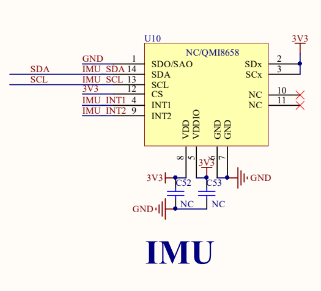

### Summer

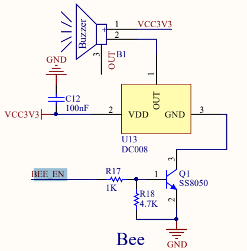

### SD-Karte

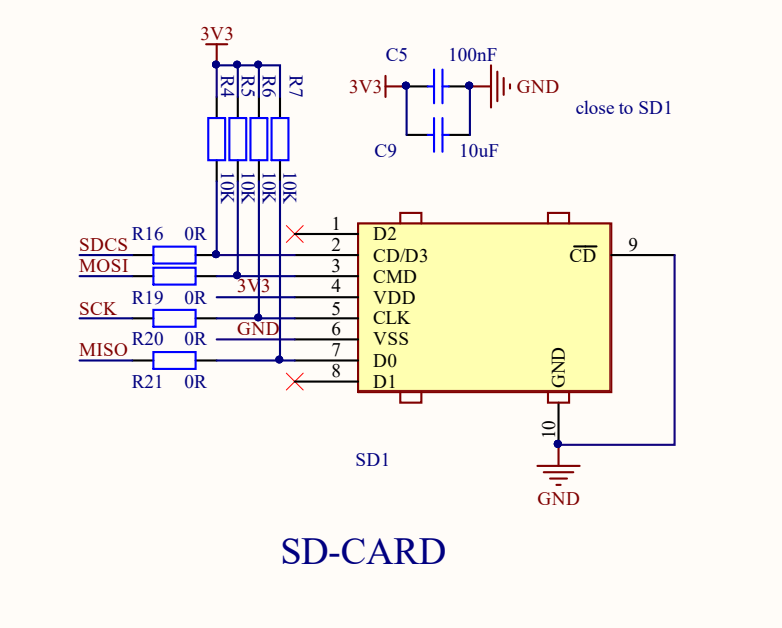

## V3.0 (Touch V1)

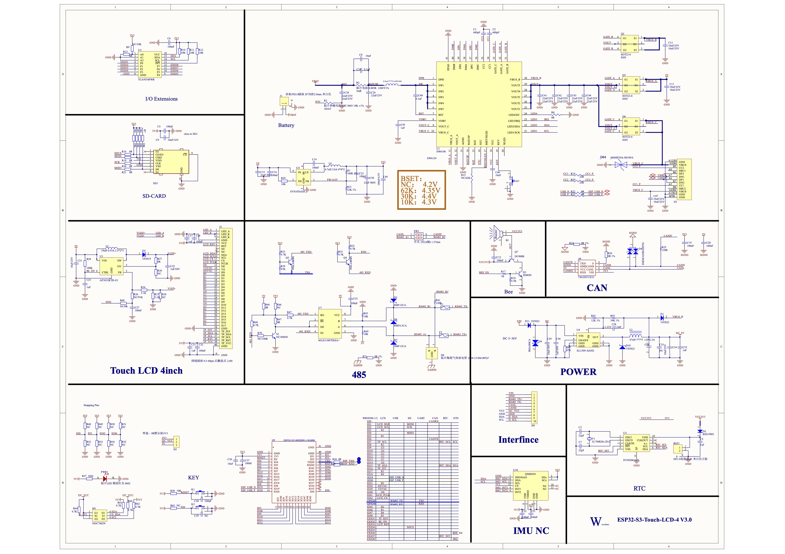
