# Using the Attractap Reader

<!-- llms-description: How to use an Attractap touch reader: sign in with a card, start or stop machines, open doors, view usage and complete forms. -->

Use your RFID card and the Attractap touch display to start or stop a machine, open a door, or request supervision. The reader shows the machines and doors assigned to it and the actions available to you.

You need an RFID card linked to your Attraccess account. If you do not have one yet, ask your administrator to register a card for you.

## Sign in with your card

1. Hold your card against the reader until your name appears at the top of the screen.
2. Remove your card. You stay signed in and can choose a machine or door from the list.
3. Tap the action on the **right** to use a resource, or its name on the **left** to see details.

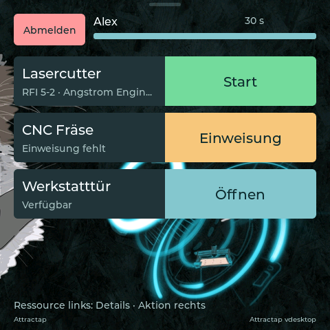

_Your name and the remaining sign-in time appear at the top. The screenshots show the German display labels used in this guide._

The reader shows your display name: your first and last name when your account has them, otherwise your username. This applies to the header, the lock screen, enrollment and reset screens, mass introductions, supervision and the session summary. Readers on an older firmware or server keep showing the username. Characters outside the reader font (Latin-1) are replaced, and very long names are shortened on screen.

You can also choose a resource **before** signing in. Tap its name, then hold your card against the reader when prompted. Its details open after you sign in. The left-arrow button at the far left of the header returns to the list.

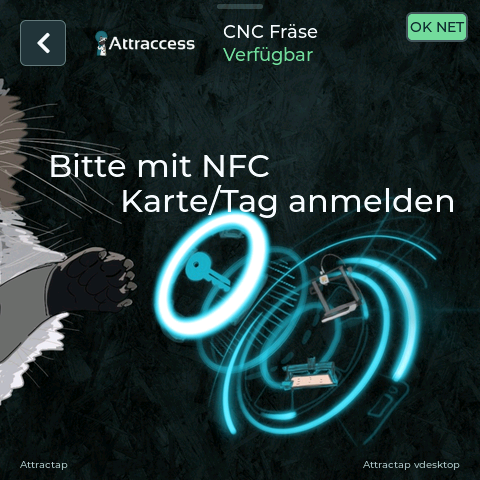

### Time and date

While nobody is signed in, the reader doubles as a clock. The card prompt shows the current time and date in large type with **RFID-Karte auflegen** (Hold your RFID card here) below it, and the resource list shows them at the top. The reader shows the time in its own [time zone](attractap/reader-ui.md#time-and-time-zone): the zone of a plugin such as [Reservations](plugins/reservations/overview.md) when one sets it, otherwise that of your Attraccess server. While you are signed in, a small clock in the footer bar shows the current time. After a restart, the clock appears once the reader has connected to the server; until then, the reader shows its usual sign-in text. If the connection drops later, the clock continues advancing internally, but the display shows the initialization screen until the reader reconnects.

During an outage, UTC continues advancing with the last time zone offset the server sent. That offset stays fixed: daylight-saving changes or a change of the reader's time zone take effect only after another valid server time sample arrives.

The signed-out card prompt keeps showing the clock when the selected resource is in use. Its header still shows the current user's name. Signing in opens the existing resource details and session controls.

## Start a machine or open a door

In the resource list, tap **Start** next to a machine or **Öffnen** (Open) next to a door. Complete any form or supervision step that appears, then wait for the result on the display.

A door with the [access only](resources/creating-resources.md#door-options) option has a single action: its details show one **Öffnen** (Open) button instead of lock, unlock and unlatch. On an Attractap Lite reader (without a display), any tap of your card opens such a door, short or long, and the reader gives no long-tap signal there.

While the reader processes an action, the controls are temporarily unavailable. Wait until the resource status has updated before tapping again. After a machine starts, its row shows your name and a **Stop** button.

### Choose a project

To record machine usage against a project, tap the machine's name to open its details, tap **Projekt wählen** (Choose project), and select your project before starting there. Starting directly from the list records the usage without a project.

### Results, messages and low balance

The reader reports results on a full screen of its own and returns to the screen you were on:

- A green check with **Nutzung gestartet** (Usage started) or **Nutzung beendet** (Usage ended) and the resource name, or **Aktion bestätigt** (Action confirmed) after a door or flow button. Tap anywhere to continue, or wait a moment.
- The **Gesamtkosten dieser Sitzung** (Total cost of this session) screen with the amount, when a stop is billed. Tap **OK** or wait.
- A red cross with **Anmeldung fehlgeschlagen** (Sign-in failed) when the card is not accepted. Tap **OK** or hold your card against the reader again.
- A warning with an explanation, for example **Status nicht verfügbar** (Status unavailable) after the reader signed you out because the machine status did not load. Tap **OK**, wait, or hold your card against the reader to sign in again.

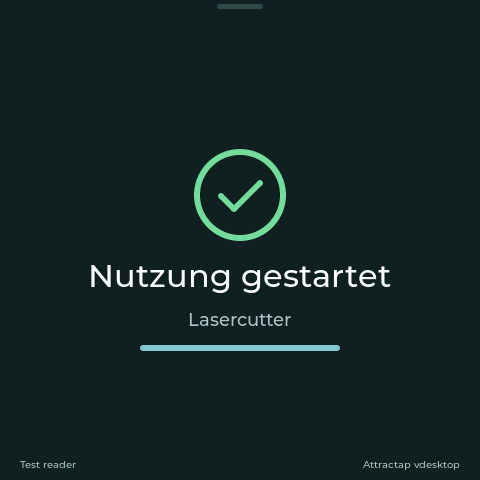

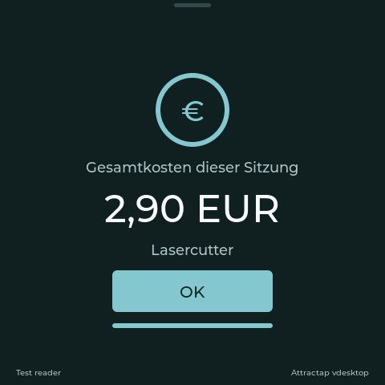

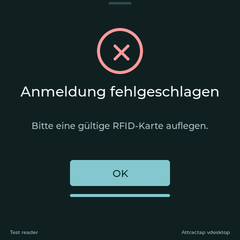

When a single button's action fails, for example **Start**, the button itself turns red for about four seconds and reads **⚠ Fehlgeschlagen – erneut tippen** (⚠ Failed – tap to retry), or the reason, for example **⚠ Karte ist nicht aktiv** (⚠ Card is inactive). It keeps its size and place, and nothing else on the screen moves. Tap the button to retry. While the reader reloads the machine status after the failure, the message waits until the status is back. If the button now means something else, for example because someone else started the machine meanwhile, the message is dropped. If the button is no longer there, the reader shows a **Etwas ist schiefgelaufen** (Something went wrong) screen with the error code and a **Zurück** (Back) button.

The same applies to usage forms: if the server cannot take a page, the reason appears on **Weiter** (Next) or **Absenden** (Submit); if the form cannot be loaded at all, it closes and the reason appears on the button that opened it.

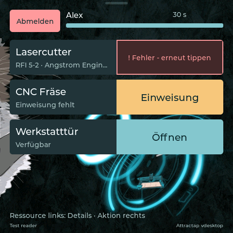

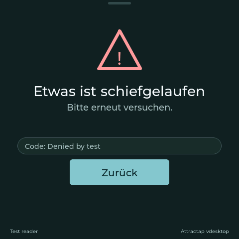

If an action fails because your balance is too low and the reader has a payment terminal, the reader opens the **Unzureichendes Guthaben** (Insufficient balance) screen. Type the amount in whole euros on the number pad, tap **Aufladen** (Top up) and continue at the payment terminal when **Aufladung gestartet** (Top-up started) appears. A missing amount, or a top-up the server refuses, shows on **Aufladen** in the same way as a failed button; the amount you typed stays. **Abbrechen** (Cancel) returns you to where you were. Usage forms and the project selection are screens of their own as well. If the reader signs you out meanwhile, whichever screen is open is replaced like any other.

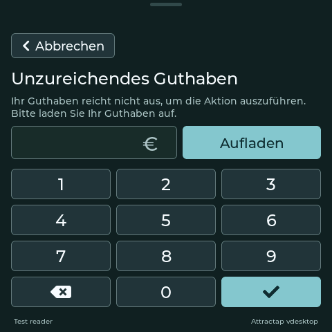

Rebooting from the maintenance drawer and powering the reader off (on devices with a power button) ask for confirmation on a full screen with **Abbrechen** and the action next to each other.

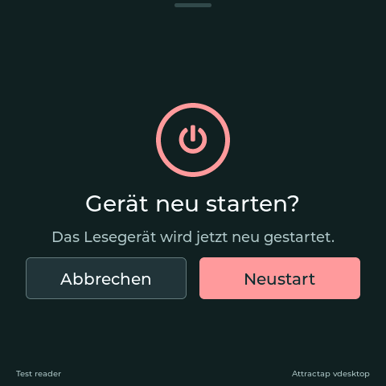

## View live usage stats

While signed in, tap the name of the machine you are using. Its details show the session duration and an **Aktuelle Nutzung** (Current usage) panel with consumed energy in **kWh**, machine operating time, and running or idle status. Readings refresh every 10 seconds while you view the details.

Energy readings require configured metering; operating time requires operating-state tracking. **Warte auf Messwert** means no current energy reading is available, and **Keine Daten** means operating-time data is unavailable. Missing readings are not counted as zero. Stats disappear when your usage ends or you sign out.

## Stop a machine

1. If you have been signed out, scan your card again.
2. Tap **Stop** next to the machine you are using. You can also open its details and tap **Sitzung beenden** (End session).
3. If the reader asks whether the machine is OK, answer it (see below).
4. Complete any required end-of-use form and wait until the display confirms that the usage has ended.

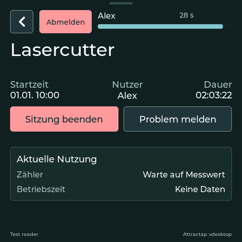

_The back arrow returns to the resource list. You remain signed in when you move between the list and details._

> [!IMPORTANT]
> **Abmelden** (Sign out) ends your sign-in on the reader. It does **not** stop machine usage. Use **Stop** or **Sitzung beenden** when you have finished using a machine.

### "Is the machine OK?"

With the maintenance license module, the reader asks **Ist die Maschine in Ordnung?** (Is the machine OK?) before it ends your own session, unless your administrator turned the [question off for the resource](resources/maintenance.md#is-the-machine-ok-when-a-session-ends) or you can manage its maintenance yourself.

- **Maschine ist in Ordnung** (Machine is OK) ends the session.
- **Wartung nötig** (Needs maintenance) opens a text field with the on-screen keyboard. Describe the problem (3 to 500 characters) and tap **Weiter** (Next). The session ends, and the maintainers are notified.
- **Abbrechen** (Cancel) keeps the session running.

End-of-use forms follow the answer; the reader does not ask again after them. The session summary or the confirmation says **Wartungsteam benachrichtigt** (Maintainers have been notified), or **Meldung nicht gesendet. Bitte erneut melden.** (Report not sent. Please report it again.) if the session ended but the request could not be filed. Ending someone else's session never asks.

## Report a problem

You can report a problem at any time, whether or not a session is running and even while the resource is under maintenance:

1. Sign in with your card and tap the resource's name to open its details.
2. Tap **Problem melden** (Report a problem) at the bottom.
3. Describe the problem (3 to 500 characters) and tap **Senden** (Send).

The reader confirms with **Wartungsteam benachrichtigt** (Maintainers have been notified), or shows **Meldung nicht gesendet** (Report not sent) on the button so you can try again. The button appears only with the maintenance license module and only if you cannot manage the resource's maintenance yourself. Attractap Lite readers have no screen, so they have neither the button nor the question.

### Session finished summary

After you successfully stop your own machine session, the reader shows **Danke, {name}!** with your display name (your name, or your username when none is set). **Dauer** is the elapsed session time in hours, minutes and seconds, not machine operating time or billed minutes. Hours can exceed 24. **Abgerechnet** shows the final formatted charge when there is a nonzero charge; otherwise only the centered duration appears.

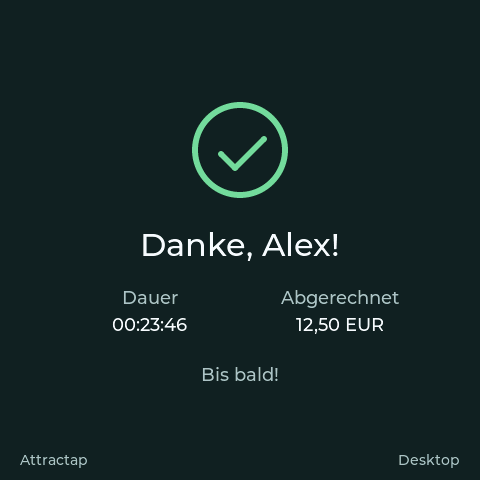

The summary stays visible for about **3.5 seconds** (about **6 seconds** when it also says what became of a maintenance request), then signs you out. Tap anywhere or present a card again to dismiss it sooner. A finger or card already held when the summary opens does not dismiss it. The dismissing card is consumed; remove it and scan again to sign in. Other running machine sessions continue.

Stopping from the list, details or after submitting a required end form produces the same summary. A failed stop does not show it. If you end another person's session as a resource manager, introducer or maintainer, you keep the existing confirmation and remain signed in. Readers using an older server without summary metadata keep the previous confirmation behavior.

The device currently uses German labels, including **Bis bald!**. Future English equivalents are **Thanks, {name}!**, **Duration**, **Charged**, and **See you soon!**.

## Session duration and extending

On a machine that [requires a duration estimate](resources/creating-resources.md#max-session-time-and-duration-estimate), touch readers with firmware that supports it (the capability **sessionDuration**) open a full-screen input after the project selection and before the start request, so before any forms. Set hours and minutes with the steppers or use a quick pick. The screen shows the max session time, if the machine has one, and does not accept more. It also says that the machine stops automatically after this time at the latest. **Cancel** aborts the start. The same applies to takeover and to a supervised start.

While you use the machine, the details show the remaining time and the time it stops automatically, with **+1 h**, **+2 h**, **+4 h**, **+6 h**, **+12 h**, **+24 h** and **Extend to maximum**. Buttons that would pass the max session time are disabled. You need the same card identity as for stopping: the session owner, or a manager who may end that session (where the reader offers to stop someone else's session, it also offers to extend it). On a machine shared by several people, the reader only extends your own session; managers extend other sessions in the web app. Extensions made in the web app update the reader live.

Readers that cannot ask never refuse a start for a missing estimate: Attractap Lite Ethernet, the GL-S10 bridge, plugin readers and touch readers with older firmware. Your session starts normally and ends at the max session time. Without a max, it ends at the machine's default estimate (60 minutes if the admin did not set one). Extend it in the web app.

> [!WARNING]
> At the end time the server stops the machine itself, even without a reader and even in the middle of a job such as a 3D print. Flows run, so power may be cut. You get a warning 15 and 5 minutes before (in the app, as push or by email, not on the reader).

## Shared machines

Some machines allow several people to work at the same time (see [Using Resources](end-user/using-resources.md#use-a-shared-machine)). On the touch reader:

- The list shows who is using the machine, for example **Alex, Sam · 2/3**: your own session first (as **Du** (You), for example **Du, Sam · 2/3**), then the others, then how many places are taken. Names that no longer fit are summed up as **+N** (**Alex, Sam +2 · 4/6**); a single name too long for the line is cut with **...**. When no place is left, **Voll** (Full) replaces the count (**Alex, Sam, Robin · Voll**). With an older server that sends no names, the list shows **In Verwendung k/N** (In use k/N). The details show **In Verwendung k/N** (In use k/N) while other people are using it. A **Start** action stays available in the list (**Ressource verwenden** in the details) as long as there is room for another person and you have no session of your own. When as many people as allowed are using it, the details and the action button show **Voll** (Full).
- If you have a session on the machine, the list names you (**Du**, You) and offers **Stop**; the details show **Von dir verwendet** (In use by you) and **Sitzung beenden** (End session). Live stats on the details screen are for your own session.
- Resource managers, introducers and maintainers get a list **Andere Sitzung beenden:** (End another session:) on the details screen with one button per other session, to end that specific session. The reader lists at most 16 sessions; end further sessions on the [detail page](resources/resource-details.md) in the web interface.
- The lock screen shows who is using the machine and the count (**Alex, Sam · 2/3**), or **Voll** (Full) instead of the count when no place is left.

On machines with a limit of 1, the reader works as described in the sections above, including takeover and ending another person's session. If the limit was lowered to 1 while several sessions are running, the reader lists them like on a shared machine, so each one can be ended.

On Attractap Lite readers (without a display), a short tap of your card starts your session. To stop your own session, hold the card against the reader until the reader signals the long tap (about 1.5 seconds, with a beep and an LED flash), then remove it. On a shared machine, a long tap never ends someone else's session. On a machine with a limit of 1, a long tap also ends another person's running session if you are a resource manager, introducer, maintainer or that session's supervisor and have no session there yourself. If the machine is full or you already have a session, the reader plays the error beep.

## Complete a required form

Your organization may ask for information before a machine starts or stops, such as a condition check or material used.

1. Tap the field to enter or select your answer. Fields marked with **\*** are required.
2. Tap **Weiter** (Next) to move through the questions, if there is more than one.
3. Tap **Absenden** (Submit) on the last question and wait for the action to finish.

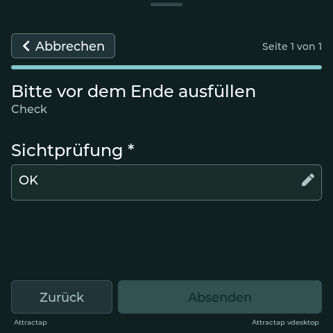

To cancel, tap the **×** in the top-right corner. You return to the list or details where you began. Cancelling a required form cancels the start or stop request; it does not complete it.

### Add photos with your phone

A photo field shows a QR code, the instruction **Mit dem Handy scannen, um Fotos hinzuzufügen** (Scan with your phone to add photos) and a count such as **0 von 3 Fotos** (0 of 3 photos).

1. Scan the QR code with your phone. The page opens without signing in.
2. Take photos or upload them from your phone.
3. The count on the reader updates within a few seconds. Then tap **Weiter** or **Absenden** as usual.

If the field is required and no photo has arrived, the reason appears on the button. Anyone who scans the QR code while the link is valid can add or remove photos in this field, so the link is short-lived: it stops working after 15 minutes, or earlier when you submit or cancel the form, sign out or someone else signs in. It takes no more photos once the maximum number is uploaded (removing a photo makes room for another). If it has expired, open the form on the reader again. A reader with older firmware cannot show photo fields: it skips optional ones, and for a required one it shows **Form with photo** (German: **Formular mit Foto**) and asks you to complete the form in the web app.

## Ask for supervision

If the action says **Aufsicht** (Supervision), tap it to request a supervised session. Ask an authorized introducer for that resource to supervise you.

The supervisor can hold their card against the reader or confirm the request in Attraccess on their phone or computer. Follow any further prompts and wait for confirmation that the machine usage has started.

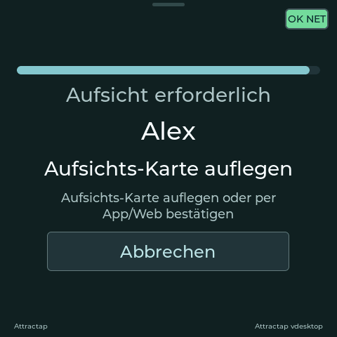

Tap **Abbrechen** (Cancel) if you do not want to continue. You stay signed in and can choose another resource.

## Understand the other buttons

The available action depends on your access and the resource's current status. You can tap the resource name to see its details even when you cannot start it.

| Display label                 | What to do                                                                                                                                     |
| ----------------------------- | ---------------------------------------------------------------------------------------------------------------------------------------------- |
| **Einweisung** (Introduction) | You need an introduction before you can use this resource. Open its details for guidance and contact an authorized introducer.                 |
| **Belegt** (Occupied)         | Someone else is using the machine. Wait until they finish.                                                                                     |
| **Übernehmen** (Take over)    | Taking over the current usage is allowed. Tap to open the details, then choose the takeover action there.                                      |
| **Gesperrt** (Blocked)        | The resource is unavailable to you because of maintenance or a reported problem. Contact the resource maintainer or resource manager for help. |
| **Laden ...** (Loading)       | The reader is checking which actions are available to you. Wait for the button to update.                                                      |

## Sign out when you are finished

Tap **Abmelden** at the top of the screen. The reader also signs you out after **30 seconds without interaction**. The countdown and bar show how much time remains; touching the display resets the countdown. It pauses while the reader processes an action.

After signing out, you can scan your card again to continue. Any running machine usage remains active, including when the reader signs you out automatically.

## If something does not work

| What you see                       | What to do                                                                                                                                                   |
| ---------------------------------- | ------------------------------------------------------------------------------------------------------------------------------------------------------------ |
| Your card does not sign you in     | Try again and keep the card in place until sign-in finishes. If it still fails, ask your administrator to check that the card is registered to your account. |
| A start, stop or door action fails | Read the message and check the resource's current status before trying again. If the problem continues, contact the resource maintainer or resource manager. |
| The reader loses its connection    | Wait for the connection to return, then sign in again. A lost connection does not end running machine usage.                                                 |

### Network badge and connection status

While the connection to the server is good, the reader shows no network badge. A badge in the top right corner appears only when there is a problem:

| Badge     | Meaning                                                                                                                                     |
| --------- | ------------------------------------------------------------------------------------------------------------------------------------------- |
| **! NET** | The connection is degraded: messages arrive late, pings are slow or lost, or sending failed. The reader keeps working but may react slowly. |
| **x NET** | The reader is offline and cannot reach the server. It reconnects automatically.                                                             |

For details, open the maintenance drawer (pull down the handle at the top edge), tap **Network** and enter the device PIN. The **Network status** screen shows the live connection health and refreshes every second. The reader stays connected while it is open, so you can watch the connection change. The back arrow returns to the previous screen, or to the start screen if the connection dropped in the meantime:

| Value                       | Meaning                                                                                  |
| --------------------------- | ---------------------------------------------------------------------------------------- |
| Connection quality          | **Good**, **Degraded** or **Offline**, the same assessment as the badge.                 |
| Time since last message     | How long ago the reader last received anything from the server or connected to it.       |
| Latest ping / Average ping  | Round-trip time of the most recent ping and the average over the last minute.            |
| Ping trend                  | Change between the oldest and newest ping of the last minute; positive means slower.     |
| Reconnects (1 min)          | How often the connection was re-established in the last minute.                          |
| Send queue                  | Messages waiting to be sent.                                                             |
| Queue full (1 min)          | How often a message could not be queued because the send queue was full.                 |
| Send failures (1 min)       | Messages that could not be sent.                                                         |
| Connection timeouts (1 min) | Times the server stayed silent for too long and the reader dropped the connection.       |
| Ping timeouts / Ping loss   | Pings without an answer, as a count and as a share of all pings sent in the last minute. |
| Missed heartbeats (1 min)   | Heartbeats the reader could not send on time.                                            |

**Not available** means there is no measurement: the pings show it until the first ping is answered after the reader starts, and the average and trend also show it when no ping was answered in the last minute.

> [!NOTE]
> Reader firmware and server ship together. The server updates readers automatically to its bundled firmware version (see [Firmware Updates](attractap/firmware-updates.md)).

## Related guides

- [Using Resources](end-user/using-resources.md) – Use machines and tools from the Attraccess app
- [RFID Cards](attractap/rfid-cards.md) – Register and manage cards
- [Introductions](resources/introductions.md) – How access to a resource is granted
