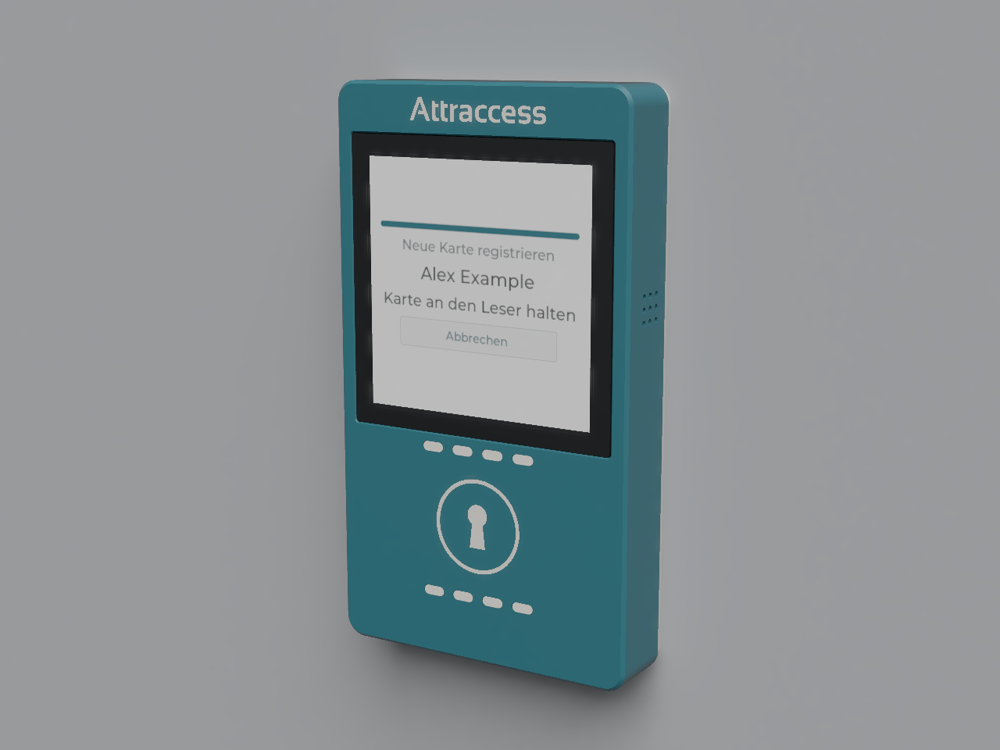
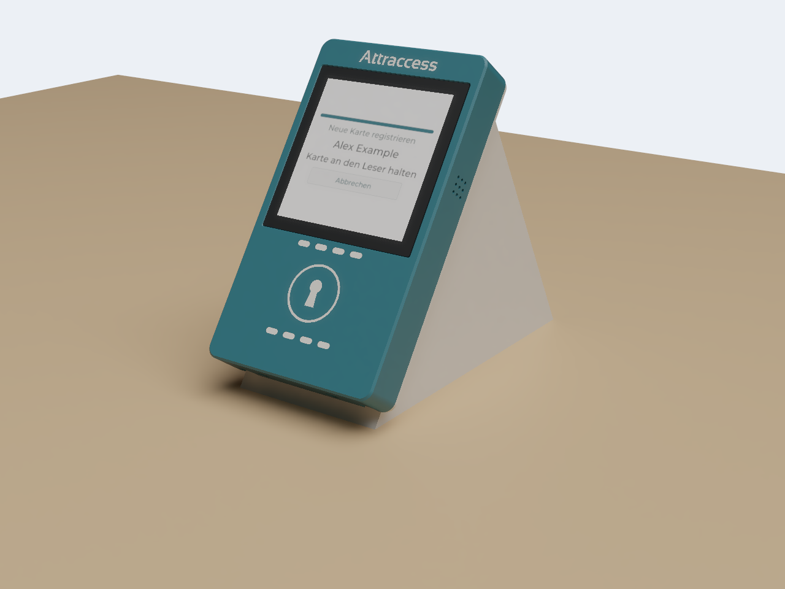

# Case
<!-- llms-description: The 3D-printable wall and desk case of the Attractap Touch P4 reader: parts, printing, design files and what is not yet verified. -->

A 3D-printable case for the [Attractap Touch P4 board](hardware/touch-p4/overview.md), revision A (4-inch 480 × 480 touch display, NFC antenna on the board, Ethernet, DC jack, USB-C, buzzer, eight status LEDs). It hangs on a wall or stands on a desk, and the same reader fits both mounts.

| On the wall | On the desk stand |
| --- | --- |
|  |  |

> **Status: CAD only.** No part has been printed, sliced or test-fitted yet. Fits and screw lengths are untested, and the display dimensions come from its product page, not from a measured panel; see [Not yet verified](#not-yet-verified).

## How it works

- **Cap**: the front shell. It carries the display, flush with the front, and the board. Eight light windows for the status LEDs, the Attraccess wordmark and a tap ring over the NFC antenna.
- **Dock**: the back plate. It is screwed to the wall (five holes; the lower pair matches the 60 mm spacing of a flush-mount box) or onto the stand. Under the Ethernet jack and the PoE module the plate has shallow recesses, and a window through it for the jack's two shield springs, so both parts keep at least 0.5 mm at their tallest. The board senses the dock in two ways, so the reader knows when it is taken off: a proximity sensor measures the infrared light that the dock's plain inner face reflects, and a hall switch senses a 10 x 3 mm magnet held in a ring on that face.
- **Stand**: a hollow wedge for the desk. The reader leans back 35°.
- The cap hooks onto a 45° cleat at the top of the dock, swings shut and is locked by two M3 screws from below. Plugs and cables end up enclosed between cap and dock.
- A cable either disappears into the wall behind the dock or leaves through a notch at the bottom, where a cable tie on a saddle inside the cap takes the pull off the jack.
- Screws go into heat-set inserts. The reader comes off the wall with two screws, the board out of the cap with four more.

The [installation manual](hardware/touch-p4/installation-manual.md) ([PDF](_media/hardware/touch-p4/attractap-installation-manual-en.pdf ':ignore')) shows every step with figures: parts and hardware list, inserts, assembly, drilling template, cable routes, desk stand and service.

## Design files

They are in [`apps/attractap/hardware/touch-p4/case/`](https://github.com/Attraccess/Attraccess/tree/main/apps/attractap/hardware/touch-p4/case).

| Folder | Contents |
| --- | --- |
| [`cad/`](https://github.com/Attraccess/Attraccess/tree/main/apps/attractap/hardware/touch-p4/case/cad) | The design (`attractap-touch-case.sc`, SolidCraft) and the files made from it: one 3MF and one STEP per part, the whole assembly as STEP, and a mock board and mock display for test fitting |
| [`board/`](https://github.com/Attraccess/Attraccess/tree/main/apps/attractap/hardware/touch-p4/case/board) | STEP export of the board alone, without parts, from the current layout ([KiCad files](https://github.com/Attraccess/Attraccess/tree/main/apps/attractap/hardware/touch-p4/kicad), revision A). The case design embeds the board as it was when the case was drawn; check it against this export after a change to the board's outline |
| [`logo/`](https://github.com/Attraccess/Attraccess/tree/main/apps/attractap/hardware/touch-p4/case/logo) | The wordmark and keyhole outlines used for the logo inlays |
| [`manual/`](https://github.com/Attraccess/Attraccess/tree/main/apps/attractap/hardware/touch-p4/case/manual) | The SolidCraft file the figures of the [installation manual](hardware/touch-p4/installation-manual.md) are rendered from, and the scripts that make the figures and the PDF |

## Printing

The case is designed for ABS+ on a filament printer. Every part has one flat face to lie on and is meant to print without supports; none has been sliced yet, so that is unconfirmed. Each 3MF already lies on its print face. For a reader that is sold, the filament needs a data sheet that states its flammability class; whether plain ABS+ is enough is in the [compliance checklist](hardware/touch-p4/compliance.md#enclosure-plastic).

| Part | File in `cad/` | Qty | Colour | Lies on |
| --- | --- | --- | --- | --- |
| Cap | `attractap-cap.3mf`, or `attractap-cap-multicolor.3mf` with the logo as separate objects for multi-colour printing | 1 | RAL 5021 | its front face |
| Dock | `attractap-dock.3mf` | 1 | Marble white | its back |
| Display frame | `attractap-display-frame.3mf` | 1 | Any | its board side |
| LED diffuser | `attractap-led-diffuser.3mf` | 2 | Natural or plain white | its board side |
| Stand (desk only) | `attractap-stand.3mf` | 1 | Marble white | its desk face |

`attractap-mock-pcb` and `attractap-mock-display` (3MF, STEP, STL) are stand-ins for the board and the display, to check the fit before the real parts are at hand. The mock display uses the assumed display dimensions listed below.

The hardware (heat-set inserts, screws, tape, cable ties) is listed in the [manual](hardware/touch-p4/installation-manual.md#parts-hardware-and-tools).

## Changing the design

The design files are SolidCraft documents (made with version 0.45.0).

- Coordinates: the origin is the centre of the display seen from the front, Z is 0 at the wall and the front face is at Z = `D`. A point (x, y) in the board's own coordinates, as used in its [design notes](hardware/touch-p4/design-notes.md#mechanics), is at case X = 43 − x and Y = 49.15 − y. In the coordinates of the KiCad file, where the board's corner is at (60, 30), that is X = 103 − x and Y = 79.15 − y.
- The depth stack is parametric (`plate_t`, `cav`, `pcb_t`, `disp_gap`, `disp_t`, `lens_t`, `tape_t`, `lens_recess`, `wall`, `pcb_ins_depth`). Positions in X and Y are plain numbers taken from the board.
- After a change to the design, `cad/tools/export_parts.py` writes the files of its parts again: cap, dock, display frame, LED diffuser, mock display and the assembly. Stand and mock board are not exported by it.
- `manual/attractap-manual-scenes.sc` is a copy of the design with extra bodies for illustration. Print files are exported only from the designs in `cad/`. The copy, the renders on this page and the manual's figures still show the earlier depth stack: a cap 1.2 mm deeper, with the display 2 mm off the board.
- The 3MF files are saved lying on their print face. In SolidCraft 0.45.0 the option that lays parts on their marked print face had no effect, so each part is turned with a temporary move before the export.

The scripts are plain Python without dependencies; run them with `python3 -I`. They drive SolidCraft through its command-line tool (the path at the top of each script is the macOS one) or write step files for it, and use `rsvg-convert` for labels.

| Script | What it makes |
| --- | --- |
| `cad/tools/export_parts.py` | The STEP, 3MF and STL files of cap, dock, display frame, LED diffuser, mock display and assembly, laid on their print faces |
| `manual/tools/scenes.py`, `scenelib.py` | Scene and camera set-up and the labels of the manual's figures |
| `manual/tools/gen_hardware.py`, `gen_strain_relief.py`, `gen_wall_route.py` | Step files that add screws, inserts, cables and cable ties to the manual's scene file |
| `manual/tools/drill.py` | The drilling template |
| `manual/tools/build_pdf.py` | The manual PDFs, `docs/_media/hardware/touch-p4/attractap-installation-manual-en.pdf` and `-de.pdf`, from the manual's pages `docs/en/hardware/touch-p4/installation-manual.md` and `docs/de/hardware/touch-p4/installation-manual.md` (needs a Chromium-based browser) |

## Not yet verified

- **Nothing has been printed.** Printed fits, the swing-on motion and the strain relief are checked in CAD only.
- **Display dimensions.** They come from the mechanical drawing on the display's product page (AliExpress item 1005005675144653, the same drawing as in the Makerfabs datasheet the board was laid out from): 3.14 mm in total, made up of the cover lens (0.55 mm), the touch sensor (0.35 mm), the bonding layer (0.175 mm) and the LCD module (2.06 mm). A corner radius of at least 1 mm is assumed. Nothing is measured. They decide whether the screen sits flush, and how far the display's metal back is from the board. Measure the panel you buy; if it differs, set `disp_t` and `lens_t` and export the parts again.
  - `lens_t` is the lens alone, 0.55 mm: the touch sensor is smaller than the lens (76.5 x 76.7 mm), so the border that the frame holds has no sensor behind it.
  - An earlier version of this case assumed 3.8 mm in total and 1.3 mm of glass, from a time when the product page could not be read. In that case this panel would have sat 0.85 mm below the front.
  - The touch sensor is 0.9 mm wider than the frame's opening for the LCD module (75.6 mm). The frame's rim reaches 0.4 mm under each side edge of the sensor and, with the 0.3 mm tape, presses on it by 0.05 mm. An opening of 77.3 mm would clear it.
  - By the drawing the lens border carries its own double-sided tape (3M 9495, 0.175 mm). If the panel comes with it, it can replace the manual's 0.3 mm tape; the glass then sits 0.1 mm lower and the rim presses on the sensor's edges by 0.2 mm, so widen the opening first.
- **Display distance to the board.** Two things set it, from opposite sides (details in the board's [design notes](hardware/touch-p4/design-notes.md#display-mounting-and-flex)):
  - The display's flex wraps round the board, and its stiff parts must lie flat behind the board after the turn. By the panel drawing that works up to **2.0 mm** between the board and the LCD's metal back, with 0.5 mm to spare at 1.5 mm.
  - On the Ethernet version the jack J401 has its solder pins behind the display: 16 pins, two shield tabs and two plastic posts, 11 of them behind the LCD's metal back. They stand at least 1.45 mm out of the board. The USB-C socket has its shell tabs under the edge of the glass.
  - So the case holds the display **1.5 mm** off the board (`disp_gap`), with the jack's pins clipped to 1 mm and polyimide tape on that corner of the LCD (the manual has both steps).
  - The two 48 V pins of the jack come out 0.5 mm beside the LCD's metal edge, inside the frame's pocket for the pins. The frame cannot put a wall between them: the solder pad of the nearer pin ends 0.1 mm from the LCD's edge. The tape on the LCD is the insulation there.
  - The other way round does not work without a longer case: with the jack below the display its plug room shrinks from 51 to 32 mm, and a cable from the wall would need a plug that ends 12 mm below the jack.
- **Inserts close to the front face.** With this display and distance only 2.3 mm lie between the board and the front wall. The insert holes of the four PCB bosses are 3.2 mm deep (`pcb_ins_depth`), so they reach 0.9 mm into the 2.4 mm front wall and leave 1.5 mm. Check on the first print that pressing the inserts in does not mark the front.
- **Dock magnet.** The ring is at X 30.5, Y 10.95 (board point 12.5, 38.2), and the magnet's face is 10.3 mm from the hall switch. By calculation that gives 22 mT, four times what the switch needs. Check on the first board that the switch reads "on the dock" with the reader hung and "off" once it is lifted away. The pocket is 10.2 mm wide for a drop of glue; tune it for the magnets you buy.
- **Dock plate in front of the proximity sensor.** The board's proximity sensor lights a patch of the dock's inner face around X 21.4, Y -2.1 (board point 21.6, 51.25), 9 mm left of and 13 mm below the magnet's ring as seen from the front. Keep the plate flat there for 9 mm around, 13.9 mm from the board's component side, and free of ribs, holes, cable clips and labels. The sensor's reading depends on the plate's colour: a reader has to store its reference again when it moves to a dock of another colour, and a black dock may reflect too little (not measured yet).
- **Ethernet jack and PoE module against the dock.** Checked with the board's 3D models (board design notes, "Case fit against the 3D models"): the jack J401 is 13.95 mm high at most and its shield springs reach 15.21 ± 0.5 mm, so they run up to 1.8 mm into the dock plate, which is 13.9 mm from the board. The case needs an opening in the dock plate under the jack, or more depth; neither is drawn yet. The PoE module is 13.35 ± 0.5 mm high (SDAPO's drawing; this case assumed 10 mm): 0.55 mm to the dock plate, 0.05 mm at its maximum.
- **Outdoor use.** There are no seals, the buzzer holes and cable notches are open, and ABS+ ages in sunlight. Treat it as an indoor case. The board's 5 GHz Wi-Fi is restricted to indoor use on channels 36 to 64 as well ([compliance checklist](hardware/touch-p4/compliance.md#_5-ghz-wi-fi)).

The manual ends with the [full list](hardware/touch-p4/installation-manual.md#not-yet-verified).
