# Attractap Touch P4 installation manual
<!-- llms-description: How to assemble the Attractap Touch P4 reader in its printed case and mount it on a wall or a desk stand. -->

## At a glance

The reader is two assemblies. The **cap** is the blue front shell that carries the display and the PCB. The **dock** is the white back plate that is screwed to the wall or onto the desk stand.

The cap hooks onto a 45° cleat at the top of the dock, swings shut, and is locked by two M3 screws from below. Plugs and cables end up enclosed between the two.

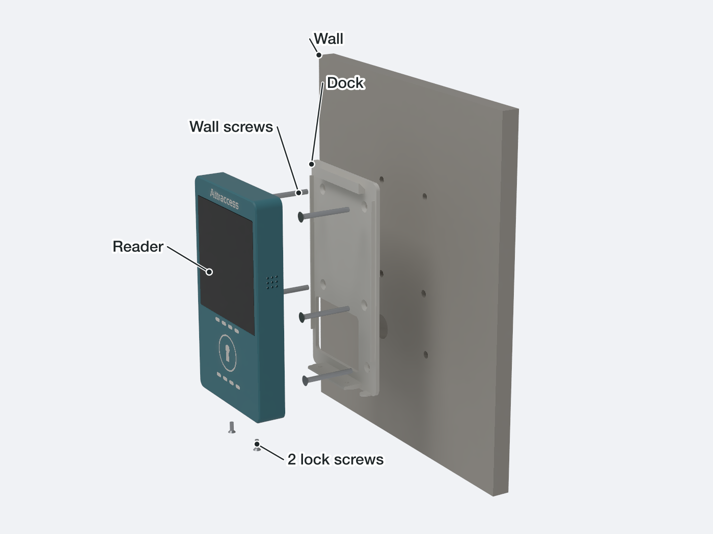

From back to front: the wall, the dock with its wall screws, the reader, and the two lock screws that go in from below.

This manual describes the CAD design, revision 2. No part has been printed or test-fitted yet, so fits and screw lengths are untested until the list at the end is checked.

## Parts, hardware and tools

One reader needs five printed parts for the wall, six for the desk. The print files are in [`case/cad/`](https://github.com/Attraccess/Attraccess/tree/main/apps/attractap/hardware/touch-p4/case/cad); each 3MF already lies on its print face.

| Printed part | File | Qty | Colour | Prints lying on |
| --- | --- | --- | --- | --- |
| Cap (front shell) | `attractap-cap.3mf` | 1 | RAL 5021 | its front face |
| Faceplate (cover over the front) | `attractap-faceplate.3mf`, or `attractap-faceplate-logo.3mf` with the wordmark | 1 | RAL 5021, stripe and wordmark white | its front face |
| Tap tile | `attractap-tile.3mf` | 1 | Black top and keyhole, plain white body | its top |
| Dock (back plate) | `attractap-dock.3mf` | 1 | Marble white | its back |
| Display frame | `attractap-display-frame.3mf` | 1 | Any | its PCB side |
| Stand (desk only) | `attractap-stand.3mf` | 1 | Marble white | its desk face |

| Hardware | Qty | Where it goes |
| --- | --- | --- |
| M3 heat-set insert, short (3 mm long) | 4 | PCB bosses in the cap |
| M3 heat-set insert, standard (5.7 mm long) | 2 | Lock bar in the cap |
| M3 × 4 pan head screw | 4 | PCB to cap |
| M3 × 8 countersunk screw, ideally Torx with pin | 2 | Lock screws, from below |
| Double-sided tape, 0.3 mm thick | 3 strips | Display glass to frame |
| Thin double-sided tape, at most 0.15 mm | about 4 strips | Faceplate to cap. Thicker tape leaves the glass sunk behind the faceplate |
| Polyimide tape (Kapton), 25 mm wide | 30 mm, plus 80 mm | Back of the display, over the Ethernet jack's solder pins (Ethernet version); over the display's flex where it leaves the display |
| Conductive gasket, fabric over foam, 5 × 5 mm, about 2 mm thick, self-adhesive | 2 to 4 | On the bare square ground pads on the PCB's display side, against the display's metal back. It ties the metal back to ground, which the reader needs to pass the static-discharge test |
| Neodymium disc magnet, 10 mm across, 3 mm thick | 1 | Ring on the dock's inner face. The reader senses it and knows when it is taken off the dock |
| Countersunk wall screw, 4 mm shank, head up to 8.6 mm, with plugs | 3 to 5 | Dock to wall |
| Cable tie, 2.5 mm wide, about 100 mm long | 1 per cable | Strain relief, only for a cable that leaves through the bottom notch or on the desk stand |
| M3 heat-set insert, standard (5.7 mm long) | 4 | Stand (desk only) |
| M3 × 8 countersunk screw | 4 | Dock to stand (desk only) |

Tools: soldering iron with a tip slimmer than 6 mm and at least 10 mm long, a driver for the M3 screws, side cutters, flush cutters for the jack's pins (Ethernet version), and a drill for the wall.

The PCB screws are M3 × 4. Earlier parts lists said M3 × 6, but since the screen went flush the insert holes in the bosses are only 3.2 mm deep, and a 6 mm screw bottoms out before it clamps the board.

## Prepare the printed parts

Six inserts go into the cap, the magnet into the dock, then the tap tile into the cap. Do all hot work before any electronics are on the bench.

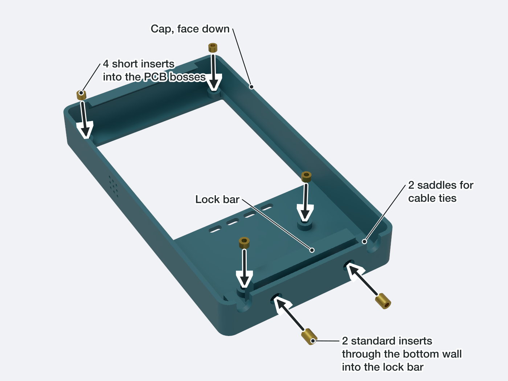

The short inserts go straight down into the bosses. The two standard ones enter through the holes in the bottom wall. The two saddles beside the bottom notches take no insert; they hold a cable tie later.

1. Lay the cap face-down on a soft cloth, inside facing up.
2. Heat the soldering iron to about 250 °C.
3. Press one short insert into each of the four PCB bosses, flush with the top of the boss or 0.2 mm below. A proud insert lifts the PCB and loosens the display behind it. These holes end 1.1 mm behind the cap's front: take the iron away as soon as the insert is flush, or the front can bulge and lift the faceplate.
4. Stand the cap on its top edge, bottom wall up. Put a standard insert on the iron tip, pass it through one of the two round holes in the bottom wall and across the slot, and press it into the lock bar until it is flush. Repeat for the second hole.
5. Check that nothing sticks out into the slot between bottom wall and lock bar. The dock's tongue has to slide in there.
6. Let everything cool, then run an M3 screw through each insert once.
7. Put a drop of superglue into the ring on the dock's inner face and press the magnet in, either side up. It must not stand above the ring.
8. Push the tap tile into the cap from behind, black top first, through the square opening below the display window. Its flange stops against the inside of the front wall. The notch in the flange goes round the PCB boss beside it. The tile stays loose until the PCB holds it.

## Assemble the reader

Everything drops into the face-down cap from behind, in this order: display on its frame, PCB, four screws. On the Ethernet version the PCB and the display each get one preparation step first.

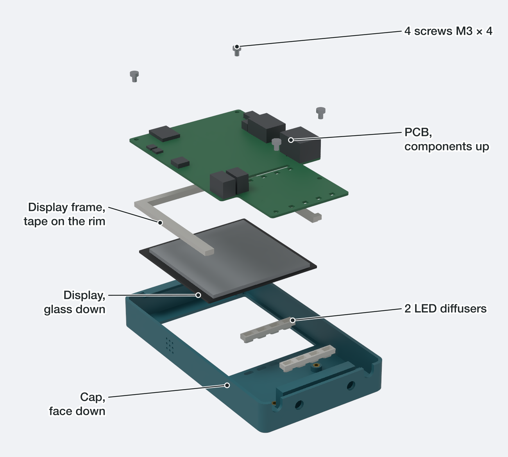

Everything is shown lifted out of the cap in the order it goes in, lowest first.

1. Ethernet version only: turn the PCB so the side without components faces you. The Ethernet jack's solder pins stand out of it in one corner: 16 pins, two wider shield tabs and two plastic posts. Clip every one of them to 1 mm with flush cutters. Cut above the solder cone, not through it.
2. Ethernet version only: lay the display glass-down, flex cable toward you. Stick a 25 × 30 mm piece of polyimide tape onto the metal back in the corner at the lower right, flush with the lower edge, and fold 2 mm of it round the right side edge of the metal. That is the corner that will lie over the clipped pins; two of them carry 48 V.
3. Stick 0.3 mm double-sided tape onto the raised rim of the display frame: one strip each on the left, right and top. The fourth side is open for the display's flex cable.
4. Lay the display glass-down on a clean cloth. Place the frame onto the back of the glass, rim down, with the open side over the flex cable. Line the frame up with the glass edges and press along the three strips.
5. Fold the flex cable over the lower edge of the display onto the metal back, so it lies flat on it with the small chip facing away from the display. Fold round the edge without creasing it. Then lay a strip of polyimide tape across the fold, over the frame's open side, and fold its ends onto the frame. It covers the flex's traces behind the gap round the glass, where a static discharge on the glass edge would otherwise land on them.
6. Lower display and frame into the cap so the glass drops into the window. Turn the cap over once and check that the glass sits flush with an even gap all round.
7. Stick a conductive gasket onto at least two of the four bare square pads on the PCB's side without components (the gold squares behind where the display will lie), two far apart from each other. The gaskets press against the display's metal back when the PCB goes in.
8. Lift the end of the flex, the narrow strip with the contacts, off the metal back. Hold the PCB with its components facing you and the Ethernet jack toward the bottom of the cap. Thread the flex's end through the slot in the middle of the PCB from the side without components, then lower the PCB onto the four bosses. The part with the chip stays flat on the display's back; only the narrow strip bends through the slot.
9. Plug the flex into its connector on the PCB and close the latch.
10. Fasten the PCB with the four M3 × 4 screws. Hand-tight is enough; the inserts sit in plastic.
11. Power the board over USB-C and check display, touch, LEDs and buzzer before the reader goes on the wall. USB-C, reset and boot are only reachable while the reader is off the dock.
12. Turn the reader face-up. Stick thin double-sided tape onto the cap's front near the edges and between the display window and the tile, then lower the faceplate over the tile and the glass and press it down all round. Its edge lines up with the cap's sides.

## Mount the dock on a wall

The dock takes three to five countersunk screws, and the reader later covers every screw head. Decide the cable route before drilling.

Indoors only. The case is not sealed, and in the EU the reader's Wi-Fi may use its 5 GHz channels 36 to 64 inside buildings only. The Wi-Fi antenna sits behind the reader's top left corner: keep metal objects away from it. A metal wall behind the reader weakens Wi-Fi a little (by estimate 1 to 2 dB at 2.4 GHz).

- **Cable through the wall:** drill a 20 mm hole 32 mm left of the dock's centre line, level with the single lower screw hole. That is the lower left corner of the dock's opening, right below the Ethernet plug, and the dock covers it. Leave both break-off tabs in place. The route is shown under "Where the cables run behind the reader" below.
- **Cable along the wall from below:** snip a tab off the dock's bottom edge with side cutters. The left tab is for Ethernet, the right one for a power cable. Each frees an 8 mm wide notch. This cable is tied down inside the reader before the reader is hung; see the next section.

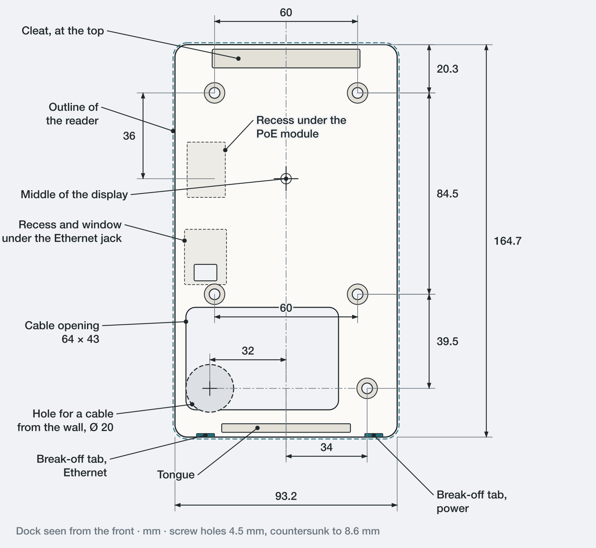

The drawing is not to scale on screen. Use the printed dock itself as the drilling template. The dashed circle is the hole for a cable that comes out of the wall.

1. Hold the dock on the wall with the angled cleat at the top and level it. The middle of the display ends up 36 mm below the upper pair of holes.
2. Mark the holes. Use both upper holes and at least one lower hole.
3. Drill and plug. On a flush-mount box, the lower pair matches the box's 60 mm screw spacing; read the note on boxes under "Where the cables run behind the reader" first.
4. Screw the dock on. Every screw head must sit flush with the plate or below it. Keep the two shallow recesses on the left of the plate free, and the small window in the lower one: the Ethernet jack and the PoE module stand over them, and the jack's two shield springs reach into the window.

## Connect, hang and lock the reader

The reader goes on in one motion: plug in, hook the top over the cleat, swing the bottom shut. Two screws from below then lock it.

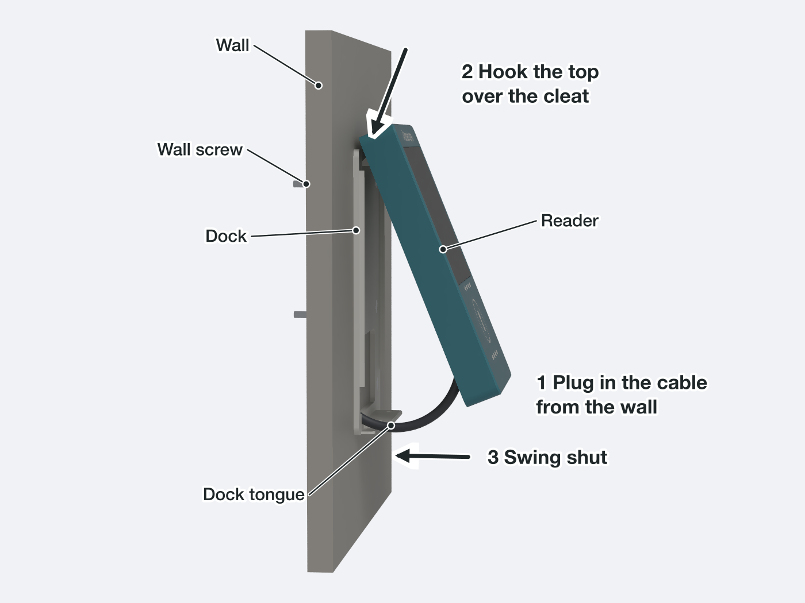

Seen from the left. The reader is drawn tilted further out than it has to be.

1. Hold the reader in front of the dock with its bottom edge tilted toward you. Push the Ethernet plug up into the jack until the latch clicks. Connect power the same way if you use it.
2. Only if the cable leaves through the bottom notch: tie it onto its saddle now, as described under "Tie the cable down at the bottom exit" below. A cable that comes out of the wall behind the dock needs no tie.
3. Set the reader's top edge against the dock about 6 mm above its final position and let it slide down. Its hook drops behind the dock's 45° cleat.
4. Swing the bottom toward the wall. Feed the cable slack back into the wall, or lay the cable into the bottom notch. The dock's tongue slides into the slot between the reader's bottom wall and its lock bar.
5. From below, drive the two M3 × 8 lock screws through the round holes in the bottom wall until snug. They clamp the lock bar onto the tongue, and their heads end up recessed inside the wall.
6. Tug the reader. It must not lift, tilt or rattle.

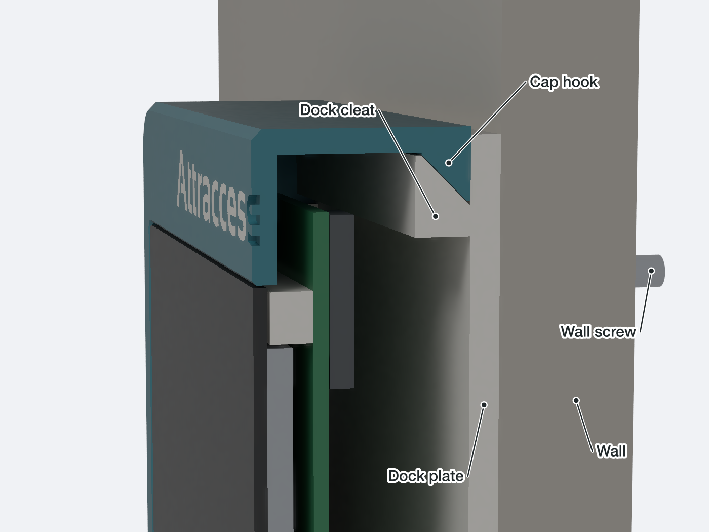

Cut through the top edge. The cap's hook sits behind the dock's cleat, so the reader cannot be pulled straight off the wall.

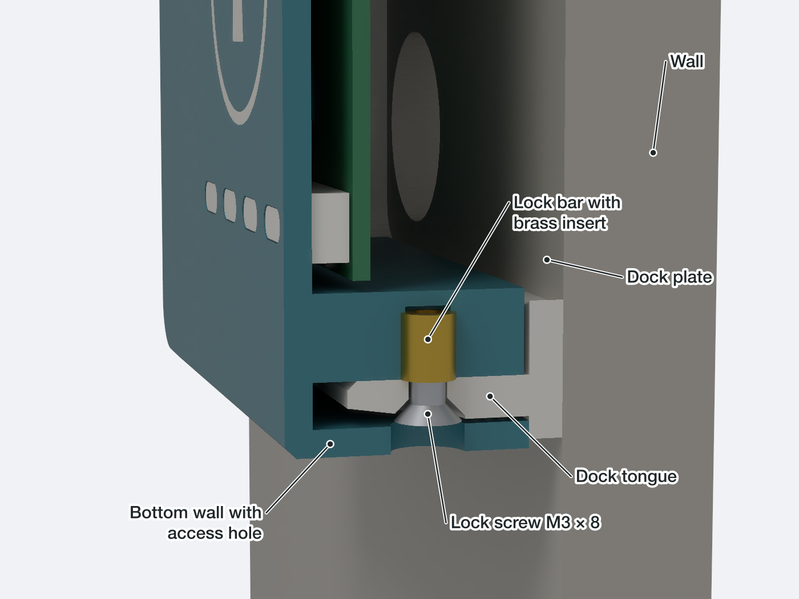

Cut through one lock screw. It passes through the bottom wall and the dock's tongue into the insert in the lock bar.

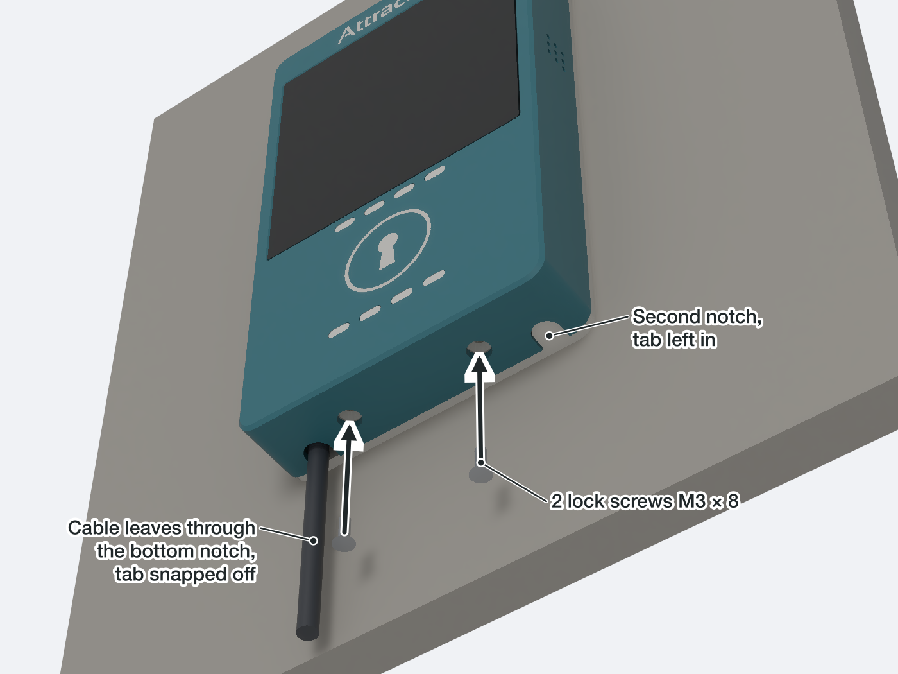

The view from below, with the lock screws drawn out of their holes and a cable leaving through the bottom notch.

Once locked, plugs and jacks are enclosed. A cable that comes out of the wall behind the dock cannot be reached from outside and needs nothing more.

### Where the cables run behind the reader

Both jacks point down and sit about 10 mm in front of the wall. A cable from the wall therefore leaves the wall below its plug and turns upward into it. Part of that turn happens inside the wall, which is why the hole is 20 mm wide.

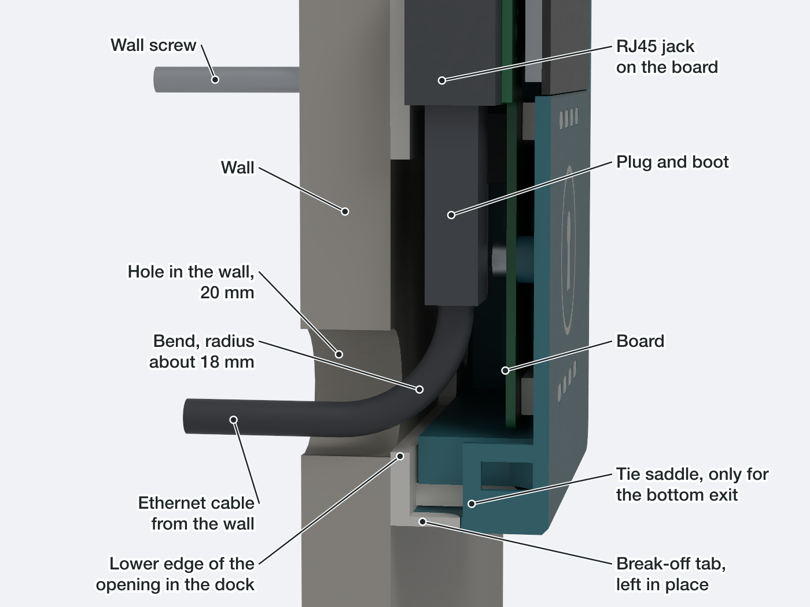

Cut through the Ethernet jack, seen from the left with the wall on the left. The cable comes out of the hole, bends upward and enters the plug from below. The break-off tab and the tie saddle stay unused.

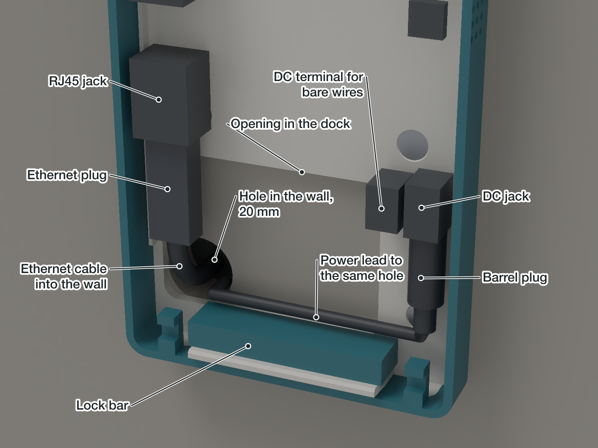

The reader on the wall with its front, display and board left out. Ethernet is on the left. On the right, a barrel plug sits in the DC jack and its lead runs above the lock bar to the same hole.

- **Bend.** The Ethernet cable makes a quarter turn with a radius of about 18 to 20 mm. Use a flexible patch cable; stiff installation cable does not make this turn.
- **Plug length.** The drawing assumes that plug and boot end 30 mm below the jack. A longer boot pushes the bend down and makes it tighter. Common moulded patch cables end 24 to 31 mm below the jack. A slim patch cable (28 AWG, under 4 mm thick) bends tighter and leaves the most room.
- **Slack.** Leave about 10 cm of cable outside the wall for plugging in. All but about 2 cm of it slides back into the hole when the reader swings shut, so there has to be free space behind the hole: a conduit, a cavity or a box.
- **Power.** If the board is powered over PoE, the Ethernet cable is the only cable. Otherwise bring two wires out of the same hole to the DC terminal beside the DC jack, or use a barrel plug as shown. A 3.5 mm lead fits through the hole beside the Ethernet cable.
- **Free plate.** Keep cables, wire slack and labels off the dock's plate just below and left of the magnet's ring, as seen from the front. The reader measures the light that this patch reflects, to know that it is on its dock. A wire lying there changes the reading, and a wire that moves there looks like someone taking the reader off.
- **Flush-mount box.** A box sits higher than this hole, level with the plug instead of below it. A cable from the box has to run down beside the plug and make a U-turn of at most 19 mm radius inside the reader. Only a thin, very flexible patch cable will do that, and this route is not modelled.

### Tie the cable down at the bottom exit

A cable that leaves through the bottom notch can be grabbed from outside, so it gets a cable tie inside the reader. Without the tie, a pull goes straight into the jack: a barrel plug slides out, and an Ethernet plug hangs on its latch and the jack's solder joints. With the tie, the pull goes through the cap and the dock into the wall screws.

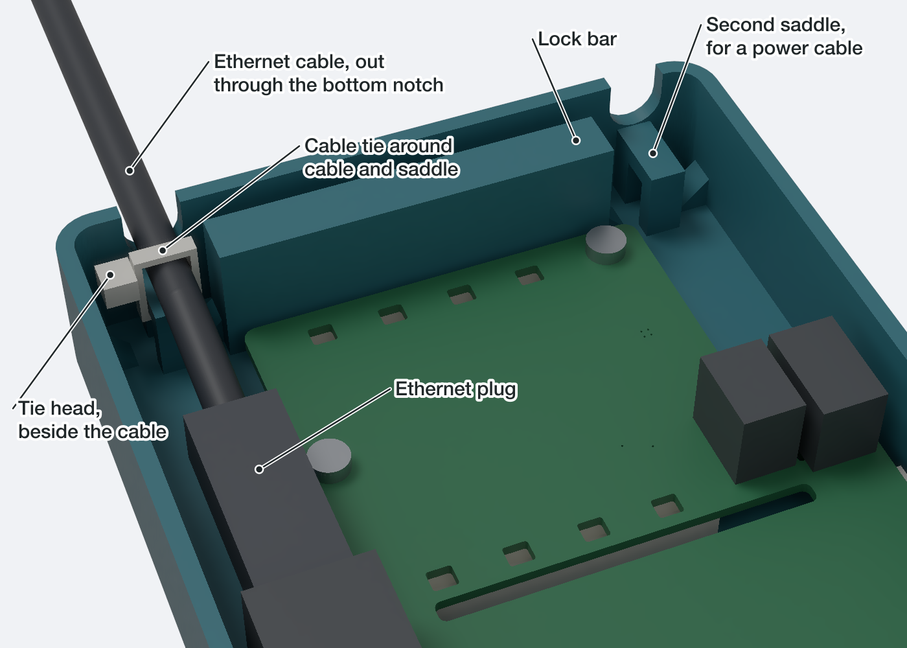

Reader face down, seen from its top end. Each bottom notch has a saddle next to it: a small bridge with an opening underneath. Here the Ethernet cable is tied to its saddle.

1. Lay the plugged-in cable over the saddle and into the notch. Ethernet uses the saddle on the Ethernet jack's side, power the other one.
2. Bend the tip of the cable tie into a hook and push it down between the saddle and the side wall. A ramp at the bottom steers it through the opening under the saddle, and a second ramp turns it up again on the lock-bar side. Tweezers help to catch it.
3. Close the tie over the cable with its head on the side-wall side, beside the cable. A head on top of the cable would hit the dock.
4. Pull the tie tight enough that the cable cannot slide, without crushing it, and cut the tail flush.
5. Tug the cable. The plug must not move.

The saddle takes cables up to about 7 mm thick. For service, cut the tie once the reader is off the dock.

## Desk stand instead of the wall

On a desk, the same dock is screwed onto the stand's sloped face instead of a wall. The reader then leans back 35°.

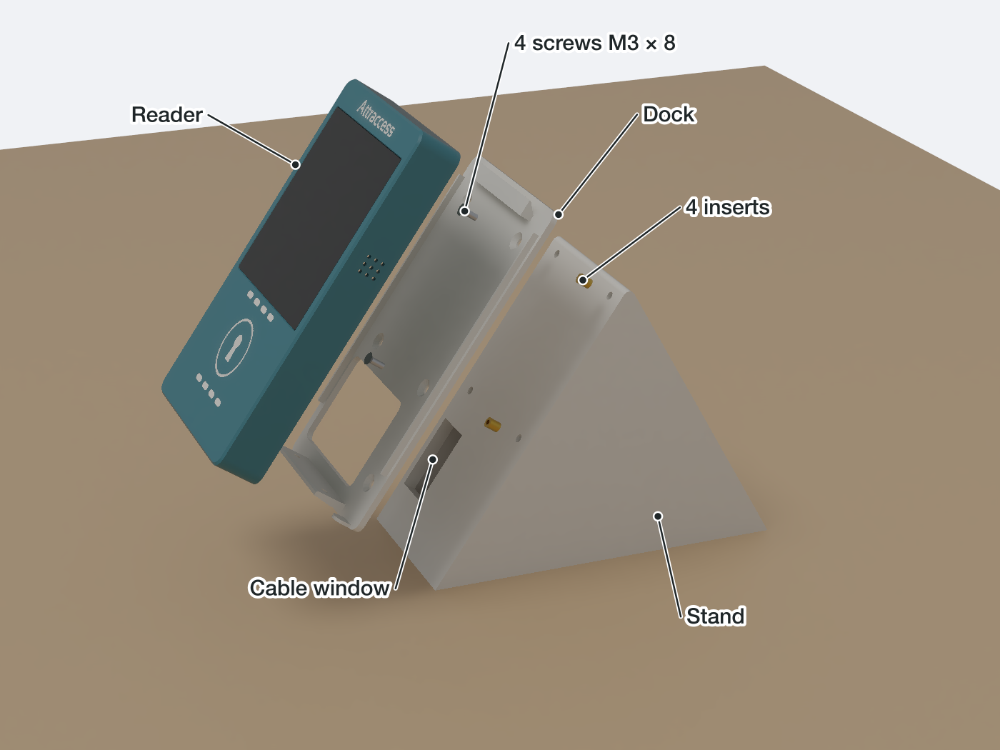

1. Press four standard inserts into the four holes in the stand's sloped face, flush with the surface.
2. Lay the dock on the sloped face, cleat at the top, and fasten it with four M3 × 8 countersunk screws through its two pairs of holes. The single fifth hole stays empty.
3. Feed the cable in through the notch at the stand's rear bottom edge and up through the window behind the dock's opening.
4. Plug in, hook on and swing shut as on the wall.
5. Lift the stand off the desk to drive the two lock screws. With the stand on the desk, the desk blocks the screwdriver, which also keeps the screws out of reach in daily use.
6. While the stand is lifted, tie the cable to one of the two fins beside the notch. Pass a cable tie through both slots of the fin and around the cable, with the cable on the notch side of the fin, and cut the tail. Leave the cable inside the stand a little slack. Each fin holds one cable.

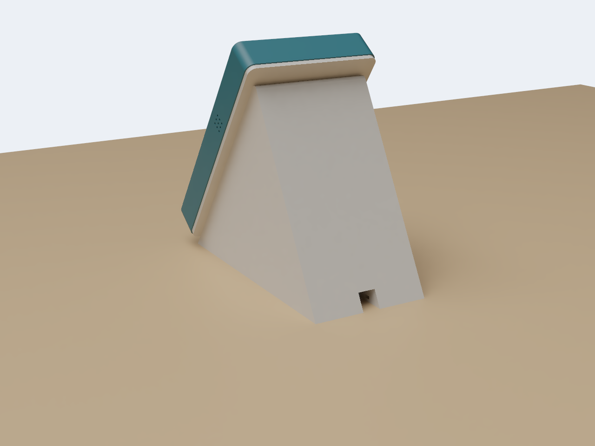

The notch at the rear bottom edge is where the cable leaves the stand. It is 12 mm wide, 11 mm high and open toward the desk, so the cable is laid in from below.

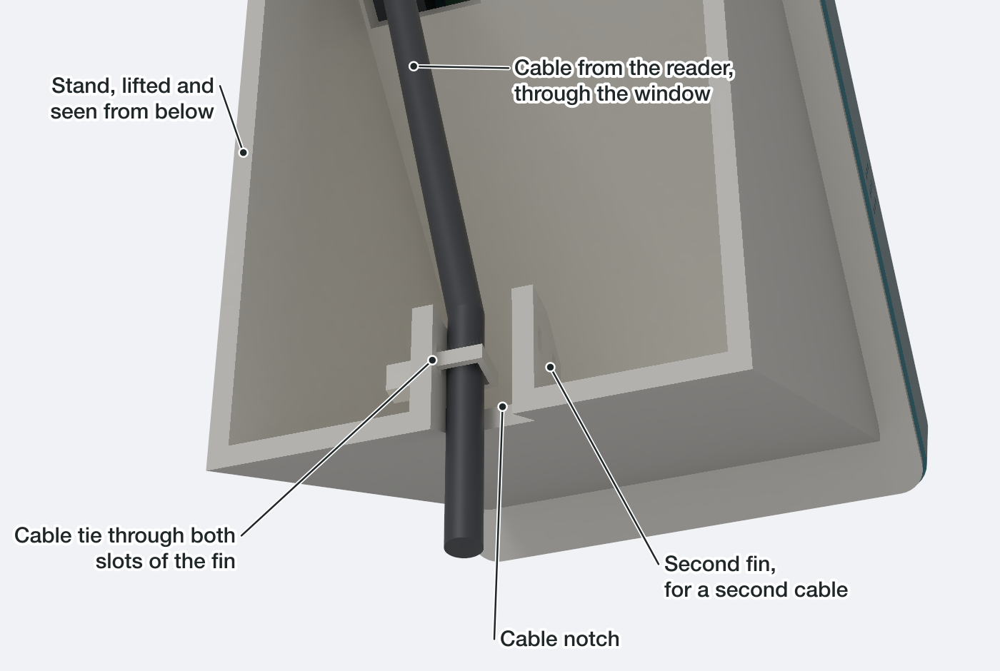

The stand turned over. The cable from the reader is tied to one fin and leaves through the notch, so a pull on it ends at the stand and not at the plug.

## Opening it again for service

Two screws release the reader; four more release the PCB. USB-C, the reset and boot buttons and the test points are only for service, and they are not protected against static discharge the way the outside of the reader is: touch a grounded metal part (or wear a wrist strap) before you plug in USB-C or press a button, and hold the PCB by its edges.

1. Remove the two lock screws from below.
2. Swing the reader's bottom about 20 mm away from the wall, then lift the reader 6 mm off the cleat.
3. Cut the cable tie if a cable is tied down. Press the latch of the Ethernet plug and unplug the cables. USB-C, reset and boot are now reachable for flashing.
4. To take the PCB out, remove the four M3 × 4 screws, open the flex connector latch and lift the board.
5. The display comes out together with its frame. To replace the display itself, peel the glass off the tape and re-tape the new one.

## Not yet verified

Nothing below has been checked on real parts. Each item can change a step or a part.

- [ ] **Printed fits.** Glass in its window (0.25 mm gap per side), tongue in its slot (0.4 mm), hook on the cleat (0.1 mm). Tune on the first print.
- [ ] **Display dimensions.** The total thickness, 3.5 mm, is measured on one sample panel; the cover lens (0.55 mm) is taken from the drawing on the display's product page, a corner radius of at least 1 mm is assumed. They decide whether the screen sits flush. Measure the panel before printing.
- [ ] **Inserts in the PCB bosses.** Their holes reach into the front wall and leave 2.1 mm of it. Check on the first print that the front shows no marks after the inserts are pressed in.
- [ ] **Display distance and flex.** The frame holds the display 1.7 mm off the PCB; the folded flex with its chip lies in that gap (see the [case](hardware/touch-p4/case.md#not-yet-verified)). Check with the real panel that the part with the chip lies flat on the display's back and that the flex reaches its connector through the slot.
- [ ] **Dock magnet.** With the reader hung on the dock the board must report "on the dock", and "off" once it is lifted away. The figures do not show the magnet's ring yet.
- [ ] **Dock plate and proximity sensor.** The board also measures the infrared light that the dock's plate reflects. What it reads on the dock, with every dock colour in use, and whether light on the case changes it, is not measured yet (see the board's bring-up notes).
- [ ] **Figures.** The figures show the case before its depth changed: the cap was 1.2 mm deeper. The steps are the same.
- [ ] **Jack pins behind the display.** Clipped to 1 mm they should clear the display's metal back by 0.5 mm or more. Measure how far the pins of a soldered jack stand out, and check the gap with the display fitted.
- [ ] **PoE module height.** Assumed 10 mm.
- [ ] **Swing-on motion.** Collision-free in CAD at five angles between 7° and closed, after the dock's tongue was tapered on 19 Nov 2026. Docks sliced before that need re-slicing.
- [ ] **Strain relief.** The tie saddles in the cap and the tie fins in the stand were added on 19 Nov 2026 and are checked in CAD only. On the first print, thread a tie and pull on the cable. The stand's cable notch was raised to 11 mm in the same change; before, it was too low for an Ethernet cable. Caps and stands sliced before that need re-slicing.
- [ ] **Cable route into the wall.** Modelled on 19 Nov 2026 with a 5.5 mm Ethernet cable at 18 mm bend radius and a 3.5 mm power lead; nothing collides in CAD. Not tried with real cables. The route from a flush-mount box is not modelled.
- [ ] **Faceplate and tap tile.** New on 27 Nov 2026 and checked in CAD only: how evenly the tile's rim lights up (the LEDs sit under the top and bottom edges only), whether the tile sits without play, and how well thin tape holds the faceplate. The figures do not show either part yet.
- [ ] **Insert fit.** The printed holes are 4.0 mm for common M3 inserts. Check them against the inserts you buy.
- [ ] **Outdoor use.** There are no seals; the buzzer holes and cable notches are open, and ABS+ ages in sunlight. Treat it as indoor only: a sealed variant would also need Wi-Fi limited to the channels allowed outdoors.
