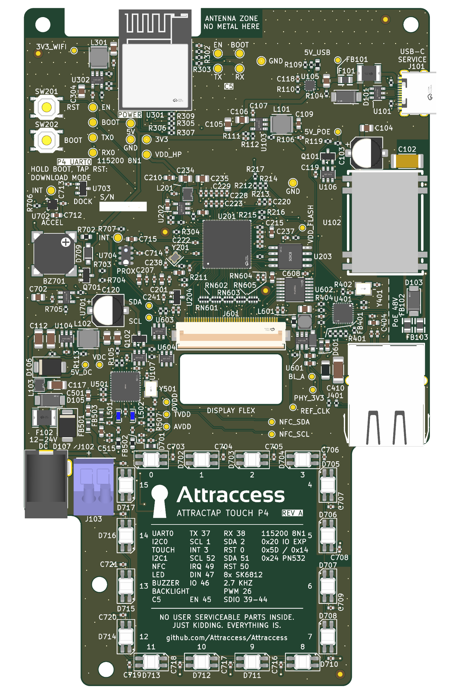
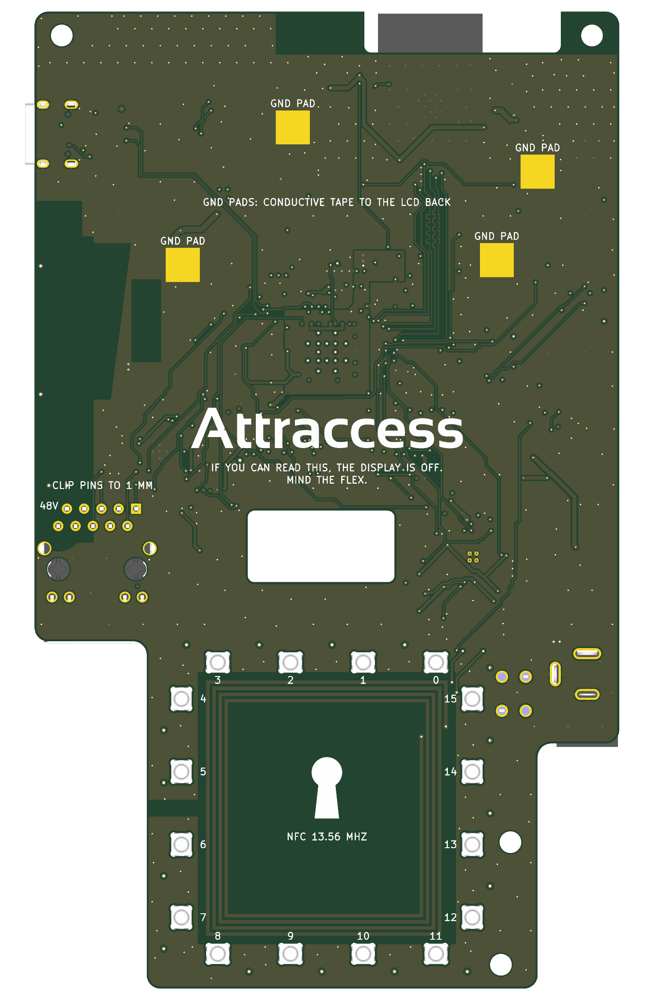
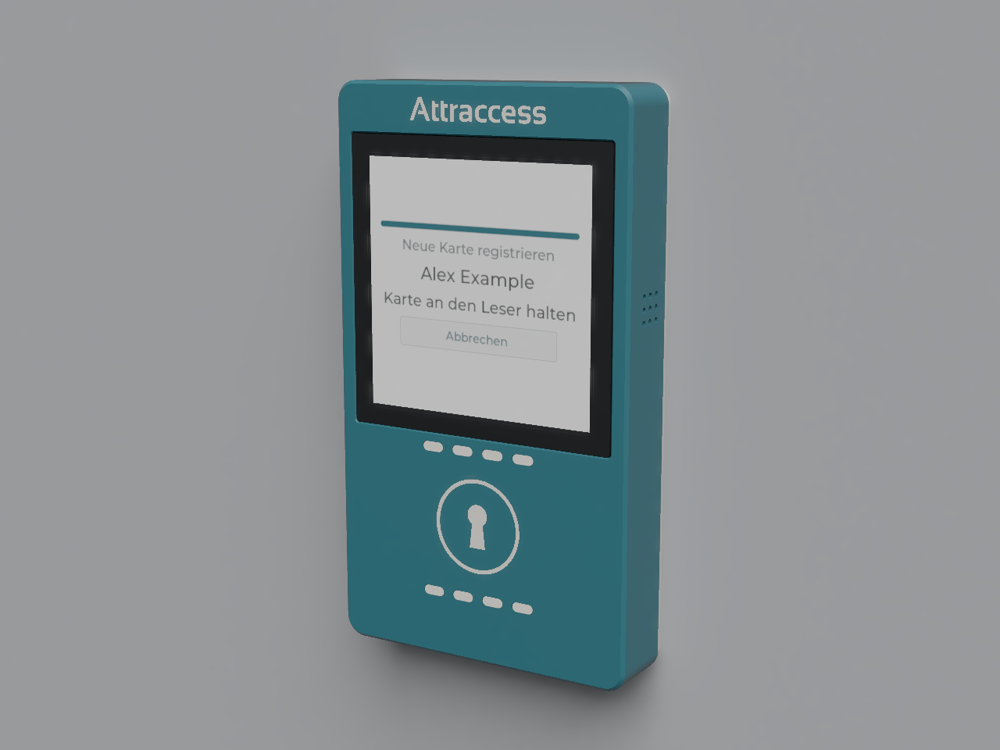

# Attractap Touch P4
<!-- llms-description: The Attractap Touch P4 reader board: what is on it, its two versions, its status, renders and drawings, its case, and where the rest of its documentation is. -->

A custom board for the Attractap touch reader, revision A. It replaces the Waveshare dev board and
the PN532 module of the current readers with one board. This page is the entry point for everyone;
the [Documentation](#documentation) list at the end leads to the details.

> **Status: revision A, not built yet.** Nobody has assembled or measured this board. It has been
> checked on paper (datasheets, JLCPCB's manufacturing limits and part library, layout rules), and
> its power input, NFC antenna and fast signals have been simulated from the routed copper. Expect
> a bring-up round ([bring-up plan](hardware/touch-p4/bring-up.md)); the targets it does not fully
> meet are listed under [known limitations](hardware/touch-p4/limitations.md). CE marking needs lab
> tests on the finished product ([compliance checklist](hardware/touch-p4/compliance.md)).

## What is on the board

| Function | Part | Notes |
|---|---|---|
| MCU | ESP32-P4NRW32X | 400 MHz dual core, 32 MB PSRAM in package, 16 MB flash |
| Wi-Fi 6 (2.4 and 5 GHz), Bluetooth LE | ESP32-C5-MINI-1 module | radio co-processor over SDIO (esp-hosted); EU-type examination certificate; its own PCB antenna in the board's top left corner |
| Display | 4.0" 480 x 480 panel, ST7701S + GT911 | same panel type as today, 40-pin flex, RGB565 |
| NFC | PN532 + PCB loop antenna | same chip and I2C protocol as today |
| Ethernet (lan version) | IP101GRI PHY + HY931147C jack | 10/100, RMII |
| PoE (lan version) | DP9900M-5V isolated module | IEEE 802.3af |
| Power | DC 12 to 24 V (barrel jack or WAGO terminal), PoE, or USB-C 5 V | any combination may be connected; USB-C is the service port for flashing and debugging |
| Feedback | 16 RGB LEDs (SK6812MINI-E), buzzer | the LEDs shine through the board in a ring round the NFC area, into the tap tile's rim |
| Tamper detection | LIS2DH12 accelerometer, VCNL4040 proximity sensor, DRV5032 hall switch | knocks, tilt, and the reader leaving its dock; the firmware does not read them yet |

Values, ranges and limits are in the [specification](hardware/touch-p4/spec.md); the
reasons behind each part are in the [design notes](hardware/touch-p4/design-notes.md).

## The two versions

Both versions are assembled from the same PCB:

| Version | Contains |
|---|---|
| **wifi** | everything except the parts whose `Variant` field is `lan` (Ethernet and PoE) |
| **lan** | all parts: Ethernet, PoE and Wi-Fi |

On 5 GHz the reader is for indoor use only, and its firmware keeps to the EU's channel and power
rules ([firmware port](hardware/touch-p4/firmware-port.md), [compliance](hardware/touch-p4/compliance.md)).

## Renders and drawings

| Component side (faces the wall) | Display side |
| --- | --- |
|  |  |

- [Schematic](_media/hardware/touch-p4/schematic.pdf ':ignore') (PDF, every sheet)
- Copper and silkscreen at 1:1: [component side](_media/hardware/touch-p4/board-front.pdf ':ignore'),
  [display side](_media/hardware/touch-p4/board-back.pdf ':ignore') (PDF, for the paper check in the
  [bring-up plan](hardware/touch-p4/bring-up.md))
- [Fabrication drawing](https://github.com/Attraccess/Attraccess/blob/main/apps/attractap/hardware/touch-p4/fab/jlcpcb/attractap-touch-p4-fab.pdf)
  and [assembly drawing](https://github.com/Attraccess/Attraccess/blob/main/apps/attractap/hardware/touch-p4/fab/jlcpcb/attractap-touch-p4-assembly.pdf)
  (PDF, part of the order package)

The renders and PDFs are written from the board by the `build` and `render` targets
([working on the board](hardware/touch-p4/development.md)).

## The case

A 3D-printable case hangs the reader on a wall or stands it on a desk; the same reader fits both.
The front shell carries the display and the board and hooks onto a dock screwed to the wall or
to the stand. Print files, CAD files and open checks are on the [case](hardware/touch-p4/case.md)
page; assembly and mounting are in the [installation manual](hardware/touch-p4/installation-manual.md)
([PDF](_media/hardware/touch-p4/attractap-installation-manual-en.pdf ':ignore')).

## License

The hardware designs (PCB, generator, case, fabrication data and these docs) are under a
[non-commercial hardware license](https://github.com/Attraccess/Attraccess/blob/main/apps/attractap/hardware/LICENSE.md).
Private persons and non-profits may use, modify and build them for non-commercial use. Nobody may
sell the design or devices built from it. Commercial users need a dedicated license or can buy
readers from the project: contact@attraccess.org.

## Documentation

Using it:

- [Specification](hardware/touch-p4/spec.md): function, supply, environment, interfaces, EMC targets.
- [Installation manual](hardware/touch-p4/installation-manual.md): print, assemble, mount and service the reader.
- [Case](hardware/touch-p4/case.md): the printable case, its print and CAD files, what is not yet verified.

Developing it:

- [Working on the board](hardware/touch-p4/development.md): project folder, generator, Nx targets, ordering and releasing.
- [Design notes](hardware/touch-p4/design-notes.md): the current design and the reason for it, block by block.
- [Known limitations](hardware/touch-p4/limitations.md): accepted deviations and points that cannot be settled on paper.
- [Design standards and review criteria](hardware/touch-p4/review.md): what the design is checked against.
- [Parts and sourcing](hardware/touch-p4/parts.md): lifecycle, alternates, cost, sourcing risks.
- [Pin map and firmware port](hardware/touch-p4/firmware-port.md): GPIO map and what the firmware has to change.
- [Simulations](hardware/touch-p4/simulations.md): what is simulated from the routed board, and the results.
- [Bring-up plan](hardware/touch-p4/bring-up.md): checks before ordering and on the first boards.
- [CE and market checklist](hardware/touch-p4/compliance.md): the directives, standards and tests, with sources.
