# Waveshare ESP32-S3-Touch-LCD-4
<!-- llms-description: Reference schematics of the Waveshare ESP32-S3-Touch-LCD-4 board, V3.0 and V4.0, that the Attractap Touch V1 and V2 readers are built on. -->

The Attractap Touch readers in use are built on Waveshare's ESP32-S3-Touch-LCD-4 board: the Touch V1 on its V3.0, the Touch V2 on its V4.0 (firmware variants `attractap-touch` and `attractap-touch-v2`). Its schematics as Waveshare publishes them, for the firmware's pin and IO-expander assignments. The [Attractap Touch P4](hardware/touch-p4/overview.md) board replaces it with a board of our own.

## V4.0 (Touch V2)

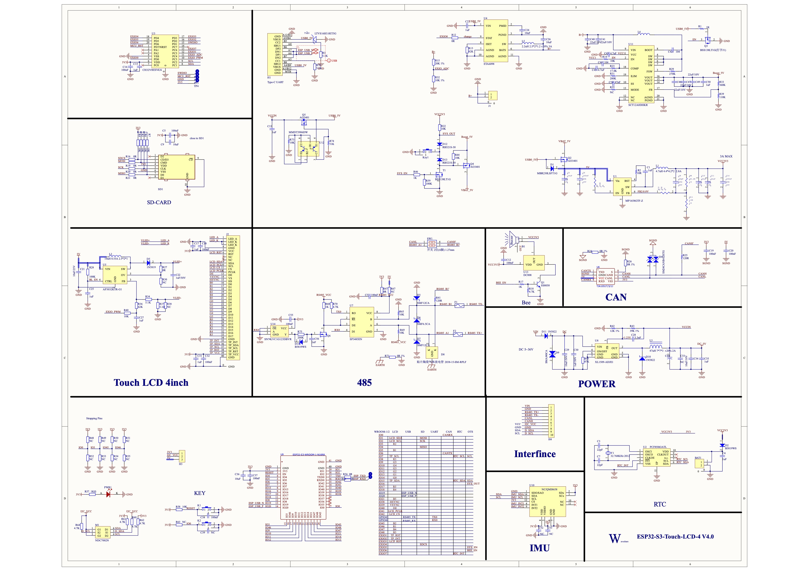

Its blocks, cut out of the sheet:

### ESP32-S3 module

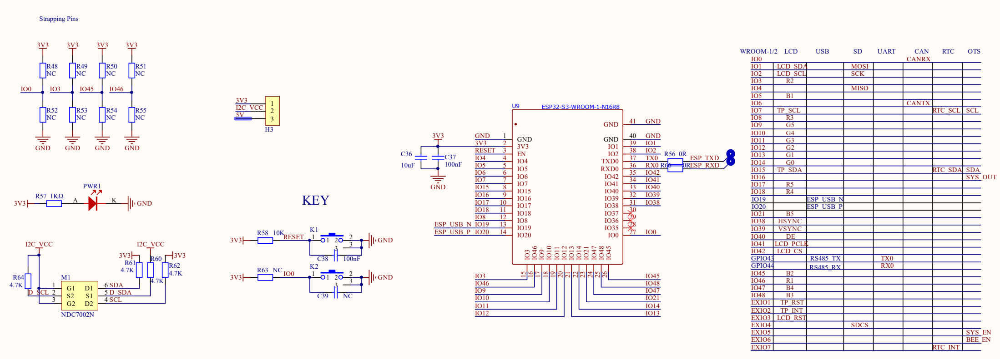

### Power

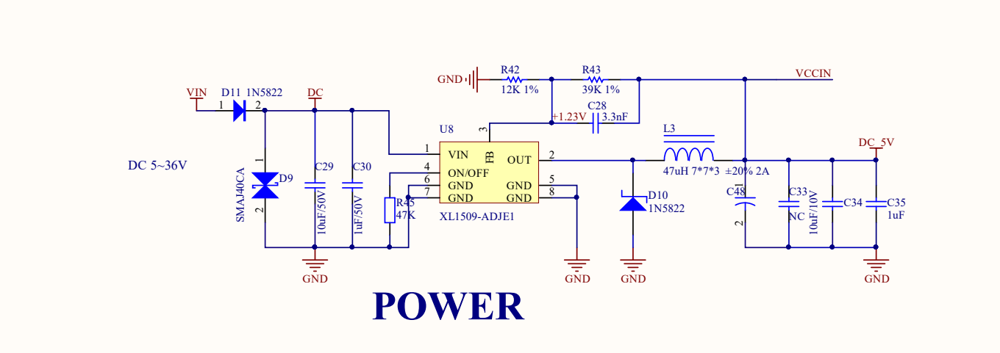

### USB

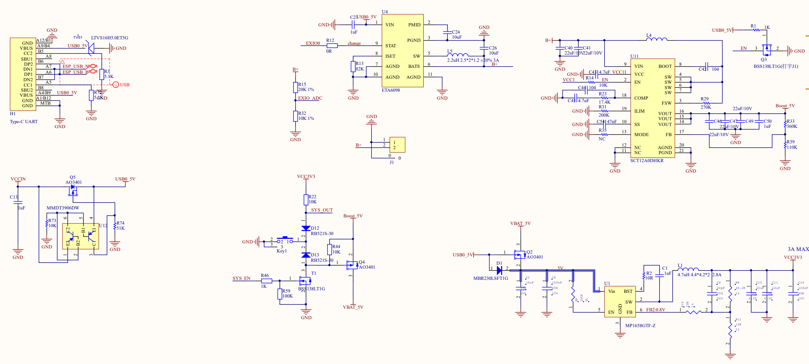

### IO expander

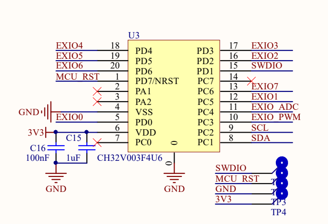

### Display and touch connector

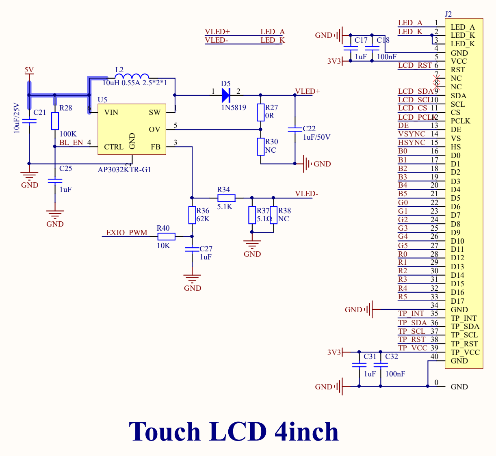

### Interface header

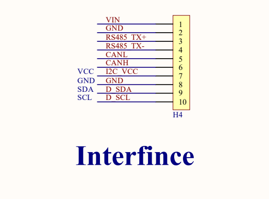

### RS-485

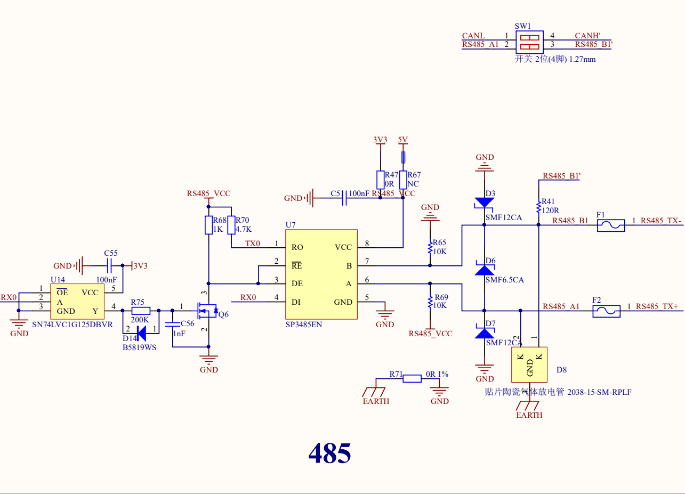

### CAN

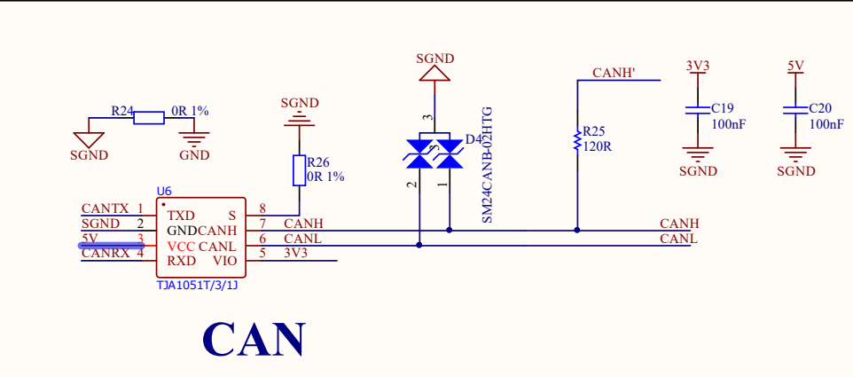

### Real-time clock

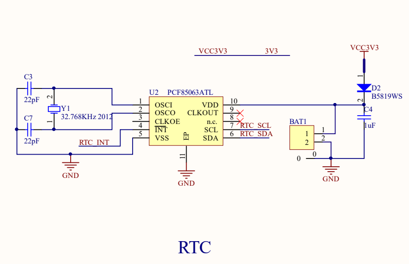

### IMU

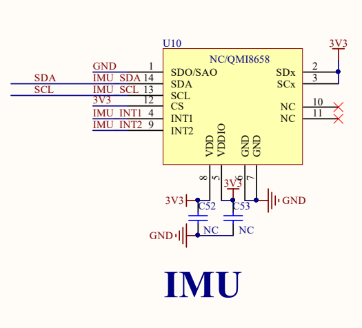

### Beeper

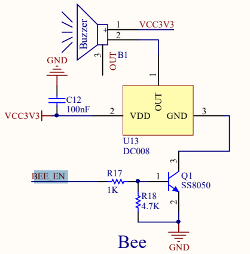

### SD card

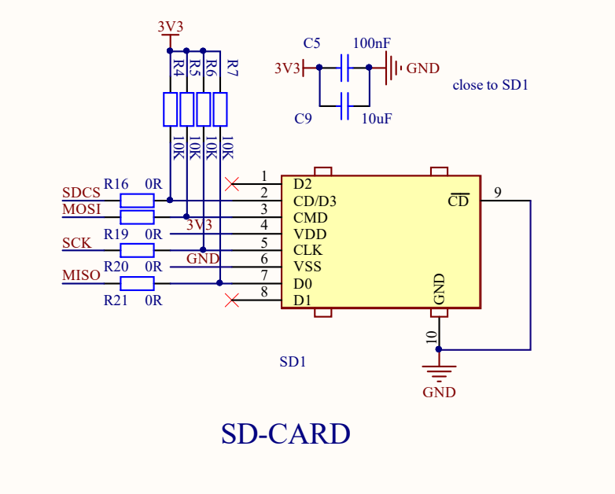

## V3.0 (Touch V1)

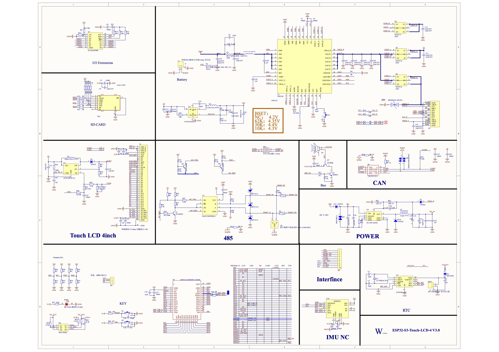
